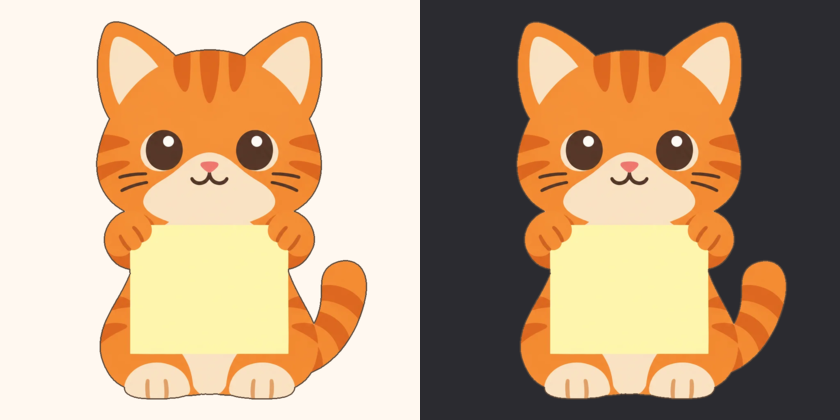
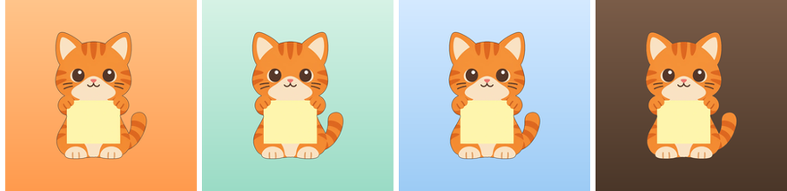

# 上线美术资源清单 & gpt-image-2.5 提示词包

> ## ⚠️ 2026-10-14 更新:v1.0 不需要生成任何新图
> 已有素材够用且零成本:图标 = 现有举牌猫 `B_cat-sitting` 合成;6 物种的 `front` / `full` = 从现有角色卡重新抠出(`art/scripts/extract-from-sheets.sh`)。依据、对比图与做法见 [`launch-todo.md` §美术方案](launch-todo.md#美术方案零生成)。
> **本文改为"以后补图"手册:** 只有决定补装扮图标(§D)、4 物种举牌图(§C)、happy / sleeping(§E)或营销背景(§F)时才用;§A / §B 的提示词 v1.0 用不上。下文"缺 / 需要出图"的状态列是**审计时**的口径,以 todo 为准。

> **日期:** 2026-10-14 · 配套 [`launch-readiness.md`](launch-readiness.md)(P0-1 / P1-2 / P1-3 / §6)
> **风格已冻结:** B 扁平矢量 + 后期统一描边(`art/style-pack/style-notes.md`)。本文件只给"上线前还缺的图"的提示词,**不改风格**。
> **你来出图,我来接入。** 每一节末尾写明了"文件名 / 尺寸 / 放哪",出完图告诉我路径即可。

---

## 0. 先读这里(铁律与公用块)

### 0.1 三条铁律
1. **每次生成都挂参考图**,禁止裸提示词重抽(`style-notes.md` 的禁令,防风格漂移):
   - 身份参考:`art/characters/<species>/<species>-character-sheet.webp`(网页端可能不认 webp,先转:`magick x.webp x.png`)。
   - 姿势/构图参考(只用于举牌图):`art/style-pack/frozen/B_cat-sitting.webp` 或 `B_corgi-sitting.webp`(同样先转 png)。
2. **纯白底生成**,后期统一抠图 + 描边(§0.5);近白色的**兔子**见 §0.6。
3. **每个提示词出 4 张挑 1**,按 §0.4 验收;不合格整批重抽,不要"修修补补"。

### 0.2 公用文本块(逐字复制,来自冻结的风格包)

```text
[STYLE]  flat vector illustration, minimal geometric shapes, simple two-tone shading, limited palette of exactly 5 colors with one dominant pastel, crisp edges, modern app-icon aesthetic, calm tidy mood
[BG]     plain white background, no shadow, no ground line, nothing else in the frame
[NEG]    no text, no letters, no watermark, no realistic photo style
[PROP]   chibi proportions with head-to-body ratio about 1:1, clean silhouette suitable for cutout
```

### 0.3 物种速写(`{SPECIES}`,来自 6 张角色卡)

| 物种 | `{SPECIES}` 文本 | 站姿(front) | 站姿(holding) |
|---|---|---|---|
| cat | `orange tabby cat with darker orange stripes on the forehead, cheeks, body and tail, cream muzzle and chest, big round dark-brown eyes, small pink nose` | sitting upright | sitting upright(已有) |
| graycat | `gray-and-white cat with a gray head and body, a white blaze between the eyes, white muzzle, chest and paws, a white tail tip, pink inner ears, large blue-green eyes with dark pupils, small pink nose` | sitting upright | sitting upright |
| corgi | `orange-and-white corgi puppy with large pointed ears with pink insides, a white stripe down the forehead, white muzzle and chest, big dark-brown eyes, an open smiling mouth with a pink tongue, short legs` | sitting upright | sitting upright(已有) |
| shiba | `shiba inu puppy with orange-tan fur, cream muzzle, cheeks, chest and paws, small cream eyebrow dots above round dark-brown eyes, pointed ears with cream insides, and a tightly curled tail with a cream underside` | sitting upright | sitting upright |
| rabbit | `off-white rabbit with long upright ears with pink insides, soft pink cheeks, round navy-blue eyes, a tiny pink nose, a pale blue-gray belly patch, and a small round fluffy tail` | standing upright | sitting upright |
| hamster | `golden-orange hamster with a cream muzzle and belly, round ears with pink insides, a small tuft of fur on top of the head, round dark-brown eyes, a tiny pink nose, thin whiskers, and pink hands and feet` | standing upright | standing upright |

### 0.4 验收清单(改编自 `art/README.md` §七,每张入库前过一遍)

- [ ] **与角色卡同一只**:毛色 / 斑纹 / 眼睛颜色 / 口鼻形状逐项对照 §0.3。
- [ ] **全身完整**:耳尖、尾巴、双脚都在画面内,四周 ≥ 10% 留白(旧 `front` 图的问题正是被切)。
- [ ] 同批 4 张并排,线条 / 上色风格一致;头身比 ≈ 1:1。
- [ ] (举牌图)便签**完全空白**、面向观众、占画面下 1/3,大小与位置接近 cat / corgi 已有图,风格统一即可。(~~Widget 叠层按它们调过~~ ← **此前这句是错的**:Widget 里宠物只是便签旁的装饰角标,便签由 SwiftUI 绘制,并不存在与举牌图的叠层对位。)
- [ ] 无文字 / 水印 / 地面阴影 / 多余道具。
- [ ] 抠图描边后,在**奶油 `#FFF8F0`** 与**深色 `#2B2B30`** 两种底上各看一次(白毛物种尤其要看)。
- [ ] 缩到 60px 剪影仍可辨识。

### 0.5 后处理管线(已用冻结样图实测通过:抠图 → 描边 → 导出 @1x/2x/3x)



把下面两个函数存成 `art/scripts/sprite-pipeline.sh`(或直接粘进终端),`source` 后使用:

```bash
# 1) 抠图 + 描边:纯色底生成图 → 透明底 + #5B4636 描边母版
process_sprite() {   # 用法: process_sprite in.png out.png [背景色,默认 white]
  local bg="${3:-white}"
  magick "$1" -alpha set -bordercolor "$bg" -border 1 -fuzz 8% -fill none \
    -draw "color 0,0 floodfill" -shave 1x1 +repage \
    -channel A -morphology erode disk:1 +channel \
    \( +clone -alpha extract -morphology dilate disk:3 -background "#5B4636" -alpha shape \) \
    -compose DstOver -composite -depth 8 "$2"
}

# 2) 导出 imageset(@1x/2x/3x + Contents.json),可同时写入多个 catalog
export_imageset() {  # 用法: export_imageset master.png asset-name <@1x边长> <catalog目录...>
  local src="$1" name="$2" s="$3"; shift 3
  for cat in "$@"; do
    local dir="$cat/Assets.xcassets/$name.imageset"; mkdir -p "$dir"
    for scale in 1 2 3; do
      local px=$((s*scale)) inner=$((s*scale*88/100))
      magick "$src" -trim +repage -resize "${inner}x${inner}" -background none \
        -gravity center -extent "${px}x${px}" -depth 8 "$dir/$name@${scale}x.png"
    done
    cat > "$dir/Contents.json" <<JSON
{
  "images" : [
    { "filename" : "$name@1x.png", "idiom" : "universal", "scale" : "1x" },
    { "filename" : "$name@2x.png", "idiom" : "universal", "scale" : "2x" },
    { "filename" : "$name@3x.png", "idiom" : "universal", "scale" : "3x" }
  ],
  "info" : { "author" : "xcode", "version" : 1 }
}
JSON
  done
}
```

要点:
- `process_sprite` 先从四周 floodfill 去底(不会误伤毛发里的白色),再**内缩 1px**去掉抠图白边,再按风格包规格描边(`disk:3`,`#5B4636`)。
- `export_imageset` 统一把精灵缩进 **88%** 的画布并居中(每边留 6%),所以不同姿势 / 物种的屏上大小一致。
- ⚠️ `fuzz 8%` 适合**生成图**(纯白底 + 饱和毛色)。**从角色卡里抠白毛物种**(graycat / rabbit,与背景只差 4–5%)必须用 `fuzz 2%`,否则白毛被一起吃掉——现成脚本见 `art/scripts/extract-from-sheets.sh`。
- ⚠️ **宠物图集在 4 个 catalog 里各有一份副本**:`PawIt/`、`PawItWidget/`、`PawItWatch/`(仅 `front`)、`PawItWatchWidget/`。漏拷一个,对应 target 就会显示旧图或空白——所以函数支持一次写多个目录:

```bash
export_imageset shiba-holding.png pet-shiba-holding 160 PawIt PawItWidget PawItWatchWidget
export_imageset cat-front.png     pet-cat-front     180 PawIt PawItWidget PawItWatch PawItWatchWidget
```

### 0.6 近白色物种(兔子)的抠图
兔子几乎是白色,白底抠图会吃身体。若抠完边缘发灰 / 缺块:生成时把 `[BG]` 换成 `plain solid light blue-gray (#DDE3EE) background, no shadow, no ground line, nothing else in the frame`,抠图时传背景色:`process_sprite in.png out.png "#DDE3EE"`(已实测:换底色后抠出面积与白底一致)。corgi / graycat 的白毛部分同理——若白毛被吃,按同样办法处理。

### 0.7 预算与批次
按脚本口径 ≈ $0.053/张(`style-notes.md`),全部约 80 张 ≈ **$4–5**;若走对话端则按订阅额度。建议顺序:**批次 1**(今天,解锁一切)= A + C + B;**批次 2** = D;**批次 3** = F;**批次 4**(可选)= E。

---

## 1. 资源总表

| 编号 | 资源 | 优先级 | 数量 | 用途 | 状态 |
|---|---|---|---|---|---|
| **A** | App 图标前景精灵(出 3 个方案选 1) | **P0** | 3×4 张挑 1 | iOS + Watch AppIcon | 缺 |
| **B** | 6 物种 `front` 标准坐姿全身 | P1 | 6 | 欢迎页 / 列表头 / 成长页 / Watch / Widget 兜底 | 现有图被硬裁,需替换 |
| **C** | 4 物种 `holding` 举牌 | P1 | 4 | Widget / Live Activity(cat、corgi 已有) | 缺 |
| **D** | 12 件装扮图标 | P1(§10-6 选"收集册"或"真换装") | 12(一张网格图切片) | 成长页装扮格(现为 SF Symbol 占位) | 缺 |
| **E** | `happy` 庆祝 / `sleeping` 睡觉 | P2 | 各 6 | 喂食反馈 / 空列表 / Widget 空状态 | 缺(代码里的状态机目前没用到) |
| **F** | 营销:商店截图背景、官网主视觉 / OG 图 | P1 | 3–5 | App Store / 官网 | 缺 |
| — | 装扮叠加层(12×6) | v1.1 | 72 | 真换装 | **不在 v1.0** |

**v1.0 的实际处理方式(以此为准):** A → 复用 `B_cat-sitting` 合成;B → 复用角色卡(含完整图 `full`);C → 不需要;D → 默认不做(todo A5 三选一);E → P2;F → 用真实截图。

---

## A. App 图标(P0)

**为什么先做它:** 没有图标 ASC 上传直接失败(P0-1),而且图标决定商店转化。

### A.0 先做两个决定

1. **背景色不要和橙猫撞色。** 实测 4 种背景(见下图):杏橙(左一)对比最弱;**薄荷(左二)与天蓝(左三)对比最好**;可可棕(右一)对比也强但偏沉。推荐薄荷 `#D6F2E5 → #9ADBC5` 或天蓝 `#D4E9FF → #9CCBF5`——正好也是现有便签预设色(mint / ocean),品牌内一致。
   
2. **只让模型画"前景精灵"**(白底),背景渐变用 ImageMagick 合成——不要让模型画背景,否则很难控制安全区和色值。

> 取舍:单只橘猫图标会让用户以为"只有猫"。若想表达多物种,放进商店截图,不要塞进图标;A3(爪印便签)是最中性的选择。

### A.1 方案 A1 · Holder(推荐:与应用内吉祥物一致,直接讲"宠物举着便签")
挂参考图:cat 角色卡 + `B_cat-sitting`(只用来定身份与配色)。

```text
The foreground layer of an iOS app icon: a cute orange tabby cat, bust-up front view with head, shoulders and both front paws visible, the paws gripping the top edge of a large blank pale-yellow sticky note held up in front of its chest; the note is a flat square with a softly folded bottom-right corner and is completely blank; the cat looks straight at the viewer with big round dark-brown eyes and a tiny happy smile; the whole subject is centered and fills about 70% of the frame with generous empty margin on every side; bold simple shapes that stay readable at 60 pixels; chibi proportions with head-to-body ratio about 1:1, clean silhouette suitable for cutout; flat vector illustration, minimal geometric shapes, simple two-tone shading, limited palette of exactly 5 colors with one dominant pastel, crisp edges, modern app-icon aesthetic, calm tidy mood; plain white background, no shadow, no ground line, nothing else in the frame; no text, no letters, no watermark, no realistic photo style; square 1024x1024
```

### A.2 方案 A2 · Peek(探头:更有"陪伴感",小尺寸识别靠耳朵 + 眼睛)

```text
The foreground layer of an iOS app icon: the top half of a cute orange tabby cat's head with both ears fully visible, and both front paws, peeking over the top edge of a big blank pale-yellow sticky note that fills the lower half of the frame; big round dark-brown eyes looking up at the viewer; the note is a flat square with a softly folded bottom-right corner and is completely blank; centered, fills about 70% of the frame with generous empty margin on every side; bold simple shapes that stay readable at 60 pixels; chibi proportions, clean silhouette suitable for cutout; flat vector illustration, minimal geometric shapes, simple two-tone shading, limited palette of exactly 5 colors with one dominant pastel, crisp edges, modern app-icon aesthetic, calm tidy mood; plain white background, no shadow, no ground line, nothing else in the frame; no text, no letters, no watermark, no realistic photo style; square 1024x1024
```

### A.3 方案 A3 · Paw Note(爪印便签:最中性、最耐缩小,但没有"宠物"角色)

```text
The foreground layer of an iOS app icon: a single large pale-yellow sticky note with a softly folded bottom-right corner, tilted about 6 degrees, with one big friendly orange paw print stamped in the middle (one large rounded main pad and four round toe pads); clean flat shapes, no face, no character, no text; centered, fills about 70% of the frame with generous empty margin on every side; bold simple shapes that stay readable at 60 pixels; flat vector illustration, minimal geometric shapes, simple two-tone shading, limited palette of exactly 5 colors with one dominant pastel, crisp edges, modern app-icon aesthetic, calm tidy mood; plain white background, no shadow, no ground line, nothing else in the frame; no letters, no watermark, no realistic photo style; square 1024x1024
```

### A.4 合成图标(已实测:输出 1024×1024、sRGB、**8-bit、无 alpha**)

```bash
source art/scripts/sprite-pipeline.sh
process_sprite icon-A1-raw.png icon-A1-sprite.png
magick -size 1024x1024 gradient:'#D6F2E5-#9ADBC5' \
  \( icon-A1-sprite.png -trim +repage -resize 680x680 \) \
  -gravity center -composite -alpha off -depth 8 AppIcon-1024.png
```

- 精灵占图标 ≈ 66%,留足安全区(Watch 的圆形裁切、iOS 的圆角都不会切到主体)。
- **验收:** 把 `AppIcon-1024.png` 缩到 180 / 120 / 60 px 各看一眼;并分别放在浅色、深色壁纸上预览。
- **放哪:** 同一张 1024 PNG 复制成 `PawIt/Assets.xcassets/AppIcon.appiconset/AppIcon-1024.png` 与 `PawItWatch/Assets.xcassets/AppIcon.appiconset/AppIcon-1024.png`(并在两个 `Contents.json` 的 1024 槽位填 `"filename"`)。我接入时会一并处理。
- **暗色 / 着色版(可选,v1.0.1):** iOS 18+ 支持;最省事做法是用 Icon Composer 把"背景渐变"与"精灵 PNG"拆成两层,暗色 / 着色版本由系统派生。min iOS 17 的单张 1024 即可上线。

---

## B. 6 物种 `front` 标准坐姿全身(P1)

**目的:** 替换现有被硬裁的 `front` 图(耳尖/下半身被切、无描边、仅 300px@3x)。
**挂参考图:** 对应物种的角色卡。**模板(把 `{SPECIES}` / `{POSE}` 换成 §0.3 对应行):**

```text
A cute {SPECIES}, {POSE} facing the viewer, full body clearly visible including both ears, the tail and both feet, relaxed happy expression, no props and no sign, centered with at least 10% empty margin on all four sides; chibi proportions with head-to-body ratio about 1:1, clean silhouette suitable for cutout; flat vector illustration, minimal geometric shapes, simple two-tone shading, limited palette of exactly 5 colors with one dominant pastel, crisp edges, modern app-icon aesthetic, calm tidy mood; plain white background, no shadow, no ground line, nothing else in the frame; no text, no letters, no watermark, no realistic photo style; square 1024x1024
```

**展开后可直接复制的 6 条:**

<details>
<summary>cat / graycat / corgi</summary>

```text
A cute orange tabby cat with darker orange stripes on the forehead, cheeks, body and tail, cream muzzle and chest, big round dark-brown eyes, small pink nose, sitting upright facing the viewer, full body clearly visible including both ears, the tail and both feet, relaxed happy expression, no props and no sign, centered with at least 10% empty margin on all four sides; chibi proportions with head-to-body ratio about 1:1, clean silhouette suitable for cutout; flat vector illustration, minimal geometric shapes, simple two-tone shading, limited palette of exactly 5 colors with one dominant pastel, crisp edges, modern app-icon aesthetic, calm tidy mood; plain white background, no shadow, no ground line, nothing else in the frame; no text, no letters, no watermark, no realistic photo style; square 1024x1024
```

```text
A cute gray-and-white cat with a gray head and body, a white blaze between the eyes, white muzzle, chest and paws, a white tail tip, pink inner ears, large blue-green eyes with dark pupils, small pink nose, sitting upright facing the viewer, full body clearly visible including both ears, the tail and both feet, relaxed happy expression, no props and no sign, centered with at least 10% empty margin on all four sides; chibi proportions with head-to-body ratio about 1:1, clean silhouette suitable for cutout; flat vector illustration, minimal geometric shapes, simple two-tone shading, limited palette of exactly 5 colors with one dominant pastel, crisp edges, modern app-icon aesthetic, calm tidy mood; plain white background, no shadow, no ground line, nothing else in the frame; no text, no letters, no watermark, no realistic photo style; square 1024x1024
```

```text
A cute orange-and-white corgi puppy with large pointed ears with pink insides, a white stripe down the forehead, white muzzle and chest, big dark-brown eyes, an open smiling mouth with a pink tongue, short legs, sitting upright facing the viewer, full body clearly visible including both ears, the tail and both feet, relaxed happy expression, no props and no sign, centered with at least 10% empty margin on all four sides; chibi proportions with head-to-body ratio about 1:1, clean silhouette suitable for cutout; flat vector illustration, minimal geometric shapes, simple two-tone shading, limited palette of exactly 5 colors with one dominant pastel, crisp edges, modern app-icon aesthetic, calm tidy mood; plain white background, no shadow, no ground line, nothing else in the frame; no text, no letters, no watermark, no realistic photo style; square 1024x1024
```
</details>

<details>
<summary>shiba / rabbit / hamster</summary>

```text
A cute shiba inu puppy with orange-tan fur, cream muzzle, cheeks, chest and paws, small cream eyebrow dots above round dark-brown eyes, pointed ears with cream insides, and a tightly curled tail with a cream underside, sitting upright facing the viewer, full body clearly visible including both ears, the tail and both feet, relaxed happy expression, no props and no sign, centered with at least 10% empty margin on all four sides; chibi proportions with head-to-body ratio about 1:1, clean silhouette suitable for cutout; flat vector illustration, minimal geometric shapes, simple two-tone shading, limited palette of exactly 5 colors with one dominant pastel, crisp edges, modern app-icon aesthetic, calm tidy mood; plain white background, no shadow, no ground line, nothing else in the frame; no text, no letters, no watermark, no realistic photo style; square 1024x1024
```

```text
A cute off-white rabbit with long upright ears with pink insides, soft pink cheeks, round navy-blue eyes, a tiny pink nose, a pale blue-gray belly patch, and a small round fluffy tail, standing upright facing the viewer, full body clearly visible including both ears, the tail and both feet, relaxed happy expression, no props and no sign, centered with at least 10% empty margin on all four sides; chibi proportions with head-to-body ratio about 1:1, clean silhouette suitable for cutout; flat vector illustration, minimal geometric shapes, simple two-tone shading, limited palette of exactly 5 colors with one dominant pastel, crisp edges, modern app-icon aesthetic, calm tidy mood; plain solid light blue-gray (#DDE3EE) background, no shadow, no ground line, nothing else in the frame; no text, no letters, no watermark, no realistic photo style; square 1024x1024
```
(兔子这条已按 §0.6 换成浅蓝灰底;抠图时 `process_sprite in.png out.png "#DDE3EE"`。)

```text
A cute golden-orange hamster with a cream muzzle and belly, round ears with pink insides, a small tuft of fur on top of the head, round dark-brown eyes, a tiny pink nose, thin whiskers, and pink hands and feet, standing upright facing the viewer, full body clearly visible including both ears and both feet, relaxed happy expression, no props and no sign, centered with at least 10% empty margin on all four sides; chibi proportions with head-to-body ratio about 1:1, clean silhouette suitable for cutout; flat vector illustration, minimal geometric shapes, simple two-tone shading, limited palette of exactly 5 colors with one dominant pastel, crisp edges, modern app-icon aesthetic, calm tidy mood; plain white background, no shadow, no ground line, nothing else in the frame; no text, no letters, no watermark, no realistic photo style; square 1024x1024
```
</details>

**导出:** 母版 → `process_sprite` → `export_imageset <母版> pet-<species>-front 180 PawIt PawItWidget PawItWatch PawItWatchWidget`。
**尺寸:** @1x 180 / @2x 360 / @3x 540(旧图 100/200/300,不够欢迎页 180pt 英雄位)。覆盖同名 imageset 即可,**无需改代码**。
**可选(零生成成本):** 小尺寸头像(Watch 20pt、列表头 64pt 圆)用全身图会让脸变小;可从同一母版裁上半身另存 `pet-<species>-avatar`,再让 `PetAvatarView` 在 ≤72pt 时取 avatar(一处小改动)。要不要做,出图后看实际观感再定。

---

## C. 4 物种 `holding` 举牌(P1)

**目的:** graycat / shiba / rabbit / hamster 目前没有举牌图,Widget 退化成被裁切的 `front`。**(非必需:** 宠物在 Widget 里只是装饰角标,回退到 `front` 即可;`front` 换成新抠的胸像后已够用。仅在想让 6 物种的举牌造型完全统一时才做。**)**
**挂两张参考图,并在提示词前加一句:** `Use the first reference image for the character's identity and colors, and the second reference image only for the pose, camera angle, and the size and position of the blank note.`(第一张 = 该物种角色卡;第二张 = `B_cat-sitting`。)

**模板(沿用冻结的"主体段模板"原文):**

```text
A cute {SPECIES}, {POSE}, full body, front paws holding up a blank sticky note sign facing the viewer, the note occupies the lower third of the frame and is completely blank (a flat pale yellow square with softly rounded corners, no lines, no text), plain white background, no text, no letters, no watermark, no realistic photo style, chibi proportions with head-to-body ratio about 1:1, clean silhouette suitable for cutout; flat vector illustration, minimal geometric shapes, simple two-tone shading, limited palette of exactly 5 colors with one dominant pastel, crisp edges, modern app-icon aesthetic, calm tidy mood; no shadow, no ground line; square 1024x1024
```

`{SPECIES}` 取 §0.3;`{POSE}`:graycat / shiba / rabbit = `sitting upright`;hamster = `standing upright on its hind legs`。兔子同样按 §0.6 换浅蓝灰底。

**导出:** `export_imageset <母版> pet-<species>-holding 160 PawIt PawItWidget PawItWatchWidget`(Watch 端按设计只用 `front`,不需要 holding)。
**尺寸:** @1x 160 / @2x 320 / @3x 480(与 cat / corgi 一致)。
**接入(我来做):** 出图入库后,在 `PetAsset.hasHoldingPose(species:)`(`Core/Sources/Core/Engine/PetAsset.swift`)把 4 个物种放开;否则 Widget 仍走 `front`。

---

## D. 12 件装扮图标(P1,取决于 §10-6)

**用途:** 成长页的装扮格(60×60 圆角块,现为 SF Symbol:`gift` / `bolt.shield` / `bird`…)。解锁顺序 = 每 5 级一件(Lv.5 → Lv.60)。锁定态由代码画锁图标,**不需要灰色版本**。

### D.1 一张网格图(风格最统一,优先)
**比例选 4:3**(4 列 × 3 行,每格近似正方形)。不要挂角色卡(图里没有宠物)。

```text
A set of 12 flat vector icons of pet accessories, arranged in a clean 4-column by 3-row grid on a plain white background with equal spacing, each icon drawn at the same scale and centered in its own cell, no pet, no character, no overlapping, no cell borders.
Row 1, left to right: a red bowtie; a black top hat with a pastel-pink band; a golden crown with three small gems; a striped knitted scarf in cream and orange.
Row 2: round black sunglasses; a flower wreath made of pastel pink, white and yellow flowers with green leaves; a small red hero cape with a golden clasp; a polka-dot party hat with a pom-pom.
Row 3: a blue triangular bandana with white dots; a pair of white feathered angel wings; a golden glowing halo ring; a round glass space helmet with a white rim and a small antenna.
flat vector illustration, minimal geometric shapes, simple two-tone shading, each icon uses at most 4 colors with one dominant pastel, crisp edges, modern app-icon aesthetic, calm tidy mood; no text, no letters, no watermark, no realistic photo style; aspect ratio 4:3
```

切片(已实测 `-crop 4x3@` 得到 12 块等大图;按顺序对应 `Outfit.allCases`):

```bash
magick outfit-sheet.png -crop 4x3@ +repage tile-%02d.png
# tile-00 bowtie · 01 topHat · 02 crown · 03 scarf · 04 sunglasses · 05 flowerWreath
# tile-06 cape   · 07 partyHat · 08 bandana · 09 wings · 10 halo · 11 spaceHelmet
source art/scripts/sprite-pipeline.sh
process_sprite tile-00.png outfit-bowtie.png
export_imageset outfit-bowtie.png outfit-bowtie 96 PawIt     # 其余 11 个同理
```
> 命名:`outfit-<Outfit.rawValue>`(`bowtie` / `topHat` / `crown` / `scarf` / `sunglasses` / `flowerWreath` / `cape` / `partyHat` / `bandana` / `wings` / `halo` / `spaceHelmet`)。**尺寸:** @1x 96 / @2x 192 / @3x 288。只放 `PawIt` 一个 catalog(成长页只在 App 里)。

### D.2 若网格图风格漂移 → 逐个生成(1:1)
把 `{ITEM}` 依次换成上面 12 个物品描述,每个出 2 张挑 1:

```text
A single flat vector icon of {ITEM}, shown alone and centered with generous empty margin, flat vector illustration, minimal geometric shapes, simple two-tone shading, at most 4 colors with one dominant pastel, crisp edges, modern app-icon aesthetic, calm tidy mood; plain white background, no shadow, no text, no letters, no watermark, no realistic photo style; square 1024x1024
```

> **不要现在生成"宠物戴着装扮"的叠加层。** 12 件 × 6 物种 = 72 张,还需要每个物种的锚点(头顶 / 脖子 / 背后)和代码里的"已装备"状态——这是 v1.1 的工作量,v1.0 只做图标收集册(见 `launch-readiness.md` P1-3)。

---

## E. `happy` 庆祝 / `sleeping` 睡觉(P2,可晚于上线)

**挂参考图:** 角色卡 + 该物种的 `holding` 母版(保证同一只)。

`happy`(喂食反馈、完成任务):

```text
A cute {SPECIES}, jumping up with joy, both front paws raised, eyes happily closed in a big smile, tiny sparkles or hearts around it (at most 3, flat shapes), full body, centered with at least 10% empty margin; chibi proportions with head-to-body ratio about 1:1, clean silhouette suitable for cutout; flat vector illustration, minimal geometric shapes, simple two-tone shading, limited palette of exactly 5 colors with one dominant pastel, crisp edges, modern app-icon aesthetic, calm tidy mood; plain white background, no shadow, no ground line; no text, no letters, no watermark, no realistic photo style; square 1024x1024
```

`sleeping`(无便签的空状态:列表为空、Widget 空状态,比现在的 SF Symbol "note.text" 讨喜得多):

```text
A cute {SPECIES}, curled up asleep in a round loaf shape, eyes gently closed, a small pale-blue crescent moon floating nearby, full body, centered with at least 10% empty margin; chibi proportions, clean silhouette suitable for cutout; flat vector illustration, minimal geometric shapes, simple two-tone shading, limited palette of exactly 5 colors with one dominant pastel, crisp edges, modern app-icon aesthetic, calm tidy mood; plain white background, no shadow, no ground line; no text, no letters, no watermark, no realistic photo style; square 1024x1024
```

> 命名 `pet-<species>-happy` / `pet-<species>-sleeping`(cat、corgi 已有 `happy`,但**目前没有任何代码在用**——`PetAvatarView.pose` 被忽略、Widget 固定取 `holding`)。所以 E 类资源在 v1.0 前**没有出图的紧迫性**,等接线(P1-2 的一部分)时再说。

---

## F. 营销素材(P1)

> **原则:真实 UI 截图用真机 / 模拟器截,不要生成。** 下面只生成"背景与氛围"。多只宠物同框的主视觉用**合成**(用 §B/§C 已抠好的精灵在 Figma / Keynote 里摆),比让模型一次画 6 只一致得多。

### F.0 商店截图脚本(要截的真实画面 + 建议标题,英文)

| # | 画面 | 标题(≤ 6 词) |
|---|---|---|
| 1 | 主屏中号 Widget(宠物举着便签),壁纸柔和 | `Your pet remembers for you` |
| 2 | Widget 上点勾选后的"完成"状态 | `Check it off right from the widget` |
| 3 | 编辑器 + 键盘,正在输入 | `Quick notes, zero friction` |
| 4 | 锁屏(accessory 小组件)+ Live Activity | `On your Lock Screen, too` |
| 5 | 成长页(连续天数 / 等级 / 装扮收集册) | `Your pet grows with you` |
| 6 | Apple Watch 表盘 / Smart Stack(**含 Watch App 时 ASC 必需**) | `And on your wrist` |

> 标题文案叠在截图上方,字体统一;不要写 App 里没上线的功能(装扮换装、Siri、iPad)。

### F.1 截图背景(纵向;生成 2:3 后在设计软件里裁到 1320×2868)
挂参考图:无(纯背景)。

```text
A soft pastel vertical background for an app store screenshot: warm cream base (#FFF8F0) with a very subtle repeating pattern of tiny orange paw prints and small pale-yellow sticky-note squares scattered at low contrast, large calm empty area in the center for a phone mockup; flat vector illustration, minimal, limited palette of exactly 5 colors with one dominant pastel, crisp edges; no text, no letters, no logos, no devices, no people; aspect ratio 2:3
```

变体:把底色换成薄荷 `#D6F2E5` / 天蓝 `#D4E9FF`(与图标背景同源),整套截图交替使用。

### F.2 带探头宠物的背景(每套 1–2 张点缀用)
挂参考图:cat 角色卡。

```text
A soft pastel vertical background for an app store screenshot, warm cream base (#FFF8F0), with the head and both front paws of a cute orange tabby cat peeking up from the bottom edge, only the top third of the cat visible, looking up toward the center; large calm empty area in the upper two thirds for a phone mockup; flat vector illustration, minimal geometric shapes, simple two-tone shading, limited palette of exactly 5 colors with one dominant pastel, crisp edges, modern app-icon aesthetic, calm tidy mood; no text, no letters, no logos, no devices; aspect ratio 2:3
```

### F.3 官网主视觉 / 社交分享 OG 图(1200×630)
生成 16:9 后居中裁切到 1.91:1。留出左半边放标题,右半边放宠物 + 便签。

```text
A wide soft pastel banner background, warm cream base (#FFF8F0), the left half calm and empty for a headline, the right half with a loose stack of slightly overlapping blank sticky notes in pale yellow, mint, pink, blue and lavender, flat vector illustration, minimal geometric shapes, simple two-tone shading, limited palette of exactly 5 colors with one dominant pastel, crisp edges, modern app-icon aesthetic, calm tidy mood; no text, no letters, no logos, no characters; aspect ratio 16:9
```

> 把 §B 的宠物精灵合成到右半边(可 2–3 只,举着 §C 的便签),比让模型直接画更稳。

---

## G. 明确"现在不要做"的

- 每只宠物 8–10 个姿势(`w6-pet-integration.md` 的最初设想):v1.0 只需要 `front` + `holding`。
- 装扮叠加层 12×6(见 D 末尾):v1.1。
- "用户照片 → 卡通形象"(AI 宠物):v1.1 付费功能。
- C 手绘水彩风的大尺寸物料(`style-notes.md` 里为分享卡 / 节日卡保留):v1.0 后评估。

---

## 交付与接入约定

出完图后,把文件按下面放到 `art/export/`(或直接告诉我路径),我负责:导出 @1x/2x/3x 并同步到 4 个 catalog、接入图标、放开 `PetAsset.hasHoldingPose`、把成长页的装扮格换成真实图标。

| 资源 | 文件名 |
|---|---|
| 图标精灵(原始白底图) | `icon-A1-raw.png`(或 A2 / A3) |
| front ×6 | `front-<species>.png` |
| holding ×4 | `holding-<species>.png` |
| 装扮网格 | `outfit-sheet.png`(或 12 张 `outfit-<rawValue>.png`) |
| 营销 | `mkt-<名称>.png` |
