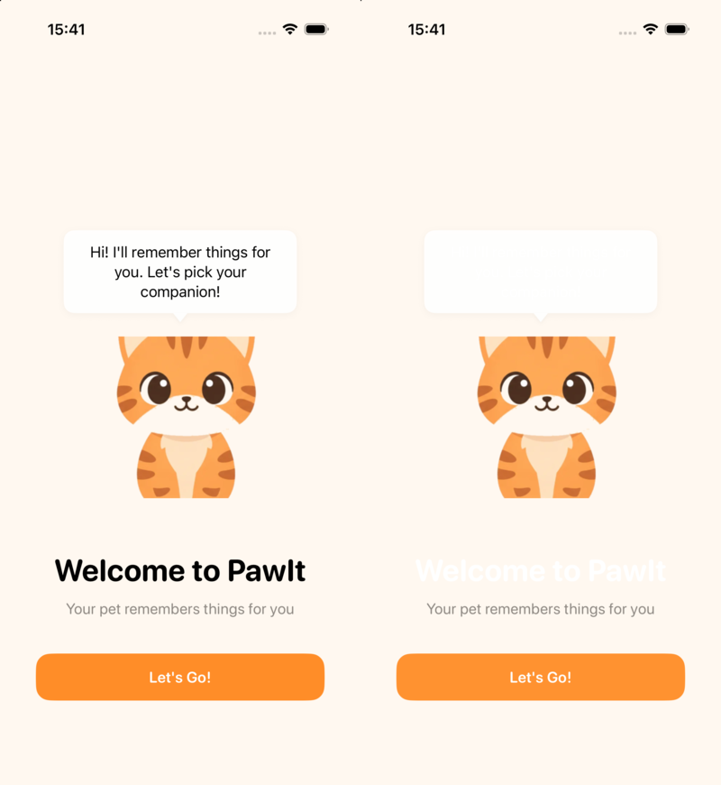
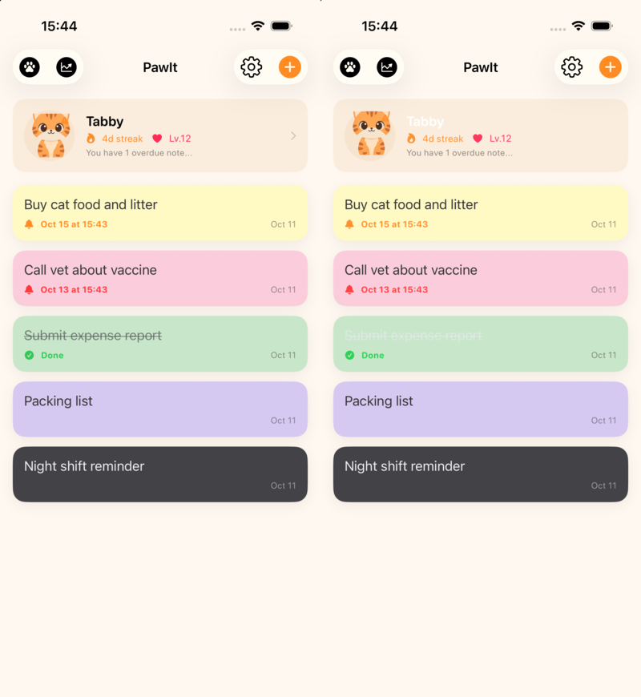
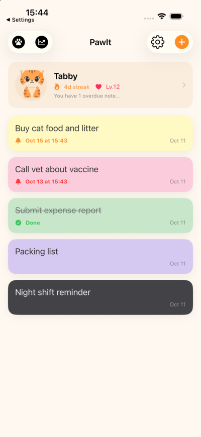
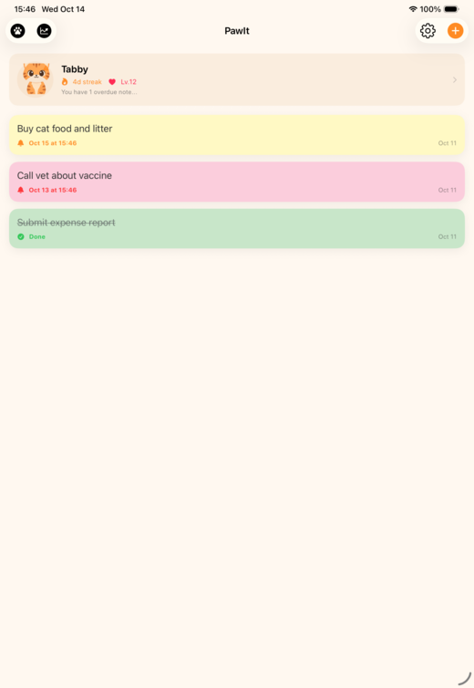

# 上线就绪审计 · v1.0 免费版差距清单

> ## ⚠️ 这是审计快照,不再记录进度
> **要做什么、做到哪了、下一步是什么 → 只看 [`launch-todo.md`](launch-todo.md)。** 本文保留审计时的证据与推理("为什么"),章节里零星的 ✅ / ~~删除线~~ 是当时顺手标的,**状态一律以 todo 为准**。

> **审计日期:** 2026-10-14 · **代码基线:** `dev` @ `8966f96`(审计开始时工作区干净)
> **范围:** v1.0 免费版(W8 商业化 / W9 AI 宠物已移至 v1.1,见 `plan.md` v1.3)
> **审计方式:** 构建 + 全量测试 + 模拟器实跑(iPhone 17 Pro / iPad Pro 11" · iOS 26.5 · 亮/暗外观,含"外部进程改库后回前台")+ 全仓静态审查(Info.plist / project.yml / 资产 / 代码路径)。
> **未覆盖(需真机/账号):** 真机行为、交互式 Widget 实际点击、Live Activity、Watch 配对同步、App Store Connect 校验 → 见 §8。
> **配套文档:** 美术资源与 gpt-image-2.5 提示词 → [`launch-art-prompts.md`](launch-art-prompts.md)
> **后续(2026-10-14):** P0 里"能用代码解决的"已全部落地(详情 → todo「已完成」);其余转成 todo 的 A–E 任务。**美术结论变更:** v1.0 不需要生成任何新图——复用已有素材(→ todo「美术方案」),所以下文所有"需要你出图 / 重新出图"的表述作废。

---

## 0. 结论速览

**功能层够了,别再加功能。** 构建通过,全量测试 172/172 通过(Core 168 + App 4),编译警告仅 2 条。离提审的差距是三类:

1. **上架工程缺项** — 图标 / 开发者账号 / 隐私清单 / 版本号 / 合规键 / 商店物料。不做:ASC 拒收或审核拒绝。
2. **首次体验缺陷** — 深色模式下欢迎页文字消失、回前台列表不刷新、保存分享图会崩溃。
3. **已承诺、未接线** — 导出/导入/历史回滚有后端无界面;"点 Widget 直接速记"没有深链;装扮解锁没有视觉兑现。

| 级别 | 含义 | 数量 | 估时(粗估,1 人) |
|---|---|---|---|
| **P0** | 不做就不能提审 / 会崩溃 / 首屏不可读 | 10 | 代码 ≈ 2–3 天,账号与物料并行 |
| **P1** | 应修:口碑、兑现承诺、审核风险 | 12 | ≈ 4–6 天(取决于 §10 的取舍) |
| **P2** | 打磨,可随 v1.0.x 补 | 见 §4 | ≈ 1–2 天 |
| **美术** | ~~需要你出图~~ → **零生成,复用已有素材** | ~~P0×1 / P1×~28 / 营销若干~~ → 0 张 | 接入 0.5–1 天(todo C2 / C3) |

> 估时是量级判断,不是承诺。~~账号类事项(尤其公司主体需要 D-U-N-S)可能比写代码更慢~~ → **已确认:公司开发者账号已加入(§10 决议 #4),账号不再是瓶颈**;剩下的账号侧工作是注册 App ID / 创建 ASC 记录 / 填 Team ID。

---

## 1. 审计证据(我实际跑了什么)

| 项 | 结果 |
|---|---|
| `xcodebuild build`(scheme `PawIt`,iOS Simulator) | ✅ 成功 |
| `xcodebuild test`(iOS Simulator) | ✅ `** TEST SUCCEEDED **`;Swift Testing:Core 168 tests / 13 suites,PawItTests 4 tests / 2 suites |
| 编译警告 | 2 条:`Core/.../ToggleItemIntent.swift:34` 未使用的 `try?` 结果;`PawItTests/PawItTests.swift:15` actor 隔离调用 |
| `swift test`(macOS 主机) | ❌ **预期内**:`OSAllocatedUnfairLock` 需 macOS 13+,Package 只声明 iOS/watchOS(见 `Core/Package.swift` 注释)。权威测试路径是 `xcodebuild test` + iOS Simulator,不是缺陷 |
| 模拟器实跑 | 欢迎页、列表、宠物头、iPad 布局;亮/暗外观;外部写库后回前台 |
| 构建产物检查 | 3 个 `AppIcon.appiconset` 无 PNG;包内无自有 `PrivacyInfo.xcprivacy`(GRDB 7.11.1 自带 `GRDB_GRDB.bundle/PrivacyInfo.xcprivacy`,✅);`nm -u` 未发现 required-reason 系统调用符号 |

**做得好的(别动):**
- 数据层:历史与变更同事务写入、加密导出/导入(AES-GCM + PBKDF2)及其测试覆盖。
- `TimelinePlanner` 午夜/DST 安全;编辑器保存是"重读库→改字段→写回",不会用旧快照覆盖 Widget 的勾选。
- 通知权限仅在点铃铛时才请求(审核友好);Watch 无数据时有降级文案。
- Widget 的便签色用固定 preset 颜色,**不受深色模式影响**(只有空状态用了 `.secondary`)。

---

## 2. P0 阻塞项

### 2.0 实施状态

> **已搬走。** 10 个 P0 的提交、验证口径与遗留项,统一放在 [`launch-todo.md` 的「已完成」](launch-todo.md#已完成);没做完的已转成 todo 里的 A–E 任务。下面的 P0-1 ~ P0-10 保留**审计时**的原始描述。

### P0-1 App 图标为空
- **证据:** `PawIt` / `PawItWatch` / `PawItWatchWidget` 三个 `Assets.xcassets/AppIcon.appiconset/Contents.json` 只声明 1024 槽位,目录里没有任何 PNG。ASC 上传校验会因缺图标失败。
- **修法:** ~~出图([art §A](launch-art-prompts.md))~~ → **用已有的举牌猫 `B_cat-sitting` 合成**(零生成,三种底色见 [todo A4](launch-todo.md))→ 1024×1024 **不透明** PNG(无圆角、无 alpha)放进 iOS 与 Watch 的 AppIcon。min iOS 17 用单张 1024 即可;暗色/着色版本可放 v1.0.1。
- **估时:** ~~美术 0.5 天~~ + 接入 0.5h(todo C2)

### P0-2 开发者账号 / 签名 / 真机从未验证
- **证据:** `project.yml` 无 `DEVELOPMENT_TEAM`(`CODE_SIGN_STYLE: Automatic`);`docs/w1-architecture.md` 把"真机部署 / 文件保护重启测试"记为待办。
- **要做:** 加入 Apple Developer Program → 填 Team ID → 真机跑通:App Group 容器可用(**模拟器不强制 entitlement,真机才强制**)、交互式 Widget 点击、Live Activity 启停、Watch 配对同步、重启后首次解锁前读写(`.completeUntilFirstUserAuthentication`)、Widget 内存/刷新预算。
- **更新(2026-10-14):** 公司开发者账号已加入;Team ID 通过本地 xcconfig 注入(见 `Config/Signing.local.xcconfig.example`),避免 XcodeGen 重新生成时丢失签名设置。
- **估时:** 填 Team ID 5 分钟;真机验证 1 天

### P0-3 缺隐私清单(`PrivacyInfo.xcprivacy`)
- **证据:** 仓库与构建产物均无自有清单;代码使用 `UserDefaults` —— `OnboardingGate` 用 `.standard`,`GrowthSettings` / `WidgetPreferences` / Watch 载荷用 App Group suite —— 属 required-reason API。
- **修法:** 4 个 bundle(App / Widget / Watch / Watch Widget)各放一份:`NSPrivacyTracking=false`、不采集任何数据类型、`UserDefaults` 声明原因 `CA92.1`(仅 App,因用了 `.standard`)与 `1C8F.1`(App Group)。样例见附录 D;XcodeGen 需把文件加进各 target 的 `sources`。
- **估时:** 1–2h

### P0-4 版本号 / 构建号写死
- **证据:** 4 个 target 生成的 Info.plist 写死 `CFBundleShortVersionString=1.0` / `CFBundleVersion=1`,`project.yml` 里的 `MARKETING_VERSION` / `CURRENT_PROJECT_VERSION` 改了不生效。
- **后果:** 第二次上传同版本号会被 ASC 拒绝(Build 号必须递增);App / 扩展 / Watch 版本不一致还可能触发嵌入包校验错误。
- **修法:** 各 target 的 `info.properties` 写 `$(MARKETING_VERSION)` / `$(CURRENT_PROJECT_VERSION)`,重新 `xcodegen generate`(Info.plist 是生成物,勿手改)。
- **估时:** 0.5h

### P0-5 出口合规键缺失(需你本人确认)
- **证据:** Info.plist 无 `ITSAppUsesNonExemptEncryption`;`ExportFormat.swift` 自行调用 CryptoKit(AES-GCM)与 CommonCrypto(PBKDF2)做加密备份。
- **后果:** 每次上传 TestFlight / 提审都会弹出合规问卷;而"自己调用了加密"不能想当然答"否"。
- **要做:** 按 Apple 当前问卷如实作答,再把结论固化为 plist 键。**这是合规声明,由你本人确认,我不替你下结论**;拿不准就按"使用加密"的保守口径评估或咨询合规顾问。是否在 v1.0 暴露导出功能(§10-5)会影响你对问卷的回答,但二进制里仍含加密代码。
- **估时:** 0.5h

### P0-6 "保存到相册"会崩溃
- **证据:** `ShareCardSheet.swift` 的 `saveToPhotos()` 直接调 `UIImageWriteToSavedPhotosAlbum(image, nil, nil, nil)`,所有 Info.plist 均无 `NSPhotoLibraryAddUsageDescription`——iOS 对缺失用途描述的受保护资源访问会直接终止进程(**代码审计结论,未在模拟器点按复现**)。同时没有完成回调:失败也会无条件弹"已保存"(`showSavedAlert = true`)。
- **修法(二选一):**
  1. **改用 `ShareLink`**(推荐):系统分享面板自带"存储图像",不需要相册权限、不需要任何 plist 键,还顺带支持直接发到社交 App(分享卡本来就是传播环)。
  2. 保留保存按钮:加 `NSPhotoLibraryAddUsageDescription`(英文文案,如 `Used only to save the note card you choose to share.`)+ 使用带回调的 API,按成功/失败分别提示。
- **估时:** 1h

### P0-7 深色模式下首屏与列表不可读


- **证据:** 深色外观下,欢迎页标题与宠物气泡文字是**白字落在奶油/白底**(气泡看起来是空的);列表里宠物名 "Tabby" 与已完成便签的文字同样消失。根因:`AppTheme` 的背景/气泡是固定亮色(`#FFF8F0`、`Color.white.opacity(0.92)`),文字却用随外观变化的 `.primary`。
- **为什么是 P0:** 商业计划 §4.2 把"深色模式全元素对比度校验"列为差评痛点;更要命的是**第一次打开就看不见字**,而深色外观是很常见的系统级设置。Widget 本体安全,受影响的是 App 本体。
- **修法:**
  - v1.0 止血:`UIUserInterfaceStyle = Light`(Info.plist 一行,仅影响 App,Widget / Live Activity / Watch 不受影响)。
  - v1.1 完整适配:`AppTheme` 4–5 个语义色 + 替换各处 `.primary` 直用。
- **估时:** 止血 0.5h;完整适配 1–1.5 天

### P0-8 回前台列表不刷新(已复现)

- **复现:** App 退后台(截图左上角的 "◂ Settings" 证明是热恢复)→ 另一进程直接改库(模拟 Widget Intent / Watch / Siri 写入:把 "Buy cat food and litter" 标完成、把 "Night shift reminder" 改名、新增 "Added from widget")→ 回前台:**新便签没出现、完成状态没划线、改名没生效**。
- **根因:** `NoteListView` 只在 `.task`(首次出现)与 sheet 关闭时 `reloadNotes()`,没有监听 `scenePhase`;`PawItApp` 的 `.active` 分支只做 Watch 同步与 Live Activity。
- **为什么是 P0:** 产品主打"Widget 上直接勾选"。在 Widget 勾完再打开 App 却看到旧状态,正中竞品差评的"不同步 / 不可靠"(商业计划 §3.2 可靠性支柱)。
- **数据安全:** 编辑器保存走"重读库→改字段→写回"(`NoteEditorView.debouncedSave`),不会用旧快照覆盖 Widget 的勾选——所以这是**显示陈旧,不是丢数据**。
- **修法:**
  - v1.0:`NoteListView` 监听 `scenePhase == .active` 时刷新便签、宠物头与成长状态(几行代码)。
  - v1.1:跨进程实时刷新需要 Darwin notification + `ValueObservation`(`DatabasePool` 看不到别的进程的写入),用于 iPad 分屏等"App 在前台、Widget 在写"的场景。
- **估时:** 0.5h(v1.0)

### P0-9 命名与不可逆 ID
- Bundle ID 一旦在 ASC 创建 App 就**永久不可改**;App Group、Watch 伴侣 ID 同理牵连。当前是 `com.pawit.*`,而 `pawit.com` / `pawit.app` 已被他人注册。改名必须在**创建 ASC 记录之前**定。
- 详见 §7(含"必须改 / 可不改"清单、域名与商店重名数据)。
- **估时:** 改名执行 ≈ 0.5–1 天(先抽一个 `AppBranding` 常量,一次到位)

### P0-10 App Store Connect 必填物料
- 隐私政策 URL、支持 URL、描述/关键词/截图、年龄分级、隐私标签、审核备注 → §6;草稿见附录 C / F。
- **估时:** 1–2 天(含建一个静态站放隐私政策与支持页)

---

## 3. P1 应修项

| ID | 问题 | 证据 / 位置 | 修法 | 估时 |
|---|---|---|---|---|
| **P1-1** | 宠物名字对不上 | `OnboardingView.selectionDialogue`(L233–240)与 `PetSelectionView.switchDialogue`(L106–113)台词用 Mochi/Luna/Coco/Hachi/Mimi/Peanut;`PetAsset.displayName` 实际是 Tabby/Misty/Biscuit/Mochi/Bun/Nugget。头部写 "Tabby",对话里它自称别的名字 | 台词一律读 `PetAsset.displayName`(单一事实源) | 0.5h |
| **P1-2** | 宠物图质量(见下方图 ①) | 6 个物种的 `front` 图是从 450px 角色卡视图**硬裁**出来的:头顶/耳尖被切平、下半身被切掉;白色口鼻与奶油底融在一起。风格包规定的 `#5B4636` 描边后处理**没执行**(对已入包的 `holding` / `front` @3x 实测,边缘像素平均色是浅橙/米色,如 `(233,164,103)`,而不是深棕 `(91,70,54)`);`front@3x` 仅 300px,却用在 180pt 的欢迎页英雄位(放大 1.8×)。另 4 个物种(graycat / shiba / rabbit / hamster)没有 `holding` 举牌图,Widget 里退化成这张裁切图。`PetAvatarView` 的 `pose` 参数被忽略(永远加载 `front`);`PetNoteRenderer` 的"姿势×心情"状态机运行时没被 Widget 用到 | ~~重新出图([art §B/§C](launch-art-prompts.md))~~ → **复用已有角色卡重新抠图**(零生成;证据与脚本 `art/scripts/extract-from-sheets.sh` 见 [todo「美术方案」](launch-todo.md#美术方案零生成))+ 描边 + 导出 @1x/2x/3x;`PetAvatarView.pose` 要么接上要么删 | 接入 0.5–1 天(todo C3) |
| **P1-3** | 装扮解锁没有视觉兑现 | `Outfit.symbolName` 是 SF Symbol 占位(`gift` / `bolt.shield` / `bird`…);没有"已装备"状态,宠物图永远不变。喂养→解锁 12 件的循环,奖励在屏幕上看不到 | 见 §10-6:(a) v1.0 当"收集册"(12 张图标 + 解锁动画,不承诺换装,**推荐**);(b) 做真换装(12 件 × 6 物种叠加图 + 锚点系统,量大);(c) 先隐藏。无论哪种,商店文案先别写 "dress up"。**更新:** 图标取舍见 [todo A5](launch-todo.md)(默认不生成新图) | (a) 接入 0.5–1h |
| **P1-4** | 点 Widget 没有深链,"一秒速记"落空 | 全仓无 `widgetURL` / `Link` / `onOpenURL`;深链只存在于通知点击(`NotificationDelegate` → `pawItDeepLink` → `pawItOpenNote`)。空状态 Widget 写着 "Tap to add a note" / "Open PawIt to create your first note",点了只落到列表页。商业计划 §4.2 把"点 Widget → 光标直接在文本框"列为 MVP 项 | `widgetURL(URL(string: "<scheme>://new"))` + `onOpenURL` 打开 `.create` 编辑器(已有 `isTextEditorFocused = true`);有便签时点非按钮区域打开该便签;Info.plist 注册 URL scheme(用新品牌名) | 2–3h |
| **P1-5** | Widget 画廊预览用真实数据 | `PawItWidgetProvider.placeholder` 与 `getSnapshot` 都走 `makeEntry` → `data.fetchContent()` 读真库,无 `context.isPreview` 分支。新装用户与审核员在"添加小组件"画廊里看到的是空状态——这正是用户决定"要不要加"的瞬间 | `isPreview` 返回示例内容(宠物 + 示例便签 + 清单进度);`placeholder` 返回不读库的静态示例 | 1–2h |
| **P1-6** | 导出 / 导入 / 历史回滚有后端无界面 | `NoteRepository.export(passphrase:)`(L409)/ `import(data:passphrase:)`(L475)/ `restore(`(L282)/ `history(`(L377)均已实现并有测试,但 App 内**没有任何调用方**。商业计划 §4.2/§4.4 把"数据导出 + 7 天可回滚"作为可靠性承诺 | 见 §10-5:(a) v1.0 最小 UI:设置页 "Back Up Notes"(分享加密文件)+ "Restore from Backup"(选文件→口令)+ 删除后 Undo(P1-7);(b) 全推 v1.1,**同时**从商店文案/官网删掉 backup / history 字样 | (a) 1–1.5 天 |
| **P1-7** | 删除便签无确认 / 撤销 | `NoteListView.deleteNote` 立即删除。后端已有 7 天历史,撤销几乎免费 | 删除后底部提示 "Note deleted · Undo",点 Undo → `restore` | 0.5–1 天含测试 |
| **P1-8** | 设置页过于简陋 | `SettingsView` 只有一个 "Growth System" 开关 | 补:版本/Build 号、Privacy Policy、Support(mailto)、Rate、开源许可页(GRDB 为 MIT,二进制分发需保留版权声明)、备份入口(P1-6)、通知权限状态 + 跳系统设置 | 3–4h |
| **P1-9** | iPad 布局被拉伸(见下方图 ②) | `TARGETED_DEVICE_FAMILY = 1,2`,iPad 上是被拉伸的手机布局(卡片横跨整个 11" 宽)。声明支持 iPad 就必须提供 iPad(13")截图,并接受审核员在 iPad 上测试。商业计划 §4.2 曾写"iPad 支持" | 见 §10-3:(a) v1.0 仅 iPhone(`TARGETED_DEVICE_FAMILY=1`,零代码;iPad 仍能以兼容模式运行,**推荐;已执行,`6a25d64`**);(b) 自适应:内容最大宽度 + 双列 + iPad 截图 + 真机 QA | (b) 1.5–2 天 |
| **P1-10** | 无 `AppShortcutsProvider` | 全仓无 `AppShortcutsProvider` / `AppShortcut(`。`AppendNoteIntent` 注释写着 "Hey Siri, add Buy cat food to PawIt",但没有注册短语,Siri / Spotlight / 快捷指令 App 不会自动出现 | 加 `AppShortcutsProvider`(1–2 条"新增便签"短语,含新品牌名);Intents 在 SPM 包内,iOS 17.4+ 需 `AppIntentsPackage` 才能让主 App 元数据收录(真机验证) | 2–3h |
| **P1-11** | 无 zh-Hans 本地化资源 | 仓库无 `.lproj` / `.strings` / `.xcstrings`。`CLAUDE.md` 的 v1.0 约定是 EN + zh-Hans | 量级:`Text("…")` 字面量 App 31 + Widget 21 + Watch 3 + Watch Widget 7,加 `Label/Button/navigationTitle/alert/通知`,粗估 100–150 条;另需 `InfoPlist.strings`(显示名)与手动复数改走 `String(localized:)` 复数规则(`moodForHeader` / `petGreeting`)。见 §10-8:软启动是 NZ→CA→US(英语市场),可 v1.0 先 EN | 0.5–1 天 |
| **P1-12** | 所有 Widget 共用同一"当前便签" | `StaticConfiguration` + 全局 `WidgetPreferences.currentNoteIndex`:放两个 Widget 显示同一张便签;`ToggleItemIntent` 只切换便签整体完成状态,清单条目在 Widget 内不可点 | 非阻塞。**`research/` 的评论样本里我没找到直接证据**,所以不宣称这是竞品差评点。建议 v1.1 用 `AppIntentConfiguration` 做"每 Widget 选便签 + 条目级勾选";v1.0 文案不要承诺 | v1.1 |

**图 ①(P1-2):`front` 图被硬裁**——耳尖与下半身被切平,口鼻与底色融在一起


**图 ②(P1-9):iPad 上是被拉伸的手机布局**


---

## 4. P2 打磨项(可随 v1.0.x)

- ~~通知标题硬编码 `"PawIt"`(`NotificationScheduling.swift:29`)→ 随改名走 `AppBranding`。~~ ✅ 已随改名改为 `"PawSticky"`(`8b84084`);仍是字面量,没有抽 `AppBranding`(下次改名前再抽)。
- `UILaunchScreen: {}` 为空 → 启动闪白;可配奶油底色 + 宠物剪影。
- 未声明 `UISupportedInterfaceOrientations`,iPhone 横屏未验 → 锁竖屏更省 QA。
- `LiveActivityManager` 仅在前台续期(`staleDate` 12h);`ToggleItemIntent.swift:34` 未使用的 `try?`;`PawItTests.swift:15` actor 隔离警告。
- 无障碍:App 内已有 20 处 accessibility 修饰,Widget(21 处 `Text`)与 Watch(10 处)为 0;Dynamic Type 最大字号未验。
- `NoteEditorView` DatePicker 用 `in: Date.now...` → 已过期的提醒无法回显/编辑。
- `NoteListView` 用非 Lazy 的 `VStack`(200+ 便签性能未测);`flushSave()` 在 `onDisappear` 里起非结构化 `Task`(极端时序可能晚于列表刷新,被 sheet 关闭回调的二次刷新掩盖)。
- 分享卡:1080×1920 画布上字号 24–42px 偏小,水印 `.secondary.opacity(0.6)` 太淡——它是传播环,值得实机看一眼并加上品牌名 + 短链/商店提示。
- StandBy 夜间模式(红色着色)下的 Widget 观感未验。

---

## 5. 对照商业计划 §4.2 MVP 清单

| MVP 项(§4.2) | 现状 | 差距 |
|---|---|---|
| 小/中/大 + 锁屏 + StandBy Widget | ✅ 小/中/大 + 锁屏三种(circular / rectangular / inline);StandBy 未实测 | 真机验 StandBy |
| iPad 支持 | ⚠️ 能跑但布局被拉伸 | P1-9 |
| 交互式 Widget(勾选 / 翻页) | ✅ 便签级勾选 + 翻页 + 追加 Intent;清单条目不可点 | 真机验;P1-12 |
| 一秒速记(点 Widget → 光标) | ❌ 无深链 | P1-4 |
| 多便签 / 清单 / **多字体 / 多色 / 渐变** | ⚠️ 多便签 ✅、清单 ✅、6 种纯色 ✅;**没有多字体、没有渐变** | 建议 v1.0 砍掉这两项(范围纪律,见商业计划风险表);文案不写 |
| 锁屏置顶 + 到期提醒 | ✅ | — |
| 深色模式全元素对比度校验 | ❌ App 本体不可读(Widget 安全) | P0-7 |
| 数据导出(一键备份) | ⚠️ 后端 ✅,无 UI | P1-6 |
| 本地优先、无账号 | ✅ | — |
| 12 套装扮 | ⚠️ 数据 ✅,视觉 ❌ | P1-3 |
| 上线标准:崩溃率 < 0.1%,SE / 11 / 老 iPad 全通过才提审 | ❓ 未验 | §8 |

---

## 6. App Store Connect 提审清单

> 逐项执行版(带负责人、顺序、完成标准)→ [`launch-todo.md`](launch-todo.md) 的 D / E 两节。本节保留为检查依据。

**账号与协议**
- [x] Apple Developer Program 已注册——**公司主体**(2026-10-14 确认)。商店卖家名将显示公司法定名称;注册 App ID、创建 ASC 记录需要 Account Holder / Admin 权限。
- [ ] 免费 App 只需接受 Free Apps 协议,不需要银行/税务(以后做内购/订阅再补 Paid Apps 协议)。
- [ ] (拟进入欧盟时)声明 DSA trader 状态——公司主体按 trader 申报时,联系信息(地址 / 电话 / 邮箱)会公开展示在欧盟商店页。软启动 NZ→CA→US 阶段暂不需要,上欧盟前必须。

**App 记录**
- [ ] 创建 App 记录:名称(≤30 字)、主语言 English (U.S.)、Bundle ID、SKU。**名称先到先得——定名后立刻占位。**
- [ ] 类别:Productivity(主)/ Lifestyle(次)。
- [ ] 价格 Free;可用地区先选 NZ,再逐步加 CA、US(plan.md W12 软启动节奏,ASC 允许后续追加地区)。
- [ ] 年龄分级问卷:预期 4+(无社交 UGC、无网络内容);**不要选 Kids 类别**。
- [ ] App 隐私:预期 "Data Not Collected"(无账号、无分析/崩溃 SDK、无网络请求)——**提交前再 grep 一遍 `URLSession` 与第三方 SDK 确认**。
- [ ] 隐私政策 URL(必填)、支持 URL(必填)、营销 URL(选填)——需要一个真的能打开的页面。
- [ ] 出口合规(P0-5)、内容版权、IDFA:否。

**版本信息**
- [ ] 截图:iPhone 必需 "iPhone with Dynamic Island (medium display)" 的 **1206×2622**(iPhone 17 Pro 原生)或 1179×2556,至少 1 张、最多 10 张,不能带 alpha(Apple 截图规格页,2026-10-14 核对;大屏 1320×2868 是可选项);iPad 13" 仅在支持 iPad 时需要(v1.0 仅 iPhone,不需要);**含 watchOS App 时必须提供 Apple Watch 截图**(如 416×496,各语言同一尺寸)。
- [ ] 副标题 ≤30、关键词 ≤100、描述、宣传文本、What's New。草稿见附录 C(标注了哪些句子取决于 P1 取舍)。
- [ ] 本地化:en-US(必须);zh-Hans(§10-8)。
- [ ] 审核备注:说明无需账号;如何添加 Widget(长按主屏 → + → 搜索品牌名);Live Activity / Watch 如何触发;一段 30 秒操作路径。

**构建与提审**
- [ ] `xcodegen generate` → Archive(Release)→ Validate → Upload(Xcode Organizer,或 `xcodebuild -exportArchive`)。
- [ ] TestFlight 内测(最多 100 人,无需审核)→ 外测(需 Beta App Review,可开公开链接)。
- [ ] 提审前:无调试开关/种子数据;无占位 SF Symbol 暴露给用户(P1-3)。
- [ ] 审核指南快检:**2.3**(元数据准确,截图须为 App 实际界面;关键词不得含竞品名,如 "Sticky Widgets" / "Stickies")、**4.2**(最低功能:Widget + 宠物成长已足够)、**5.1.1**(隐私政策与权限用途描述;**5.1.1(i) 要求隐私政策链接同时出现在 ASC 元数据与 App 内**——原文已于 2026-10-14 核对)、Live Activity 只放与任务相关的实时信息,不做推广。
- [ ] 商标/名称初筛:USPTO(美)、IPONZ(新西兰)、CNIPA(中)。

---

## 7. 命名评估:PetSticky

> **定稿(2026-10-14):PawSticky。** 下文是评估过程,保留作为依据。定名后复查(同日):`pawsticky.com` / `pawsticky.app` RDAP 均返回 404(未注册,**不保证可购买**);iTunes Search(US / NZ,`media=software`)前 10 条结果中无名称含 "pawsticky" 的 App。

### 7.1 结论

**PetSticky 可用,但不是最优(我的评分:6.5 / 10)。** 它不会出事,但有三处先天弱点,而替代方案同样能"一眼看懂":

| 如果你想要… | 选 |
|---|---|
| 保留"一眼看懂 + ASO 直白",但更可注册、更贴品牌(爪印) | **PawSticky** |
| 品牌可注册性与情感钩子优先("宠物替你记住"= 价值主张) | **DontFurget**(fur + forget) |
| 就是喜欢 PetSticky | 完全可行——请**当天**注册域名并做商标初筛 |

### 7.2 PetSticky 的优缺点

**优点**
- 自解释(宠物 + 便签),与商业计划 §8 的首要 ASO 词 "sticky notes widget" 同向。
- 9 个字母,好拼好记;`petsticky.com` / `petsticky.app` RDAP 显示均未注册;App Store 美区 / 新西兰无同名 App。

**弱点**
1. **描述性商标**:pet + sticky 直接描述产品,在多数商标体系下容易被认定为描述性(保护弱、别人也能用近似名)。*需官方检索或律师确认,这里只是风险提示。*
2. **与品类领导者同词根**(Sticky Widgets、Stickies):容易被混淆,也容易被"蹭"。
3. **情感承诺缺失**:产品的魂是"由宠物帮你记住事情"(爪印),PetSticky 只表达"宠物主题便签",没有"记住 / 陪伴"。
4. 中文无法直译——但可用 zh-Hans 显示名绕开(见 §7.5)。

### 7.3 候选对比

> 域名:RDAP 查询,2026-10-14。`available` = RDAP 404,**不保证一定能买到**(可能是 premium / 保留词);`unknown` 一律不当作可用。商店重名:iTunes Search API,US storefront 全部测过;NZ、CN 仅对 PetSticky / PawSticky 测过。检索只覆盖名称含候选词的结果,不等于商标结论。

| 名称 | `.com` | `.app` | App Store 同名 | 可注册性 | 情感 / 定位 | 总评 |
|---|---|---|---|---|---|---|
| **PetSticky**(你的提案) | ✅ | ✅ | 无 | 低(描述性) | 中(清晰但冷) | **B** |
| **PawSticky** | ✅ | ✅ | 无 | 中 | 中高(爪 = 品牌符号,延续 爪印) | **B+ / A−** |
| **DontFurget** | ✅ | ✅ | 无 | **高**(造词) | **高**(= 价值主张) | **A−**(品牌)· ASO 弱,副标题要补 "Sticky Notes" |
| **PawMember** | ✅ | ✅ | 无 | 中高 | 中高(paw + remember),略甜腻 | B+ |
| **RemindPaw** | ✅ | ✅ | 无 | 中 | 中 | B |
| **PawStickies** | ✅ | ✅ | 无 | 低 | 中 | C+(过于贴近 Stickies,弃更样本) |

- `furgetmenot`:`.app` 可用、`.com` 已被注册(2028 到期);`furget` 在 App Store 有近似名 "furgets"(Luke Walz)——不构成阻塞,但说明 DontFurget 比 Furget 更安全。
- **已淘汰**(`.com` 与 `.app` 都已被注册):PawPad、PawNote(s)、PawPost、PetPost、PawMind、Memeow、TailNote、FurNote、NotePaw、PawMemo、MewMo、PawMinder、PawMark(s)、MindPaw、PetMind、WagNote、PawSit。`PetNoted` 域名可用,但 PetNote* 近名 App 成簇,易混淆。
- **`pawit.com`(2025-03-07 注册,GoDaddy)/ `pawit.app`(2025-04-29 注册,Name.com)均已被他人持有**,很可能就是你要改名的原因;这也意味着继续用 PawIt 会拿不到官网与 `.app` 域名。

### 7.4 改名的影响面(`PawIt` → 新名)

> **已执行(2026-10-14):** ID 与 App Group 见 `1dcde49`,用户可见字符串与显示名见 `8b84084`;"可保持不动"那一栏原样保留。下表的行号是审计基线 `8966f96` 的,仅作历史参考。**没有抽 `AppBranding.name`**——字面量一次性替换后由 `scripts/preflight.sh` 守卫防回流,代价低于新增抽象。

**必须改(用户可见,约 20 处 + 4 个显示名)**

| 位置 | 内容 |
|---|---|
| `project.yml` | `CFBundleDisplayName` ×4(L36 / 58 / 81 / 102;Widget 现为 "PawIt Widget") |
| iOS App | `NoteListView.swift:64,311,313` · `OnboardingView.swift:85` · `ShareCardView.swift:171`(分享卡水印)· `LiveActivityManager.swift:55`(兜底名) |
| Widget | `PawItWidgetBundle.swift:40`(`configurationDisplayName`)· `LockScreenWidgets.swift:176,218` · `NoteWidgets.swift:386` |
| Core | `AppendNoteIntent.swift:12`(Shortcuts 里可见的 description)· `NotificationScheduling.swift:29`(通知标题) |
| Watch | `PawItWatchApp.swift:35,85` · `PawItWatchWidgetBundle.swift:188,270,329` |

> 建议先抽一个 `AppBranding.name`(放在 Core 的 `PawItInfo` 旁),一次改名永不再散落。

**必须在创建 ASC 记录之前决定(不可逆 / 高成本)**
- Bundle ID × 5(`com.pawit.app` / `.widgets` / `.watchkitapp` / `.watchkitapp.widgets` / `.tests`)+ `bundleIdPrefix` + `WKCompanionAppBundleIdentifier`。
- App Group `group.com.pawit.shared`:4 个 entitlements + `Core.swift:8` 的 `PawItInfo.appGroupID`。
- 若尚未创建 ASC 记录 / App ID:现在改**零成本**;创建之后 Bundle ID 永远不能改。反向域名建议用你**真正拥有**的域名。

**可保持不动(内部名)**
- target / module / 目录名 `PawIt*`、Swift 类型名、Widget `kind` 字符串(`"PawItWidget"` / `"PawItWatchWidget"`,改了只会让开发机上已添加的 Widget 失效)。
- 另一类"无用户可见性、但最好首次提审前一并统一"的:Logger subsystem(`com.pawit.*`)、`pawit.sqlite3`、导出信封 `"pawit.export"`、Watch 载荷键 `com.pawit.watchPayload`。**一旦有真实用户与备份文件就不能再改**(导入会严格校验信封格式)。

### 7.5 中文显示名

zh-Hans 显示名可独立于英文品牌名(`InfoPlist.strings` + ASC 本地化名称)。建议 **`宠物便签`**(直白、搜索友好)或 **`爪印便签`**(保留"爪印"品牌资产)。

### 7.6 定名后的动作

1. 当天注册 `.com` + `.app`(两个都买,防抢注与钓鱼);2. 建静态站(隐私政策 + 支持页,P0-10);3. 抢社媒 handle;4. ASC 创建记录占名;5. 商标初筛;6. 改代码与 ID(§7.4)。

---

## 8. QA / TestFlight 计划

每次出包前先 `xcodegen generate` → 构建 → 跑 [`scripts/preflight.sh`](../scripts/preflight.sh)(需要 0 失败;⏳ 项依赖外部输入,见 [todo「已完成」](launch-todo.md#已完成))。

沿用 `plan.md` 的 QA 协议(P1 / P2 / W / I / W-午夜 / AW / DW),下列是**上线前必须在真机补跑的增量项**:

| # | 场景 | 通过标准 |
|---|---|---|
| 1 | 全新安装 → 引导 → 添加 Widget(小 / 中 / 大 / 锁屏 / StandBy)→ 记一条 → 勾选 → 喂养 | 全流程无崩溃、无空白、文字可读 |
| 2 | **Widget 勾选后打开 App**(P0-8 回归;模拟器已验证,真机再确认一次) | 列表与宠物头立刻与 Widget 一致 |
| 3 | 重启后**首次解锁前**触发 Widget 刷新 | 不崩溃、不丢数据(文件保护) |
| 4 | 午夜 / 时区 / DST 切换 | 时间线正确翻日(W-午夜) |
| 5 | 低电量模式、后台刷新关闭、存储空间不足 | 降级但可用 |
| 6 | 升级路径:旧 build → 新 build | 数据保留;**改 App Group 会使旧测试数据丢失——仅限开发机** |
| 7 | Live Activity 启停与 12h 过期 | 过期后清理 / 前台重启 |
| 8 | Watch:配对 / 断连 / 无数据态 | 无数据时显示 "Open … on iPhone" |
| 9 | 无障碍:VoiceOver 过一遍主流程;Dynamic Type XXL;Reduce Motion(喂食动画) | 可完成主流程 |
| 10 | 通知:拒绝权限后的行为;到期提醒触达;点击通知的深链 | 不循环弹窗;深链正确 |
| 11 | 导出 → 导入 → 回滚往返(若做 P1-6) | 数据逐条一致 |

**设备矩阵:** 最小屏 iPhone(SE 3 或 mini)、带灵动岛的 iPhone、Pro Max;Apple Watch 最小 + 最大各一;iPad(仅当 §10-3 选 b)。
**TestFlight:** 内测 ≥5 人 × 1 周 → 外测 20–50 人;以 Xcode Organizer 崩溃报告为准,达标线沿用商业计划:崩溃率 < 0.1%。

---

## 9. 建议路线(粗估;公司账号已就绪)

> 最新排期与负责人见 [`launch-todo.md` §0](launch-todo.md);本节是审计时的粗估。

| 阶段 | 内容 | 粗估 |
|---|---|---|
| **今天** | ~~拍板 §10 的决策~~(已完成,见 §10);注册 `pawsticky.com` / `.app`;在开发者后台注册 App ID / App Group | — |
| **T+0 ~ 2 天** | 创建 ASC 记录与 Bundle ID;美术:零生成复用已有素材(todo C2 / C3) | 并行 |
| **T+1 ~ 4 天** | ✅ **已完成(2026-10-14)**:P0 代码 P0-3 ~ P0-8 + 改名(P0-9),见 [todo「已完成」](launch-todo.md#已完成) | ≈ 2–3 天 |
| **T+4 ~ 8 天** | P1(按 §10 裁剪)+ 美术接入 + 本地化 | ≈ 4–6 天 |
| **T+8 ~ 15 天** | 真机 QA + TestFlight + 截图 / 元数据 / 建站 | ≈ 1 周 |
| **之后** | 提审(审核通常 1–2 天,首次可能更久)→ 软启动 NZ → CA → US | plan.md W12 |

总计 **≈ 2.5–3 周** 的专注工作量;美术验收返工与真机 QA 是最大的不确定项(账号已就绪)。

---

## 10. 需要你拍板的决策

| # | 决策 | 选项 | 我的建议 | **决议(2026-10-14)** | 影响 |
|---|---|---|---|---|---|
| 1 | 最终名称 | PetSticky / PawSticky / DontFurget / 其他 | **PawSticky**(求稳)或 **DontFurget**(求品牌) | ✅ **PawSticky** | ASC、图标文案、改名、域名 |
| 2 | ASC / Bundle ID 现状 | 未创建 / 已创建 | 若未创建,Bundle ID 随新名一起换 | ✅ **均未创建**,Bundle ID 随新名一起换 | **不可逆** |
| 3 | iPad | 仅 iPhone / 自适应 | **仅 iPhone** | ✅ **v1.0 仅 iPhone** | 截图、QA、1.5–2 天 |
| 4 | 开发者账号类型 | 个人 / 公司 | 个人先上(快);公司主体可后续 App Transfer | ✅ **公司主体,已加入** | 卖家名、时间线 |
| 5 | 备份 / 回滚 UI | v1.0 最小版 / 推 v1.1 | **v1.0 最小版**(Export / Import + Undo delete);推迟则删文案 | ✅ **v1.0 最小版**(P1-6 / P1-7 照做) | 可靠性承诺、1–1.5 天 |
| 6 | 装扮系统 | 收集册 / 真换装 / 隐藏 | **收集册**(12 个图标) | ✅ **收集册** | 美术量、1 天 |
| 7 | 深色模式 | 锁浅色止血 / 完整适配 | **锁浅色**,v1.1 做完整 | ✅ **锁浅色**,v1.1 完整适配 | 0.5h vs 1.5 天 |
| 8 | 语言 | 先 EN / EN + zh-Hans | 软启动在英语市场 → **先 EN**,zh-Hans 随 v1.0.x | ✅ **v1.0 先 EN**,zh-Hans 随 v1.0.x(P1-11 顺延) | 0.5–1 天 |
| 9 | Bundle ID / App Group 命名 | `com.pawsticky.*` / 公司域名 / 保留 `com.pawit.*` | `com.pawsticky.*`(品牌一致) | ✅ **`com.fitpetgo.pawsticky`**(你手填的公司域名前缀) | **不可逆** |
| 10 | 本轮范围 | 仅改名 / 改名 + 全部 P0 / 仅文档 | 仅改名 | ✅ **改名 + 全部 P0 工程项,分小提交** | 见下 |

> **决策记录(2026-10-14):** 上表决议均来自你的回复。落地时的假设与取舍(请核对):
>
> 1. **ID 映射(决议 #9 的解读)**:iOS App = `com.fitpetgo.pawsticky`;Widget = `….widgets`;Watch = `….watchkitapp`;Watch Widget = `….watchkitapp.widgets`;Tests = `….tests`;App Group = `group.com.fitpetgo.pawsticky.shared`(沿用原来的 `.shared` 后缀)。**在开发者后台注册 App ID / App Group 之前请核对这一组字符串;若想改成别的形态(例如 App 本体用 `….pawsticky.app`),是 `project.yml` + `PawItInfo.appGroupID` + 2 条测试的一次查找替换。**
> 2. **刻意保持不变的内部标识**(对用户不可见、与品牌名无关,保持"不透明 ID"反而是最佳实践):target / module / 目录名 `PawIt*`、Swift 类型名、Widget `kind`、`pawit.sqlite3`、导出信封 `"pawit.export"`、Watch 载荷键、内部 Notification 名。Logger subsystem 改为跟随新的 Bundle ID。
> 3. **P0-5 出口合规键**:按"仅使用系统自带加密(CryptoKit / CommonCrypto),且仅用于用户自己的备份文件"的口径写入 `ITSAppUsesNonExemptEncryption = false`。**这是对你公司的合规声明,请由公司确认后再提交 ASC;若结论不同,翻转为 `true` 即可。**
> 4. **P0-6 保存到相册**:采用方案 1——移除直接写相册的按钮,保存走系统分享面板的 "Save Image"(无需权限与 plist 键)。
> 5. **P0-2 签名**:Team ID 通过可选的本地 xcconfig 注入(`XcodeGen` 重新生成会覆盖 Xcode 里手改的签名设置)。你告诉我 Team ID,我也可以直接写进 `project.yml`。

---

## 附录 A. 证据图索引

| 图 | 文件 |
|---|---|
| 欢迎页 亮 / 暗 | `assets/launch-audit/01-darkmode-onboarding-light-vs-dark.png` |
| 列表 亮 / 暗 | `assets/launch-audit/02-darkmode-list-light-vs-dark.png` |
| 回前台后列表陈旧 | `assets/launch-audit/03-stale-list-after-foreground.png` |
| `front` 图被裁切 | `assets/launch-audit/04-front-pose-clipped.png` |
| iPad 拉伸布局 | `assets/launch-audit/05-ipad-stretched-layout.png` |
| 抠图 + 描边管线实测 | `assets/launch-audit/06-outline-recipe-preview.png` |
| 图标背景色对比 | `assets/launch-audit/07-icon-bg-options.png` |
| **修复后** 回前台刷新(左:修复前 · 右:修复后) | `assets/launch-audit/08-foreground-refresh-before-after.png` |
| **修复后** 系统深色外观下 App 保持浅色(左:欢迎页 · 右:列表) | `assets/launch-audit/09-darkmode-locked-light-after.png` |
| 零生成复用:现在入包的 `front` vs 从角色卡重新抠出的胸像 / 完整图 | `assets/launch-audit/10-art-reuse-before-after.jpg` |
| 图标三选一(同一只举牌猫 × 薄荷 / 天蓝 / 淡紫,浅 / 深壁纸与 60px) | `assets/launch-audit/11-icon-options-from-existing-cat.jpg` |

**复现 P0-8 的方法:** 模拟器装好 App(`com.fitpetgo.pawsticky`)并用 `sqlite3` 往 App Group 容器的 `pawit.sqlite3` 里种一只选中的宠物(`pet_profile` + `growth_state`)和几条便签(种了宠物与便签就不会弹欢迎页)→ 启动 App → `xcrun simctl launch <udid> com.apple.Preferences` 把 App 推到后台 → 再用 `sqlite3` 改库(勾选 / 改名 / 新增)→ `xcrun simctl launch <udid> com.fitpetgo.pawsticky` 回前台 → 截图。容器路径:`xcrun simctl get_app_container <udid> com.fitpetgo.pawsticky groups`,库文件在其下的 `Library/Application Support/pawit.sqlite3`。**注意:** 日期列是 GRDB 文本格式 `YYYY-MM-DD HH:MM:SS.SSS`(UTC),便签 `id` 是大写 UUID 文本;`08` / `09` 两张图就是这样截的。

## 附录 B. 美术资源

见 [`launch-art-prompts.md`](launch-art-prompts.md)——**v1.0 不需要生成**,该文件改为"以后补图"手册;现行做法见 [`launch-todo.md` §美术方案](launch-todo.md#美术方案零生成)。

## 附录 C. App Store 元数据草稿(英文)

> App 名称已定为 **PawSticky**(§10 决议 #1)。**带 ⚠ 的句子取决于 P1 取舍,功能没上线就删掉**(审核指南 2.3:元数据必须准确)。字符数已核对。

| 字段 | 草稿 | 字数 / 上限 |
|---|---|---|
| 名称 | `PawSticky: Notes Widget` | 23 / 30 |
| 副标题 | `Your pet remembers for you` | 26 / 30 |
| 宣传文本 | `Pick a pet, jot a note, and watch your companion hold it up on your Home Screen. Check things off and your pet grows happier every day.` | 135 / 170 |
| 关键词 | `memo,reminder,todo,checklist,cat,dog,kawaii,cute,lock screen,watch,corgi,shiba,rabbit,hamster` | 93 / 100 |
| What's New (1.0) | `Welcome! Pick a pet, add your first note, and put your companion on your Home Screen.` | 85 / 4000 |
| 类别 | Productivity(主)· Lifestyle(次) | — |
| 年龄分级 | 4+(以问卷结果为准) | — |

> 关键词里不放已在名称/副标题出现的词(sticky / notes / widget / pet / remembers),Apple 会合并索引,重复浪费字符;**不要放竞品名**。

**描述(草稿)**

```
PawSticky turns your Home Screen into a cozy sticky-note board, with a pet who remembers things for you.

PICK A PET
Choose a cat, corgi, shiba, rabbit, hamster, or gray cat. Your companion holds your note up right on your Home Screen and Lock Screen.

NOTES THAT STAY OUT OF YOUR WAY
• Small, medium, and large Home Screen widgets plus Lock Screen widgets
• Check a note off or flip to the next one straight from the widget
• Quick notes, checklists, due-date reminders, and six pastel note colors
• Live Activities keep an important note on your Lock Screen
• A calm companion on Apple Watch

YOUR PET GROWS WITH YOU
Finish a task and your pet gets fed. Keep a streak, level up, and unlock new collectibles — no pressure, and no penalty when you miss a day.

⚠ YOUR NOTES STAY YOURS (仅当 P1-6 上线;决议 #5 已定 v1.0 做最小版)
Back up your notes to an encrypted file and restore them any time. Deleted notes can be recovered for 7 days.

PRIVATE BY DESIGN
No account, no ads, no tracking. Your notes live on your device.

Free to use.
```

> 描述里**刻意没写** dress up / 换装(P1-3)、Siri(P1-10)、iPad(P1-9)、多字体 / 渐变(§5);上线哪项再加哪项。

## 附录 D. 隐私清单样例(`PrivacyInfo.xcprivacy`)

适用于 App / Widget / Watch / Watch Widget 四个 bundle。**仅 App 需要 `CA92.1`**(因 `OnboardingGate` 用了 `UserDefaults.standard`);其余三个只保留 `1C8F.1`。

```xml
<?xml version="1.0" encoding="UTF-8"?>
<!DOCTYPE plist PUBLIC "-//Apple//DTD PLIST 1.0//EN" "http://www.apple.com/DTDs/PropertyList-1.0.dtd">
<plist version="1.0">
<dict>
    <key>NSPrivacyTracking</key>
    <false/>
    <key>NSPrivacyTrackingDomains</key>
    <array/>
    <key>NSPrivacyCollectedDataTypes</key>
    <array/>
    <key>NSPrivacyAccessedAPITypes</key>
    <array>
        <dict>
            <key>NSPrivacyAccessedAPIType</key>
            <string>NSPrivacyAccessedAPICategoryUserDefaults</string>
            <key>NSPrivacyAccessedAPITypeReasons</key>
            <array>
                <string>CA92.1</string>
                <string>1C8F.1</string>
            </array>
        </dict>
    </array>
</dict>
</plist>
```

> 新增任何 required-reason API(文件时间戳、磁盘空间、系统启动时间等)时同步补条目。提交前用 Xcode "Generate Privacy Report" 汇总核对。

## 附录 E. `project.yml` 补丁草案(**大部分已应用**,保留作历史参考)

> 已应用:P0-4、P0-5(`false`)、P0-7、`TARGETED_DEVICE_FAMILY`、P0-2(改为经 `Config/Base.xcconfig` 注入本地 Team ID,不再写进 `settings.base`)。**未应用:** P1-4 深链用的 `CFBundleURLTypes`(P1-4 还没做);P0-6 选的是方案 1,所以**不需要** `NSPhotoLibraryAddUsageDescription`。

```yaml
# 每个 target 的 info.properties(4 个 bundle 都要)
info:
  properties:
    CFBundleShortVersionString: $(MARKETING_VERSION)   # P0-4
    CFBundleVersion: $(CURRENT_PROJECT_VERSION)         # P0-4

# 仅 iOS App target
info:
  properties:
    UIUserInterfaceStyle: Light                         # P0-7 止血(v1.1 完整适配后删除)
    ITSAppUsesNonExemptEncryption: <由你确认 true/false>  # P0-5
    # 仅当 P0-6 选"保留保存按钮":
    # NSPhotoLibraryAddUsageDescription: "Used only to save the note card you choose to share."
    # P1-4 深链(scheme 用新品牌名):
    # CFBundleURLTypes:
    #   - CFBundleURLName: <bundle id>
    #     CFBundleURLSchemes: [<scheme>]
settings:
  base:
    DEVELOPMENT_TEAM: <你的 Team ID>                    # P0-2
    TARGETED_DEVICE_FAMILY: "1"                         # §10-3 选"仅 iPhone"时(App + Widget 两个 target 都改)
```

## 附录 F. 隐私政策提纲(英文,放到你的静态站)

1. **Summary:** PawSticky does not collect, transmit, or share any personal data. There are no accounts, ads, analytics, or third-party SDKs.
2. **Where your data lives:** Notes, pets, and settings are stored only on your device (in an app-group container shared by the app, its widgets, and its Watch extension). Data protection is enabled.
3. **Notifications:** Reminders are scheduled locally on your device; nothing is sent to a server.
4. **Photos:** The app does not request access to your photo library. If you choose "Save Image" in the system share sheet for a note card, iOS saves that image for you. *(与 P0-6 方案 1 一致:App 不直接写相册。若日后加回直接保存,这条与 Info.plist 用途描述要一起改。)*
5. **Apple Watch:** Notes sync between your iPhone and Apple Watch over the system connection; no cloud service is involved.
6. **History & backups:** Deleted or edited notes may stay in an on-device history for 7 days. Backups are encrypted with a passphrase you choose and are created only when you export. *(随 P1-6 调整。)*
7. **Children:** The app is not directed to children under 13 and collects no data from anyone.
8. **Changes & contact:** We will post changes on this page. Contact: `<你的支持邮箱>`。Effective date: `<上线日期>`。
