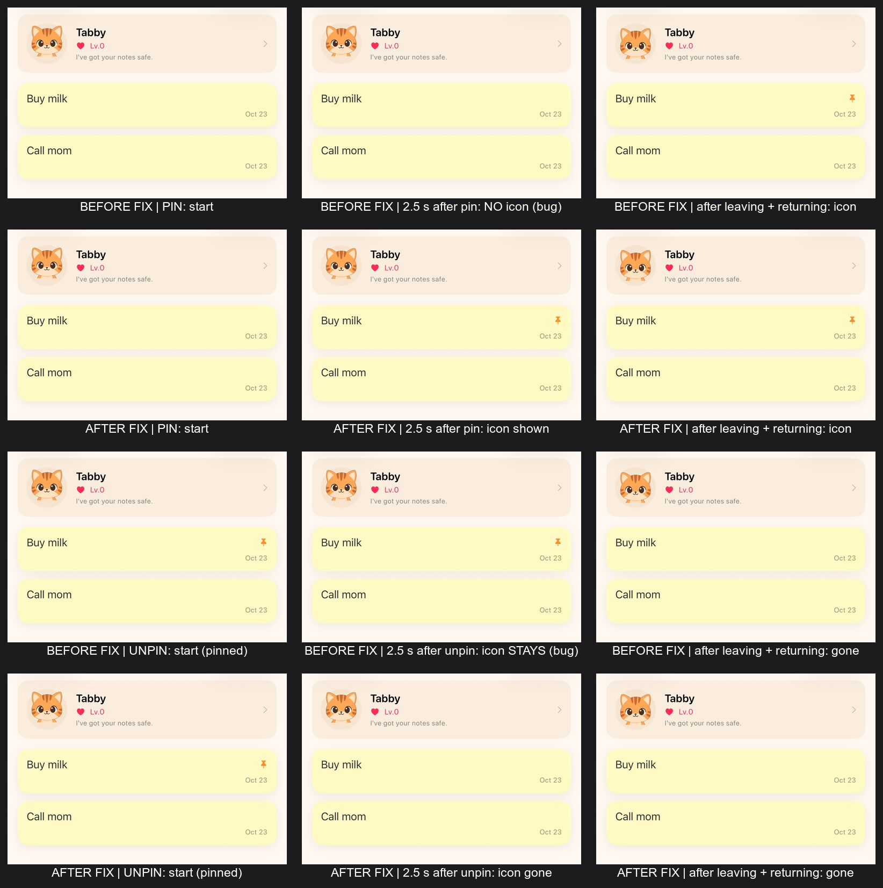
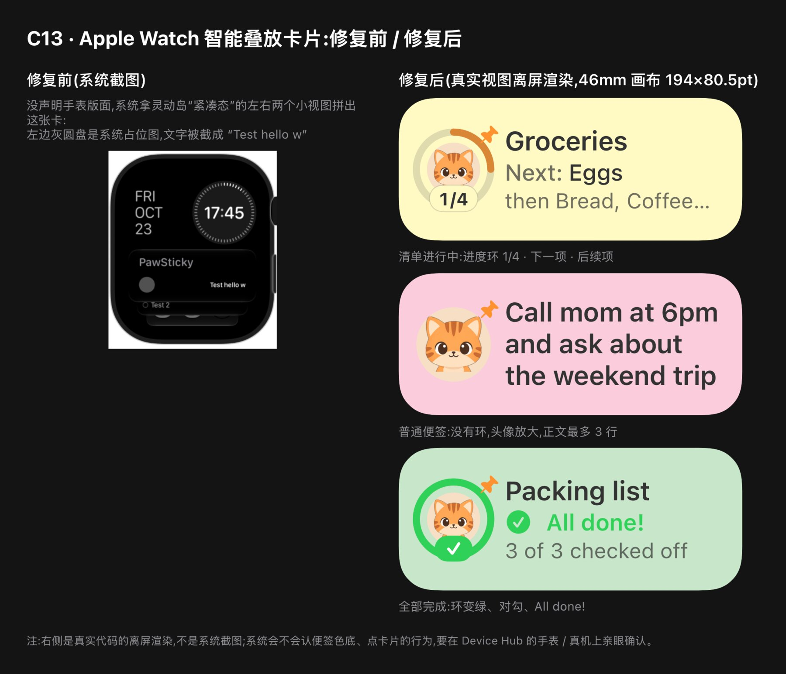
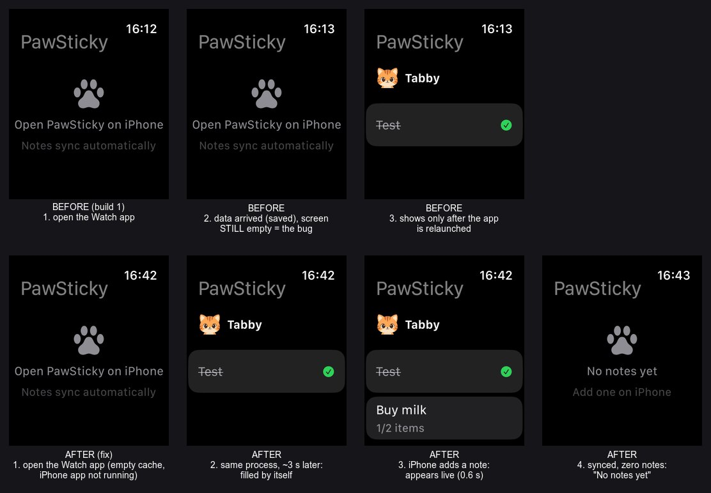

# PawSticky v1.0 上线 TODO

> **这是唯一回答"现在该做什么、做到哪了"的文档。** 勾了 = 做完;没勾 = 没做。
> *为什么*要做某一项 → 看审计依据 [`launch-readiness.md`](launch-readiness.md)(只读快照,不再记状态)。
> **更新:** 2026-10-23 · **v1.0 (1) 已提审,被拒 1 次**(Guideline 2.1(a):Watch App 没同步便签)→ **根因已查明并修复,你已真机复验通过;另修了真机发现的 C12(pin 图标不立刻显示)、Watch 模拟器截图里看出的 C13(智能叠放卡片灰圆盘 + 字太小,**还没在手表上亲眼验过**);Build 号已 +1(→ 2),修复已提交到本地 `main`(未推送、未打 tag),等你 Archive → Upload Build 2**(见 E5)· 2026-10-21 · **A 6/6 拍完**(A2 Team ID = X38QPV26TR,A3 维持豁免)· **B 5/5 完成** · D2 已拍板(隐私政策直接用网站通用页,5.1.1(i) 风险已接受)· **C 13/13 完成**(C9 Live Activity 无入口 / C10 锁屏背景 / C11 仅 iPhone 目的地已通过真机复验;C12 pin 图标即时显示在模拟器上验证,待真机瞄一眼;C13 手表卡片的日志 / 测试 / 版面已验证,**系统里的真实样子待你看**)· **D3 完成、D6 截图齐备**(iPhone 7 + Watch 2,ASC 格式在 `docs/assets/screenshots/asc-upload/`)· preflight **55 通过 · 0 ⏳ · 0 失败**(四个 bundle 构建号均为 2)· 测试 **313 / 313**(Core 232 + App 81;2.1(a) 修复新增 17、C12 新增 10、C13 新增 28;之前 258)· `v1.0.0` = `7b54f6a`(Build 1 的出包点,已推送 origin);Build 2 的修复在 `main` 的 `678095b`…`7f265f4`(之后另有文档提交与 C13 的 `b45c59e` `94a2617`;本地,**未推送、未打 tag**;`dev` 仍停在 `7b54f6a`)· v1.0 免费版 · 仅 iPhone(+ Watch)

**怎么用:** 从上往下做;做完把 `- [ ]` 改成 `- [x]`(或回复我任务编号,我来改)。
**图例:** 🔴 不做就不能提审 · 🟡 应做(口碑 / 兑现承诺)· ⚪ 可推迟 ｜ **[你]** 只有你能做(账号、审美拍板、对外发布)· **[我]** 我来写代码 / 文档

---

## 0. 一眼看懂

| 阶段 | 内容 | 谁 | 进度 |
|---|---|---|---|
| ✅ 工程 P0 | 改名 / ID / 隐私清单 / 版本号 / 合规键 / 相册崩溃 / 回前台刷新 / 锁浅色 / 仅 iPhone | 我 | **已完成** → [文末](#已完成) |
| **A** 先拍板 | 6 个小问题,一条消息答完 | 你 | **6 / 6 已完成** |
| **B** 账号 + 真机 | 填 Team ID、真机跑通 | 你 | **5 / 5 已完成**(B4 未触发) |
| **C** 代码 + 美术 | 图标、宠物图、设置页、撤销 / 备份、Widget 体验 | 我 | **13 / 13 已完成**(C9–C13 真机 / 模拟器发现并修复,C10 已复验通过,C12 待真机瞄一眼,**C13 待在手表上看一眼**;请你过目 C3 的新宠物图) |
| **D** 站点 + ASC | 隐私政策页、商店资料、截图 | 你(我起草文字) | 4 / 6(剩 D4、D5、D7;D1、D8 可推迟) |
| **E** 出包 + 提审 | 构建、TestFlight、提审、发布 | 你为主 | 0 / 4(Build 1 已提审、被拒 1 次 → **E5:修复已提交、Build 号已是 2,等你出包**) |

**👉 现在:** **E5**——Build 2 已备好:2.1(a) 的修复你已真机复验通过,真机发现的 pin 图标小 bug(C12)也修好了,Build 号已 +1(→ 2),修复都已提交到本地 `main`。轮到你:⓪ **先看一眼 C13**(在 Device Hub 的手表 / 真机上:手表表盘上滑进智能叠放,看 PawSticky 那张卡;逐项清单在 C13 条目的"请看"),并确认**锁屏上钉住的大卡片没变样**——C13 改了 Live Activity 的渲染入口,而你之前真机复验的是没有它的版本;不满意告诉我怎么调,或 `git revert 94a2617` 只退回手表小卡片(阶段 1 的灰圆盘修复 `b45c59e` 可保留);① (推荐)先推送 `main` 并打 tag(如 `v1.0.0-b2`),让 Build 2 可回溯到代码;② Archive → Upload Build 2 → ASC 版本页把 Build 换成 2;③ 更新审核备注第 6 条 → Resolution Center 回复 → 重新提审。**真机上顺手看一眼 C12**(点 Pin / Unpin 后图钉应当立刻出现 / 消失),并建议 Build 2 上 TestFlight 后把 E5 的冷路径步骤再走一遍。
**关键路径:** A → ( B ∥ C ∥ D 前半 ) → D6 截图(要等 C 做完)→ E。
**时间:** 从你答完 A 起算,**紧凑 ≈ 2 周,宽松 ≈ 3 周**。TestFlight 与审核等待约占一半;真机问题和审美返工是最大变数。
**美术:** v1.0 **不需要再生成任何图**,证据与做法见 [§美术方案](#美术方案零生成)。

---

## A. 先拍板(你 · 约 10 分钟)

> 每项都给了我的默认。**没意见就回复"按默认"**——只有 A2(Team ID)和 A3(公司的合规结论)必须由你给出内容。

- [x] **A1 ID 映射** 🔴 — ✅ 你已确认 "ID OK"(2026-10-14):App `com.fitpetgo.pawsticky` · Widget `….widgets` · Watch `….watchkitapp` · Watch Widget `….watchkitapp.widgets` · App Group `group.com.fitpetgo.pawsticky.shared`。在 ASC 创建 App 记录(D3)后 Bundle ID 永久不可改。
- [x] **A2 Team ID** 🔴 — ✅ 你已在 Xcode 里选好 Team(2026-10-21),Team ID = `X38QPV26TR`。我已把它持久化到 `Config/Signing.local.xcconfig`(git 忽略;Xcode UI 的设置会被 `xcodegen generate` 冲掉,xcconfig 不会),重新生成工程 + 构建 + preflight 验证通过(`DEVELOPMENT_TEAM = X38QPV26TR` ✅)。
- [x] **A3 出口合规结论** 🔴 — ✅ 你已拍板(2026-10-21):**维持豁免声明** `ITSAppUsesNonExemptEncryption = false`(依据:App 仅用系统 CryptoKit AES-GCM / CommonCrypto PBKDF2 标准算法,只加密用户自建的备份文件,密钥由用户口令在设备上派生,无网络传输、无第三方加密库);**不做**年度自我分类报告。法国管制:ASC 的法国申报要求已取消多年,软启动 NZ → CA → US 不涉及,进欧盟前(D8)再核对。
- [x] **A4 图标底色** 🔴 — ✅ 你选了 **B 天蓝**(2026-10-14)。下图保留以便回看:
  
- [x] **A5 美术方案 + 装扮图标** 🔴 — ✅ 你选了 **(a)**(2026-10-14):v1.0 零生成(依据见 [§美术方案](#美术方案零生成));装扮保持现在的 SF Symbol 锁 / 解锁网格,UI 文案 "Outfits" 改成 "Collection"。商店文案**不写** dress up。
- [x] **A6 隐私政策与支持页的 URL** 🔴 — ✅ 你给了 `https://www.fitpetgo.com/privacy-policy` 与 `https://www.fitpetgo.com/contact-us`(2026-10-14),不再单独注册 pawsticky 域名。**⚠️ 隐私政策页内容不够用,见 D2。**

---

## B. 账号 + 真机(你 · 约半天,可与 C 并行)

> 为什么要早做:**模拟器不强制 entitlement,真机才强制**。App Group、Widget 读写、Watch 同步只有真机能证明——越晚发现越贵。依赖 A1、A2。

- [x] **B1 登录账号** 🔴 — ✅ 你已在 Xcode 登录并选了公司 Team(2026-10-21,能在 Signing 里选 Team 即已登录)。角色是否 Account Holder / Admin 顺手在 appstoreconnect.apple.com 确认一下(D3 建 App 记录需要)。
- [x] **B2 填 Team ID** 🔴 — ✅ 你在 Xcode UI 设置的 Team 只活在本地 pbxproj;我已写入 `Config/Signing.local.xcconfig`(`X38QPV26TR`)并在重新 `xcodegen generate`(UI 设置被冲掉)后验证构建设置仍读到它。
- [x] **B3 真机跑起来** 🔴 — ✅ 你已真机跑通(2026-10-21),并抓到第一个真机问题:Live Activity 被关后 App 内无入口(→ C9,问题已代码确认)。
- [ ] **B4 (仅 B3 报 App Group 错才做)** — developer.apple.com → Certificates, IDs & Profiles → Identifiers:手动建 App Group `group.com.fitpetgo.pawsticky.shared`,再到 4 个 App ID(App / Widget / Watch / Watch Widget)的 App Groups 能力里勾上它。
- [x] **B5 真机冒烟 15 分钟** 🔴 — ✅ 完成(2026-10-21):全项通过——启动 / 选宠 / Widget 家族 / 勾选回 App 同步 / 点按直达(含设置页开着时)/ Watch 数据与新头像 / 备份恢复(明文 + 加密)。C9 回归也过(关掉 Live Activities 点 Pin 弹窗指路)。真机发现的 LA 次级文字偏灰 → C10 已修(待再瞄一眼)。**⚠️ 2026-10-23 补记:这次冒烟里 Watch 一项能过,走的是"运气路径"**——开发机上 Xcode 同时装两端并重启手表 App,缓存里本来就有数据;"先有便签、后装手表 App"这条冷路径没覆盖到,被审核员踩中(→ E5)。以后真机冒烟必须包含它。

---

## C. 代码 + 美术(我 · 合计约 4–5 天;只做 🔴 约 1 天)

> 每项一个小提交;做完我会跑 `xcodegen → 构建 → 测试 → preflight` 并给模拟器截图。依赖标在各项后。

- [x] **C1 设置页:隐私政策 / 支持 / 版本** 🔴 — ✅ 已完成:设置页新增 About 分组——Version(`1.0 (1)`,取自 Info.plist)、**Privacy Policy** 与 **Support** 外链(URL 常量在 `Core/Sources/Core/Core.swift` 的 `PawItInfo`,目前是你给的 fitpetgo.com 两个地址)、Acknowledgements(GRDB 的 MIT 原文)。审核指南 5.1.1(i) 要求隐私政策在 App 内“易于找到”,放在设置页第一屏即可见。 测试:`CoreTests.legalURLsAreHTTPSLinksToConcretePages`(https / 有 host / 带路径)、`AppInfoTests`(版本文案,含“构建后变量已展开”),均先看它失败再实现。preflight 新增 3 类守卫:① 两个 URL 存在且是真实 https(❌);② `Package.resolved` 里每个依赖都要在 Acknowledgements 里声明(❌;先拿掉文件看它变红再恢复);③ **隐私政策 URL 仍是 fitpetgo.com 通用页时显示 ⏳**——这是提醒你做 D2,换成专属页的 URL 后自动消失。
- [x] **C2 App 图标接入(iOS + Watch)** 🔴 — ✅ 已完成:`art/scripts/make-app-icon.sh` 用 `B_cat-sitting` 合成天蓝底(`#D4E9FF → #9CCBF5`)1024×1024 sRGB 无 alpha PNG,写入 `PawIt/` 与 `PawItWatch/` 的 `AppIcon.appiconset`(`Contents.json` 已补 `filename`)。验证:preflight 两条图标检查 ⏳ → ✅(并新增“Contents.json 必须引用图标文件”检查,先造出失败再修好);构建后 `Assets.car` 与 `CFBundleIcons` 均含 AppIcon。想换底色:`ICON_TOP=… ICON_BOTTOM=… art/scripts/make-app-icon.sh`。
- [x] **C3 宠物图零生成接入(P1-2)** 🟡 — ✅ **代码与素材已完成,等你过目点头**:`extract-from-sheets.sh` 抠图 → 新增 [`art/scripts/export-pet-imagesets.sh`](../art/scripts/export-pet-imagesets.sh) 导出 6 物种 `pet-<sp>-front`(胸像,方形画布 88% 内接,@1x/2x/3x = 100/200/300px)覆盖 4 个 catalog(**名字不变**,约 20 处引用零改动;Watch 同样用胸像),并新增 `pet-cat-full`(全身,仅 PawIt)给欢迎页英雄位——胸像的下沿是裁切线,放在无背景的大图位像“漂浮的头”。**选宠卡仍用胸像**:我对比后发现 90pt 高的卡片里全身图脸太小,胸像更清楚,所以另外 5 个物种不需要 `full`,没打进包(省约 1 MB)。cat / corgi 的举牌图没动。验证:preflight 新增“宠物素材齐全”检查(先让它因缺 `pet-cat-full` 失败,再导出变绿);模拟器截图——欢迎页、选宠网格、6 物种各自的列表头,耳朵完整、兔子清晰可见: **Widget / 锁屏 / Watch 没在真机或模拟器里看过**(模拟器无法脚本化添加 Widget),它们复用同一批 `front` 图;圆形锁屏小组件对图片做了 `clipShape(Circle())`,实测 cat / corgi / hamster 的耳尖有 4–5% 像素落在圆外会被略微裁掉(≈ 1pt),可接受——**真机 B5 冒烟时请看一眼锁屏圆形组件**。
- [x] **C4 宠物名字统一(P1-1)** 🟡 — ✅ 已完成:头部叫 Tabby,对话里它却自称 Mochi(而 Mochi 是另一只柴犬)。两份私有台词 switch 收敛成 `PetDialogue`(选宠 / 换宠),名字一律读 `PetAsset.displayName`。先写 `PetDialogueTests`(名字 = 卡片名、不提别的宠物)并看它因旧台词失败(14 个断言),改完全绿。
- [x] **C5 删除撤销(P1-7)+ 备份 / 恢复最小界面(P1-6)** 🟡 — ✅ 已完成:**① 删除撤销**:删除后底部出现 5 秒 "Note deleted · Undo" 小条;撤销在**同一事务**里把便签与清单项一起复活(新增 `NoteRepository.undoDeleteNote`,复用 `restore` 的单实体语义——历史不记父子关系,所以清单项 id 要在**删除前**读出来带上),并补回提醒、刷新 Watch / 锁屏。重复点撤销按成功处理;删除失败不再被静默吞掉,也不会误取消提醒。**② 备份 / 恢复**:设置页新增 Data 分组——**Back Up Notes**(口令可选:留空 = 明文 JSON;填了 = AES-GCM + PBKDF2 加密,**至少 8 位**、输两遍;走系统“存储到文件”,默认文件名 `PawSticky Backup 2026-10-14`)与 **Restore from Backup**(选文件 → 先校验信封,不是备份的文件在问口令**之前**就拒掉 → 页内出现红色 "Replace All Notes and Pets" 确认卡片,加密备份在卡片里输口令 → 整体替换;口令输错留在卡片里重输,不必重选文件)。 
  - **设计取舍:** 结果用页面内联状态行而不是弹窗(文件面板刚关闭就弹 alert,在 SwiftUI 里常弹不出来;内联对 VoiceOver 也更稳,另有播报);口令统一规整成 NFC(不同键盘对 “é” 的字节序列不同,不规整会出现“口令没错却解不开”);备份文件上限 20 MB(超限基本是选错了文件);恢复成功后一次性对齐库外状态——取消被替换便签的提醒与锁屏钉住、按备份里的到期日重排提醒(这台设备还没被问过通知权限时,只有存在未过期到期日才在此刻询问)、Watch 与小组件各刷新一次;设置页关闭后列表与宠物头部重新加载。口令下限在 `BackupPassphrasePolicy.minimumLength`(一个数字,想收紧 / 放宽只改它,测试相对它书写)。
  - **验证:** 先写测试看它因缺类型 / 缺方法而红,再实现转绿——Core +6(`undoDeleteNote` ×4、`inspectExport` ×2)、App +41(口令策略、失败文案、文件读取与命名、服务往返含 NFC 与“口令错库不动”、控制器流程;全部用真实临时库)。全量 **226 / 226 通过**(Core 175 + App 51)。模拟器实测:撤销条样式;设置页 Data 分组;导出页校验;恢复确认卡片(明文 / 加密);口令输错后的提示与卡片保留(这一步跑的是 App 里的真实代码路径);恢复成功(备份后临时多塞一条便签再恢复——库里只剩原来 2 条,多的那条在历史里留有快照)。顺带修了一个链接坑:`SharedStore.init` 的默认参数把 GRDB 符号编进了调用方,App 测试包链接失败,拆成无参重载。
  - **没验证的:** 系统的“存储到文件 / 选择文件”面板(模拟器无法脚本化点击)。→ **B5 / E2 真机请走一遍:备份 → 存到文件 → 删 App 重装 → 恢复(明文、加密各一次)**。
- [x] **C6 Widget 两项体验(P1-5、P1-4)** 🟡 — ✅ 已完成:**① 画廊预览不再是空状态**:`getSnapshot` 判断 `context.isPreview`,预览与占位改走示例内容——一张 "Pick up groceries"、3 项清单(第 1 项已勾)、2 小时后提醒、你选的宠物(没选过就是猫);示例永不逾期(不会渲染成红字)、不读也不写便签库(`WidgetSample`)。已添加的小组件仍读真实数据,空库就如实显示空状态。**② 点 Widget 直达**:所有尺寸(含锁屏三款)加 `widgetURL`——正在显示便签 → `pawsticky://note/<id>` 打开**那一条**;空状态 "Tap to add a note" → `pawsticky://new` **直接进新建页**("一秒速记"终于兑现)。勾选 / 翻页按钮是 App Intent,不受影响。App 端 `onOpenURL` → `DeepLinkRouter` 先挂起 → 列表页出现后取走(冷启动时 URL 早于列表页,不挂起就丢)。`pawsticky` scheme 写在 `project.yml` 的 `CFBundleURLTypes`,Info.plist 由 XcodeGen 重新生成。
  - **设计取舍:** 链接解析是**严格白名单**(未知 scheme / host、多余路径段、坏 UUID 一律丢弃;查询串与片段忽略,留给将来加埋点)——scheme 一注册,网页和别的 App 就能触发它,所以只放行两种“只打开页面、不改数据”的形态。落点还会尊重现实:便签已被删(小组件快照比库旧)→ 停在列表,不开空编辑器;全新安装还没走完引导 → 不弹编辑器(引导结束本来就会进新建页;全新安装的人可以在打开 App 前就从画廊加了小组件);设置 / 选宠 / 成长 / 分享页开着时先收起、再开编辑器(同一时刻只能开一个 sheet)。
  - **验证:** 先写测试并看它失败(桩实现让断言落空,不是缺符号),再实现转绿——Core +19(`DeepLink` 12:构造 / 往返 / 大小写 / 结尾斜杠 / 查询串 / 外来 scheme / 未知 host / 坏 UUID / 多余路径;`WidgetSample` 7:不逾期、文字不超 3 行、清单有勾有未勾且圆环半满、id 稳定、宠物回退)、App +9(落点决策 4、路由器 4、**scheme 确实注册进了 Info.plist** 1——这一条先因 Info.plist 未重新生成而红)。全量 **254 / 254 通过**(Core 194 + App 60)。preflight 新增“Info.plist 注册的 scheme == `DeepLink.scheme`”,**51 通过 · 2 ⏳ · 0 失败**。模拟器:`simctl openurl pawsticky://…` 弹出系统确认框 **"Open in 'PawSticky'?"**——说明 scheme 已被系统认到本 App;但这个框模拟器里点不了,所以用一个**临时启动参数**把 URL 直接塞给路由器(验完已删除并用 Grep 确认源码里无残留),覆盖六个场景,见上图:冷启动→便签 ✅ · 冷启动→新建 ✅ · 全新安装→**只有引导、没有编辑器叠在上面** ✅ · 便签 id 不存在→列表 ✅ · 热启动(App 已在列表页)→便签 ✅ · 乱写的链接→列表 ✅。
  - **没验证的:** ① 画廊本身(模拟器无法脚本化打开);`isPreview` 分支只有一行条件,示例内容的“看起来是好的”由上面 7 个测试守住。② 真实的“点 Widget → `onOpenURL`”(系统投递 Widget 链接时没有确认框;模拟器里加不了 Widget)。③ 设置页开着时从主屏点 Widget 的“先收起再开编辑器”时序(决策函数有单测,收起动画没跑过)。→ **B5 真机请看:画廊里是示例便签而不是空状态;点空状态的 Widget 直达新建;点有便签的 Widget 直达那一条;开着设置页回主屏再点 Widget。**
  - **没做(不在 C6 范围):** Live Activity(锁屏 / 灵动岛上钉住的便签)点按仍只是打开 App,没接这套链接——接法一样(`widgetURL` + `DeepLink.openNote`),可放 v1.0.x。
- [x] **C7 装扮文案(P1-3)** 🟡 — ✅ 已完成(按 A5(a)):成长页标题 "Outfits" → "Collection"、统计块 "Outfits"(原 T 恤图标)→ "Collected"(sparkles 图标)、"All outfits unlocked!" → "Collection complete!"、分享卡 "n/12 outfits" → "n/12 collected";SF Symbol 网格不变。另给 preflight 加了守卫:用户可见字符串里再出现 outfit 就失败(先让它抓到 4 处,改完变绿)。
- [x] **C8 每批收尾回归** 🔴 — ✅ 本批已跑(**之后每次改动仍要再跑**):`xcodegen generate` 后入库的生成物零差异 → **干净**构建成功 → `xcodebuild test` **254 / 254 通过**(Core 194 + App 60)→ `scripts/preflight.sh` **51 通过 · 2 ⏳ · 0 失败**(两个 ⏳ 是 Team ID 与"隐私政策 URL 仍是通用页",都在等你)。编译警告仍是审计时的那 2 条(`ToggleItemIntent.swift:34`、`PawItTests.swift:15`),没有新增。命令见[附录](#附录常用命令)。
- [x] **C9 Live Activity 被系统关闭后无入口(B3 真机发现)** 🟡 — ✅ 已修(2026-10-21,方案你拍板:失败弹窗 + 设置页状态行):**问题**——锁屏移除 / 系统设置里关掉 Live Activities 后,`pin` 的 `areActivitiesEnabled` 守卫只写 os_log 就静默返回,`togglePin` 又用 `try?` 吞掉,点 Pin 零反馈且 App 内无任何"去系统设置打开"的入口(低电量也触发同一静默失败;只划掉 Activity 而开关还开着时再 Pin 本来就能恢复,`isPinned` 只认 `.active`)。**修法**:① `pin` 改为 throw `LiveActivityUnavailableError.activitiesDisabled`(授权探针参数可注入,测试用);② 列表 `togglePin` do/catch → `PinIssue` 归因弹窗("Live Activities Are Off" + **Open Settings** 直达 `openSettingsURLString`,全工程唯一出口;其他失败给通用重试文案);③ 设置页新增 Lock Screen 分组:Live Activities On/Off 状态行,点按直达系统设置,回前台(`scenePhase == .active`)自动刷新。**验证**:先写 4 个测试看红(缺类型 / 缺参数),实现后 **258 / 258 通过**(Core 194 + App 64,新增 4);preflight **53 通过 · 0 ⏳ · 0 失败**;改动文件无新增编译警告(增量构建)。**真机回归**:✅ 通过(2026-10-21)——弹窗指路、状态行刷新都验过;顺带发现 LA 文字偏灰 → C10。
- [x] **C10 Live Activity 卡片发灰看不清(B5 真机反馈,三轮)** 🟡 — ✅ 已修(2026-10-21):**第一轮**按次级文字透明度修(0.4–0.6 → 0.75),复验仍灰;**第二轮**真机截图视觉分析定位到"粉彩底根本没画、系统深玻璃 + 系统灰阶文字",按 `containerBackgroundRemovable(false)` 修——真机复验**仍玻璃**(该开关对锁屏 LA 无效);**第三轮**查官方文档(Creating custom views for Live Activities)钉死真因:**锁屏 LA 的背景色归 `activityBackgroundTint(_:)` 管**(默认白 / 黑 / iOS 26 玻璃),`containerBackground(for: .widget)` 是主屏 Widget 的机制、对锁屏 LA 从未生效——粉彩其实一直没画上去过,iOS 26 把默认底改成玻璃才暴露。修法:`activityBackgroundTint(便签色)` + 文档配套的 `activitySystemActionForegroundColor(墨色)`(系统"结束"辅助按钮的文字色)。**真机复验**:✅ 通过(2026-10-21)——粉彩底 + 深字回来了。三轮终修的教训:锁屏 LA 的背景归 `activityBackgroundTint`,View 层的 `containerBackground` 管不到它。
- [x] **C11 收敛运行目的地到仅 iPhone** 🟡 — ✅ 已做(2026-10-21):`project.yml` 给 PawIt / PawItWidget 显式 `SUPPORTS_MAC_DESIGNED_FOR_IPHONE_IPAD = NO`、`SUPPORTS_XR_DESIGNED_FOR_IPHONE_IPAD = NO`,重新生成后 Xcode 目的地列表只剩 iPhone(在 Xcode UI 里删活不过 `xcodegen generate`,持久层必须在 yml)。**注意**:这两个开关只管构建 / 运行目的地;商店侧的 Mac / Vision 兼容是 ASC 的 Availability 设置(D4 顺手关),且 Designed-for-* 渠道复用 iOS 截图、本来不需要额外截图。
- [x] **C12 Pin 之后钉住图标不立刻显示(E5 真机复验时发现)** 🟡 — ✅ 已修(2026-10-23,`1610f29`):点 Pin 后便签卡片右上角的橙色图钉要切走再回 App 才出现;Unpin 同理(图标赖着不走)。
  - **根因(模拟器复现 + 日志对证):** 列表在 `body` 里直接问 ActivityKit(`LiveActivityManager.isPinned`)——那是**不可观察**的外部状态,而 `togglePin` 又没改任何 `@State`,SwiftUI 没有重绘的理由。数据本身是对的(pin 返回时 ActivityKit 已报告 `true`);"切走再回来就好了"只是因为回前台的 `reloadNotes()` 重新赋值 `notes`、顺带整页重绘。和 2.1(a) 的手表空状态是同一类坑:**界面显示的外部状态必须有可观察的持有者**(已写进 CLAUDE.md 代码规范)。
  - **修法:** 新增 `@MainActor @Observable PinnedNotes`,列表读它;`togglePin` 当场 `didPin` / `didUnpin`,`reloadNotes()`(回前台、各 sheet 关闭时)与 ActivityKit 对齐——锁屏上被划掉、系统到期收走都靠这一步反映回来。**一个坑:** `Activity.end` 是**异步**的,`unpin()` 返回 6ms 后 ActivityKit 仍报告"钉着",约 500ms 后才变;这个窗口里恰好来一次对齐,就会把刚取消的图标"拉回来"。所以持有者记住"已请求结束"的便签,系统真正报告结束之前不显示。`LiveActivityManager.isPinned` 因此无人调用,已删(换成 `pinnedNoteIds()`,注释写明界面不许在 `body` 里直接调它)。
  - **验证:** ① 先写 10 个测试看红(桩实现下全是断言失败,不是缺符号),再实现转绿;对 `ending` 记账做了两个**变异检查**(去掉"压着已请求结束的" → 竞态测试红;去掉"系统结束后解除压制" → "可再次钉住"测试红;均已还原)。② 模拟器按同一流程做前后对比(上图:每组中间一格是关键帧;日志里 unpin 后 `activityKit=true ui=false`,500ms 后两者都是 `false`);冷启动时 Activity 还活着,图钉也能正确显示。③ 全量 **285 / 285**(Core 204 + App 81),标准构建 0 警告,preflight 53 / 0 / 0。
  - **没验证的:** 真机(Live Activity 的 `end` 时序可能与模拟器不同,但对账逻辑不依赖具体毫秒数);"在锁屏上把卡片划掉后回 App,图钉消失"这条对齐路径只有单测(`refreshDropsActivitiesTheSystemHasEnded`),没在模拟器里操作过(`simctl` 点不了屏)。删除便签 / 备份恢复也会结束 Activity,但被结束的便签那时已不在列表里,图标无从显示,之后的 `reloadNotes()` 会对齐,没有单独处理。→ **真机请看:Pin 后图钉立刻出现;Unpin 后立刻消失;Pin 后在锁屏上划掉那张卡片,回 App 图钉消失。**
- [x] **C13 Apple Watch 智能叠放卡片:灰圆盘 + 字太小(你发 Watch 模拟器截图问"要不要优化"时看出的)** 🟡 — ✅ 已改(2026-10-23,阶段 1 `b45c59e` + 阶段 2 `94a2617`;**未上传,Build 号仍是 2**,Build 2 出包时会带上它):手表上钉住的便签,卡片左边是个**灰色圆盘**(本该是宠物头像),标题被硬切成 "Test hello w",整张卡又小又空。你选的是"阶段 1 + 阶段 2 一起做 · 布局 C(宠物进度环)· 底色先试便签色"。
  - **根因(日志对证):** App 没声明手表版面,Watch 智能叠放卡片是系统拿**灵动岛紧凑态**的左右两个小视图拼出来的。`compactLeading` 里放的是 480px 的举牌图,**超过紧凑呈现的图片尺寸上限**——系统归档 Live Activity 时**不报错、静默换成灰色占位圆盘**(配对模拟器上 iPhone 端 `PawItWidget` 扩展的日志:`[1: 480x480] Max size exceeded: 437.85x219.6; using placeholder image`)。标题则是内联的 `noteText.prefix(12)`:没有省略号,还切在单词中间。
  - **阶段 1 · 修 bug(所有 iOS 版本都受益):** ① 新增 `pet-<物种>-badge`(48 / 96 / 144px,和 `front` 同一张胸像缩出,**零生成**,由 `export-pet-imagesets.sh` 固化)给紧凑态用;② 标题改走 Core 的 `LiveActivityText.compactTitle`:取第一行、按词边界截断并加 `…`("Test hello world" → "Test hello…");③ preflight 加两条守卫(徽章不得 > 144px;`compactLeading` 里不得再加载 `petImage(`)。
  - **阶段 2 · 手表专用小卡片:** 声明 Live Activity 的 `.small` 家族(iOS 18+;手表智能叠放与 iOS 26 CarPlay 共用),在 `ActivityFamilyRouter` 里按 `@Environment(\.activityFamily)` 分流——`.small` → `SmallActivityView`,锁屏 / 横幅仍是原来的大卡片。小卡片 = **宠物进度环**(环 = 清单完成度,下沿胶囊 x/y,右上角钉住)+ 标题 + "Next: 下一项" + "then 后续两项";全部完成时环变绿、对勾、"All done!";普通便签没有环,头像放大、正文最多 3 行。画布矮(40mm)时 `ViewThatFits` 从最后一行开始丢,不靠截断。卡片逻辑(下一项 / 后续项 / 完成态 / 环比例)是 Core 的 `ActivityGlance`,视图只排版。底色:便签色 `activityBackgroundTint`,卡片自己再铺一层同色底(万一系统在手表上不认 tint,深色字也不会落在黑底上)。**部署目标仍是 iOS 17**:一个 Widget + 一个 `#available(iOS 18.0, *)` 的小扩展(`supplementalSmallIfAvailable()`)就够;iOS 17 上手表继续显示紧凑态(已被阶段 1 修好)。
  - **验证:** ① **日志对证**(配对模拟器 iPhone 17 Pro ↔ Watch 46mm,同一流程前后对比):修复后 `[3: 144x144] Image permitted`,整段日志**零条** `Max size exceeded`。② **先写测试看红、再实现转绿**:Core +28——`LiveActivityTextTests` 16(短标题原样 / 刚好等于上限 / 按整词截断 / 半个词被丢 / 词尾恰在切点 / 自定义上限 / 单个长词与无空格文本硬切 / emoji 等字形簇不被劈开 / 只取首行 / 全空白得空串 / 结果永不超限 / `firstLine` 3 条),`ActivityGlanceTests` 12(进度与下一项 / 空清单是空环而不是没有环 / 后续项默认最多 2 且可配 / 跳过中间已勾项 / 最后一项没有后续 / 全部完成 / **整条被标成完成但清单没勾完** / 文字去空白 / 空白项不当"下一项"但仍计入总数)→ 全量 **313 / 313**(Core 232 + App 81);阶段 1 的提交**单独**也能构建、**301 / 301**(两个阶段可以独立回滚)。③ 标准构建 0 警告;preflight **55 / 0 / 0**;守卫做过**负对照**(把 `compactLeading` 改回 `petImage(` → ❌ 且退出码 1,还原后 0)。④ **版面**:用一次性渲染工程(不入库)把**真实视图**按系统给的各画布尺寸(手表 40 / 41 / 42 / 44 / 45 / 46mm / Ultra,CarPlay 三种)离屏渲染,看清单三种状态、普通 / 完成 / 无标题、4 种便签色、灵动岛紧凑药丸有没有溢出或切字(上图右侧)。
  - **没验证的(请你看):** ① **手表上真实的智能叠放卡片**——唤出它要在手表上手动上滑,我这边操作不了界面(`simctl` 没有点按 / 滑动,Computer Use 没有辅助功能权限),所以**系统认不认便签色底**、卡片四周的内边距、点卡片后的行为(你之前的截图里是一页带 "Open on iPhone" 的详情)都没亲眼见过;上图右侧是**离屏渲染,不是系统截图**。② 40mm 最窄画布(152×69.5pt)文字列最挤,条目文字过长时以省略号结尾(逐字符截断,可能停在单词中间,例如 "Weekend err…")。③ CarPlay(iOS 26)。④ **锁屏 / 横幅的大卡片现在也经过路由视图**——渲染上等价,但没有在真机锁屏上看过,**C10 的粉彩底 + 深字请再瞄一眼**。⑤ 灵动岛紧凑态的真实样子(模拟器截图里灵动岛内容是空的,只验过日志与离屏渲染)。⑥ iOS 17 回退(没有 iOS 17 运行时,只做了编译验证)。
  - **真机 / Device Hub 请看:** 手表表盘上滑进智能叠放,PawSticky 那张卡——① 头像不再是灰圆盘;② 进度环 / 标题 / Next 行清楚;③ **底色是便签色还是黑底、四周有没有露边**(若不好看,退路是手表上统一用深色:`SmallActivityView.preset` 固定成现成的 `.charcoal`,顶层 tint 对小家族同步,几行改动,告诉我就行);④ 点卡片的行为;⑤ 清单勾完后环变绿;⑥ 带灵动岛的真机:药丸左侧是小头像、右侧标题带省略号;⑦ **锁屏上钉住的大卡片没变样**。**注意:`simctl install` 会结束该 App 的所有 Live Activity**——模拟器里重装后要重新 Pin,手表约 15–30 秒后才出现卡片。

---

## D. 站点 + App Store Connect(你 · 我起草文字 · 约 2–3 天,多数可与 C 并行)

- [ ] **D1 ⚪ 注册 pawsticky 域名(可选)** — 不再是必需:隐私 / 支持页用 fitpetgo.com 即可(A6)。仅当想要独立官网 / 防抢注时再买。
- [x] **D2 隐私政策页** 🔴 — ✅ 你已拍板(2026-10-21):**直接用现有 `https://www.fitpetgo.com/privacy-policy`,不另发 PawSticky 专属页**。已知风险(拍板时接受):该页第一段写明"只适用于本网站、不适用于其他渠道",没提 App,内容(网站 cookies / 广告 / 账号注册)与"不收集数据"的问卷口径不一致——审核指南 5.1.1(i) 有拒审可能。**备用方案**(若真被 5.1.1(i) 拒):发布 [`pawsticky-privacy-policy.md`](pawsticky-privacy-policy.md)(留在库里不删)→ 改 `PawItInfo.privacyPolicyURL` → 重出包,损失一个审核周期(1–2 天)。preflight 的对应 ⏳ 已改为记录本决议的 ✅ 项;Core.swift 常量注释同步更新。遗留小项挪到 D4:手机确认 `contact-us` 看得到联系方式。
- [x] **D3 ASC 创建 App 记录** 🔴 — ✅ 你已完成(2026-10-21),**名称 = `PawSticky`**(D4 文案第一句即 PawSticky,兼容无需改)。Bundle ID `com.fitpetgo.pawsticky` 从此锁定。
- [ ] **D4 填商店资料** 🔴 · 2–3h · 依赖 D2 — 副标题 / 宣传文本 / 关键词 / 描述 / What's New 用审计附录 C 的草稿(C5 已做,备份那一段可以保留);类别 Productivity(主)+ Lifestyle(次);价格 Free;可用地区**先只选 NZ**(之后逐步加 CA、US);年龄分级问卷(预期 4+,**不要选 Kids 类别**);内容版权选"不含第三方内容";隐私政策 URL、支持 URL。关键词里**不要放竞品名**。另在手机打开 `contact-us` 确认看得到联系方式(邮箱或表单;ASC Support URL 硬要求,原 D2 遗留);再在 Availability 里关掉 Mac (Designed for iPad) / Apple Vision 兼容(C11 的商店侧动作)。
- [ ] **D5 App 隐私问卷** 🔴 · 15 分钟 — 预期 **Data Not Collected**。我已在 `f36d2d4` 核对:全部 Swift 源码里没有 `URLSession` / 分析 / 广告 / 定位 / 相册等 API,唯一第三方依赖是 GRDB(本地 SQLite)。以后加任何 SDK 或网络请求,必须回来改这份问卷。
- [x] **D6 截图** 🔴 — ✅ 完成(2026-10-21):iPhone 7 张(1170×2532 → **1179×2556**)+ Watch 2 张(**416×496**,Series 12 46mm 原生,无需缩放)均已转为无 alpha JPEG,在 `docs/assets/screenshots/asc-upload/`(原片未动);上传时挑 5–6 张 iPhone + 1–2 张 Watch。规格依据:Apple 截图规格页(2026-10-14 核对)+ MobileAction/appscreens 交叉确认(1170×2532 属旧类别,不能作必需集)。
- [ ] **D7 审核信息** 🔴 · 30 分钟 — ASC "App Review Information":联系人姓名 / 电话 / 邮箱(必填)、取消勾选"需要登录"、审核备注贴[附录模板](#附录审核备注模板)。
- [ ] **D8 ⚪ 进欧盟前再做** — DSA trader 声明(公司主体按 trader 申报,地址 / 电话 / 邮箱会公开展示在欧盟商店页);商标初筛(USPTO / IPONZ / CNIPA)。软启动 NZ → CA → US 阶段不需要。

---

## E. 出包 + 提审(你为主,我协助)

- [ ] **E1 构建并上传** 🔴 · 1h · 依赖 B、C、D3 — 先 `xcodegen generate` → 构建 → `scripts/preflight.sh`(0 失败;两个历史 ⏳ 已于 2026-10-21 清零,现为 55 通过 · 0 ⏳ · 0 失败)。**前置已完成(2026-10-21)**:`dev` 已合入 `main` 并打 tag `v1.0.0`,preflight 终检通过;待 Xcode Archive → Upload(首传 Build 号 = 1,重传前找我把 `CURRENT_PROJECT_VERSION` +1)。(推荐)把 `dev` 合到 `main` 并打 tag(如 `v1.0.0`),保证每个 build 能回溯到代码。Xcode:目标选 Any iOS Device → Product → Archive → Distribute App → App Store Connect → Upload。**每次上传 Build 号必须递增**(改 `project.yml` 的 `CURRENT_PROJECT_VERSION` 后重新 `xcodegen generate`)。完成标准:ASC 的 TestFlight 页出现该 build,状态不是 Invalid / Missing Compliance。
- [ ] **E2 TestFlight 内测 + 真机 QA** 🔴 · 3–7 天 — 邀请自己 + 几位朋友(Internal Testing:ASC 用户最多 100 人,**无需审核**),按审计 §8 的 11 个场景在真机跑一遍;设备至少:最小屏 iPhone、带灵动岛的 iPhone、一块 Watch。崩溃以 Xcode Organizer 报告为准,门槛沿用商业计划:崩溃率 < 0.1%。
- [ ] **E3 修复迭代** 🔴 · [我] — 把 QA 发现的问题(截图 + 复现步骤)给我,我修,你重传(Build 号 +1)。
- [ ] **E4 提审与发布** 🔴 · 30 分钟 + 审核等待 — 在 ASC 的版本页选 build → 核对 D3–D7 全绿 → Submit for Review。审核通常 1–2 天,首次可能更久。发布方式选"手动发布",过审后自己按下按钮;地区先 NZ。被拒:把拒信贴给我,按条目处理。
- [ ] **E5 审核被拒 · Guideline 2.1(a) "Watch App 没同步便签" → 修复后重新提审** 🔴 — 2026-10-23 首次提审被拒(v1.0 (1);审核设备 iPhone 17 Pro Max + Apple Watch;Submission ID `3ac53f88-fd27-4b1d-93ba-145ff9ab4620`;审核员截图在 `docs/assets/review/`:手表停在空状态 "Open PawSticky on iPhone",而 iPhone 上明明有便签)。**根因已查明、修复已写完、验证已做**,详情与证据见[文末「已完成」](#已完成)里的 E5 记录。修复**已提交**(`678095b`,提交表见文末),Build 号也已 +1。剩下的:
  - [x] **[我] 根因 + 修复 + 验证** — 两个独立根因都复现并修复:① 手表 App 晚于便签装好时没人补推;② 手表界面只在启动时读一次缓存,数据后到就一直空着。配对模拟器逐场景验证 + 全量 **275 / 275** + preflight **53 / 0 / 0**。
  - [x] **[我] Build 号 +1** — ✅ 已做(2026-10-23,你说"版本号加到 2"):`project.yml` 的 `CURRENT_PROJECT_VERSION` `"1"` → `"2"`(`7f265f4`),`xcodegen generate`(入库的 plist 引用变量,无需变动),完整测试 + 标准构建 + preflight 全绿,四个 bundle 构建号均为 2。**我没有 Archive / 上传。** 版本号 1.0 不变,Build 号递增即可在同一个版本下重传。
  - [x] **[你] 真机复验** — ✅ 你已在真机上测过,效果正常(2026-10-23)。当时走的是哪条路径没有记录;开发机 Xcode 直装会掩盖冷路径(见 B5 补记),所以 **Build 2 传上 TestFlight 后,建议用 TestFlight 版把下面的步骤再走一遍**(尤其 ① 手表端先卸再装、⑥ iPhone App 被划掉)——重新提审前最便宜的一道保险。步骤(要踩的正是审核员的路径):① iPhone 上 Watch App → My Watch → 找到 PawSticky,关掉 *Show App on Apple Watch*(或在手表上长按图标删除),让手表端卸载;② 在 iPhone 的 PawSticky 里建 2 条便签(其中一条带清单);③ 重新打开该开关,等手表端装好;④ **只**在手表上打开 PawSticky(别碰 iPhone)→ 期望:几秒内出现宠物头像 + 2 条便签;⑤ 手表开着时在 iPhone 上再建一条 → 期望:手表上实时出现;⑥ 把 iPhone 上的 PawSticky 划掉(强退),重复 ①–④ → 期望:手表照样拿到数据。手表要解锁、在手腕上、与 iPhone 在蓝牙范围内。**任一步不符把现象告诉我**,真机的连通性时序可能与模拟器不同。
  - [ ] **[你] 重新出包并回复审核** — **注意:Build 2 现在除了 2.1(a) 修复和 C12,还带着 C13(手表智能叠放小卡片 + 灵动岛紧凑态)**——C13 让锁屏卡片也经过一个"按家族分流"的路由视图,出包前请先照 C13 的"请看"清单看一眼(尤其锁屏上钉住的卡片粉彩底 + 深字没变)。Archive → Upload Build 2;ASC 版本页把 Build 换成 2;把[附录审核备注模板](#附录审核备注模板)里**已改写的第 6 条**更新到 ASC 的 Notes;在 Resolution Center 回复被拒的那条消息(附录有英文稿;真机复验已通过,发之前把措辞核对成你看到的实际现象);重新 Submit for Review。

---

## 美术方案(零生成)

**结论:不需要重新生成,先发布。** 已有素材够用,而且比现在入包的图更好——现在入包的 `front` 是从 450px 角色卡视图**硬裁**出来的(耳尖 / 下半身被切,兔子是白色落在奶油底上几乎看不见),这才是该修的问题。


| 资源 | 要新图吗 | 用什么 |
|---|---|---|
| App 图标 | 否 | 已有 `B_cat-sitting`(举牌橙猫,1024²)+ 渐变底色合成(主体 920px → 760px,不放大) |
| 6 物种头像 `front`(约 20 处使用) | 否 | 从**已有角色卡**重新抠出正面图 → 胸像。脚本 [`art/scripts/extract-from-sheets.sh`](../art/scripts/extract-from-sheets.sh),4 秒、零成本 |
| 英雄位 / 选宠卡 `full` | 否 | 同一脚本产出的完整正面图 |
| graycat / shiba / rabbit / hamster 举牌图 | **否** | Widget 里宠物只是便签旁的**装饰角标**(便签本身是 SwiftUI 画的),没有举牌图时代码本来就回退到 `front`(`hasHoldingPose`)。我之前写的"Widget 叠层按举牌图调过"**是错的**,已在 art 提示词里更正 |
| 装扮图标 ×12 | 默认否 | 见 A5 |
| 营销背景 / happy / sleeping | 否 | 截图用真实界面;happy / sleeping 是 P2 |

**"一定要重新生成吗?"** 不必。**"脚本能不能生成?"** `art/scripts/gen-images.sh` 能(OpenRouter `openai/gpt-image-2.5-flare`,≈ $0.053/张),但它**只支持文生图**——请求体里只有 `model / prompt / aspect_ratio / quality / n`,**没有参考图字段**。重抽同一只宠物会风格漂移,[`style-notes.md`](../art/style-pack/style-notes.md) 明确写了"在支持参考图之前,禁止批量生成新姿势"。所以**成本不是问题**(原计划整套约 80 张 ≈ $4–5),**风险**才是。以后真要补图:在 gpt-image-2.5 对话端手动挂角色卡当参考图,或让我先给脚本加 `image` 字段。

**抠图的坑(都写进了脚本注释):** 白毛物种(graycat、rabbit)与背景只差 4–5%,泛洪 `fuzz` 必须 2%——旧文档配方里的 8% 会把白毛吃掉;兔子耳朵很长,胸像要取到 72% 高度才包得住脸;灰猫的尾巴尖会在胸像右下角露出一块,脚本会把它抹掉。脚本每次运行还会自检:完整图和胸像都必须是**单一连通块**,否则报错而不是悄悄出残图。无损母版(`art/scripts/.tmp/raw/`)不在 git 里,脚本找不到时自动回退到入库的 webp——两种输入我都跑过,结果一致(±2px),所以全新 clone 也能跑。

---

## 想更快上线

> C 阶段已经全部做完,下表只在你想回头砍范围(比如 B5 真机发现 Widget / 备份有大问题时)才有参考价值。

| 砍什么 | 省 | 代价 |
|---|---|---|
| C5 备份 + 撤销 | 1.5–2 天 | 商店描述删掉 "YOUR NOTES STAY YOURS" 整段(附录 C 的 ⚠);删除没有后悔药;"可靠性"卖点变弱 |
| C6 Widget 两项 | 3–5h | 画廊里是空状态;点 Widget 只进列表,"一秒速记"落空 |
| C3 里的 `full`(只换胸像) | 约 0.3 天 | 欢迎页英雄位用放大的胸像(可接受) |
| C4 / C7 | 1–2h | 名字对不上、装扮文案仍写 Outfits(无害但不严谨) |
| **不能砍** | — | A、B、C1、C2、C8、D2–D7、E |

---

## 推迟到 v1.0.x / v1.1(不挡上线)

| 项 | 去向 | 备注 |
|---|---|---|
| zh-Hans 本地化(P1-11) | v1.0.x | 决议 #8:软启动在英语市场,先 EN |
| 深色模式完整适配 | v1.1 | 现在锁浅色(决议 #7) |
| 每个 Widget 独立选便签 + 清单条目可点(P1-12) | v1.1 | v1.0 文案不要承诺 |
| Siri / 快捷指令短语(P1-10) | v1.0.x | 2–3h;iOS 17.4+ 需 `AppIntentsPackage`,要真机验证 |
| 装扮图标成图 / 真换装 | v1.0.x / v1.1 | A5 选 (c) 就是 v1.0.x |
| 多字体 / 渐变便签 | 砍掉 | 商业计划 §4.2 曾写,代码没有;文案不要写 |
| P2 打磨项 | v1.0.x | 审计 §4(启动图、锁竖屏、无障碍、分享卡字号 …) |
| 4 物种举牌图、happy / sleeping、营销背景图 | 看数据再说 | 见 [§美术方案](#美术方案零生成) |
| iPhone Duo(折叠屏)截图 | 2027-04 前留意 | Apple 截图规格页在该机型下提示:2027 年 4 月起,使用 iOS 27.1 SDK 及以上的 App 需要提供其截图;12 月上线不受影响 |
| ⚪ 顺手:备份无损母版 | 5 分钟 | `art/scripts/.tmp/raw/`(17 MB,18 张 PNG)是唯一无损来源且不在 git 里,拷到网盘 / 外置盘;入库的 webp 是有损的 |

---

## 已完成

<details>
<summary>工程 P0(点开看提交与验证口径;依赖外部输入的 3 项已转成上面的任务)</summary>

**验证口径(2026-10-14):** `xcodebuild test`(iPhone 17 Pro 模拟器)**172 / 172 通过**(Core 168 + App 4);干净构建成功,编译警告仍是审计时的那 2 条,没有新增;构建后跑 [`scripts/preflight.sh`](../scripts/preflight.sh)**41 通过 · 3 等待外部输入 · 0 失败**。该脚本是配置类 P0 的可重复验收(先在改动前跑出红灯,再逐项转绿)——**每次出包前先构建、再跑它**;不先构建会报"找不到构建产物"。

| P0 | 状态 | 提交 | 怎么验证的 · 遗留 |
|---|---|---|---|
| P0-1 图标 | ⏳ → **C2** | — | 接线已实测:临时放 1024 PNG 后构建通过,`CFBundleIconName = AppIcon`、`Assets.car` 含各尺寸,preflight 图标检查转 ✅;随后已撤掉,**未提交占位图** |
| P0-2 签名 | ✅ 机制 · ⏳ → **A2 / B2** | `1fbd2e2` | `Config/Signing.local.xcconfig`(git 忽略,模板见 `.example`)。无本地文件时 `DEVELOPMENT_TEAM` 为空且构建不受影响;有文件时 PawIt / PawItWatch 都拿到 |
| P0-3 隐私清单 | ✅ | `f051d15` | 4 个 bundle 各一份(App:`CA92.1` + `1C8F.1`;其余:`1C8F.1`),`NSPrivacyTracking=false`;preflight 在构建产物里逐个核对 |
| P0-4 版本号 / 构建号 | ✅ | `5973522` | 用 `MARKETING_VERSION=9.9 CURRENT_PROJECT_VERSION=99` 构建,4 个 bundle 的 Info.plist 全变成 9.9 / 99 |
| P0-5 出口合规键 | ✅ 已写入 · ⚠️ → **A3** | `72379d7` | `ITSAppUsesNonExemptEncryption = false`(口径见审计 §10 决策记录 #3)。**这是代你公司做出的合规声明** |
| P0-6 保存到相册崩溃 | ✅ | `23f3ffb` `1b98d12` | 移除直接调 `UIImageWriteToSavedPhotosAlbum` 的按钮与"已保存"弹窗,保存改走分享面板;preflight 守卫:源码里再出现相册 API 却没有用途描述会报红。**没在模拟器里复现过崩溃**(代码审计结论);分享面板里有 Save Image 是系统对图片的标准行为,**没在模拟器里点开确认** → E2 看一眼 |
| P0-7 深色模式 | ✅ 止血(v1.1 完整适配) | `8c103aa` | `UIUserInterfaceStyle = Light`。系统切到深色后重新验证:欢迎页与列表文字清晰,见 [`09`](assets/launch-audit/09-darkmode-locked-light-after.png)(对比审计时的 [`01`](assets/launch-audit/01-darkmode-onboarding-light-vs-dark.png) / [`02`](assets/launch-audit/02-darkmode-list-light-vs-dark.png))。Widget / Live Activity / Watch 不受此键影响(Widget 便签色固定,安全) |
| P0-8 回前台不刷新 | ✅ | `192fc59` | 同一套"外部进程改库后回前台"步骤跑两遍:修复前列表仍是旧的,修复后勾选划线 / 新名称 / 新便签都出现,见 [`08`](assets/launch-audit/08-foreground-refresh-before-after.png)(左:前,右:后)。`scenePhase` 没有可单测的接缝,所以用模拟器复现验收 |
| P0-9 命名与不可逆 ID | ✅ 代码 · ⏳ → **A1** | `1dcde49` `8b84084` | Bundle ID / App Group 迁移测试先行(先改期望值看红,再改常量转绿);用户可见字符串与 4 个显示名已改为 PawSticky,preflight 守卫防旧品牌名回流 |
| P0-10 ASC 物料 | ⏳ → **D** | — | 隐私政策站点 / 支持页 / 截图 / 描述 / 年龄分级 / 隐私标签 |

**同批顺手落地:** 仅 iPhone(P1-9 选 a,`6a25d64`);通知标题改为 PawSticky。

**模拟器做不到、只能真机验的:** 真机签名与 App Group 容器、交互式 Widget 点击、Live Activity、Watch 配对同步、重启后首次解锁前的读写 → 对应 B5 与 E2。

</details>

<details>
<summary>C 阶段(代码 + 美术):提交与验证口径</summary>

**验证口径(2026-10-14):** **干净**构建 + `xcodebuild test`(iPhone 17 Pro 模拟器)**254 / 254 通过**(Core 194 + App 60;P0 时是 172,多出来的 82 个都按“先看它因正确的原因失败、再实现转绿”的顺序写成);编译警告仍是审计时的那 2 条,没有新增;[`scripts/preflight.sh`](../scripts/preflight.sh) **51 通过 · 2 等待外部输入 · 0 失败**。

| 项 | 提交 |
|---|---|
| A 阶段决议、TODO 文档 | `ea17828` `cffd2a4` |
| C2 App 图标 | `1aec30d` |
| C3 宠物图零生成接入 | `348c096`(抠图脚本)`62e7dee`(替换入包) |
| C4 宠物名字统一 | `c14dacf` |
| C7 装扮文案 → Collection | `d4fcb0f` |
| C1 设置页(版本 / 隐私政策 / 支持 / 致谢) | `9067a6c` |
| C5 删除撤销 + 备份 / 恢复 | `b821021` `673c0c8` `a890868`(文档 `5e1ad3f`) |
| C6 Widget 画廊示例 + 点按直达 | `da96aad` `fcdcfbc`(文档 `7067909`) |
| C9 Live Activity 失败引导(真机发现) | `c3909b3` |
| C10 锁屏 LA 背景 activityBackgroundTint(真机发现,三轮) | `a44b624` |
| C11 仅 iPhone 运行目的地 | `5696ed1` |
| E5 Watch 同步修复(2.1(a) 被拒)· 代码 / 文档 | `678095b` / `a8bf923` |
| C12 pin 图标即时显示(E5 复验时发现) | `1610f29` |
| Build 号 +1(→ 2) | `7f265f4` |
| C13 Watch 智能叠放卡片 · 阶段 1(灰圆盘 / 标题截断)/ 阶段 2(小卡片) | `b45c59e` / `94a2617` |

以上 C 阶段的提交已随 `v1.0.0` 合入 `main` 并推送;**最后四行(2026-10-23 起)直接提在 `main` 上,尚未推送。**

**C9–C11 验证口径(2026-10-21)**:**258 / 258 通过**(Core 194 + App 64,C9 新增 4 测试,先红后绿);preflight **53 通过 · 0 ⏳ · 0 失败**;C9、C10 真机复验通过(C10 教训:锁屏 LA 背景归 `activityBackgroundTint`,View 层 `containerBackground` 管不到)。

**C12 / E5 / Build 2 验证口径(2026-10-23)**:全量 **285 / 285 通过**(Core 204 + App 81;基线 258 + E5 的 17 + C12 的 10,均先红后绿);标准 `generic/platform=iOS Simulator` 构建成功、整包 0 警告;preflight **53 通过 · 0 ⏳ · 0 失败**,四个 bundle 构建号均为 2;源码里无 `TEMP-SHOT` 残留。

**C13 验证口径(2026-10-23)**:全量 **313 / 313 通过**(Core 232 + App 81;C13 新增 28,先红后绿);阶段 1 的提交单独构建 + 测试 **301 / 301**;标准构建 0 警告;preflight **55 通过 · 0 ⏳ · 0 失败**(新增两条守卫:徽章素材 ≤ 144px、`compactLeading` 不得加载大图——后者做过负对照);日志对证"灰圆盘"根因与修复(`Max size exceeded` → 零条);各画布尺寸下的离屏渲染;无 `TEMP-SHOT` 残留。**没在手表的真实智能叠放里看过**(见 C13 条目)。

**C 阶段新增、只能真机验的:** Widget 画廊里是示例便签(不是空状态);点 Widget(空状态 / 有便签)直达新建 / 那一条;设置页开着时再点 Widget;系统“存储到文件 / 选择文件”面板下的备份与恢复;锁屏圆形 Widget 里新头像的耳尖;Watch 上的新头像。→ 都已写进 B5;**C13 的手表智能叠放小卡片、灵动岛紧凑态单独列在 C13 条目的"请看"里。**

</details>

<details>
<summary>E5 审核被拒 2.1(a)(2026-10-23):根因 / 修复 / 验证证据 / 没验证的</summary>

**拒信要点:** "the watch app does not sync notes at time of review"(v1.0 (1),iPhone 17 Pro Max + Apple Watch)。审核员截图:`docs/assets/review/Screenshot-1023-145811.png`(手表:空状态)、`Screenshot-1023-145837.png`(iPhone:有 Tabby 和一条已完成的 "Test")。

**为什么 B5 没抓到:** 开发机上 Xcode 同时装两端并**重启**手表 App,缓存里已有数据——走的是"运气路径"。而 ASC 审核备注让审核员**先建便签(第 2 步)、再从 Watch App 里装手表端(第 6 步)**,正好踩中冷路径。

**两个独立根因**(都在配对模拟器上用审核员的顺序复现,按 iPhone 日志 → 手表日志 → 落盘 → 截图逐层对证):

| # | 根因 | 修复前的现场证据 |
|---|---|---|
| ① 投递缺口 | iPhone 只在"激活 / 回前台 / 便签变更"时推送,`isWatchAppInstalled == false` 时直接跳过;**没实现 `sessionWatchStateDidChange`**,手表 App 装好后没人通知 iPhone 去补推;手表端也从不主动要 | iPhone 日志在装手表 App 前只有 `未配对 Watch 或未安装 Watch App，跳过同步`,装好之后**一条都没有** |
| ② 界面不刷新 | `WatchNoteListView` 只在 `.task` 里读**一次** UserDefaults;数据**后到**(冷启动激活回调、后台推送、之后的推送)只落盘、不重绘 | iPhone 回前台后推送成功、手表日志 `收到同步:1 条便签,存入 UserDefaults`,但**屏幕仍是空状态**(对比图 BEFORE 2);重启手表 App 才出现(BEFORE 3) |

**修复(源码 4 改 + 1 新,测试 2 新;已提交 `678095b`):**
- `Core/Sources/Core/Store/WatchSnapshotStore.swift`(新):手表端**可观察**的快照存储(`@MainActor @Observable`)。界面读它;Watch Widget 读它落的盘(同一个 UserDefaults key、同一种编码,有测试守着)。**新 `syncDate` 优先**——几条来路可能乱序,旧快照不许盖新的;同时间戳视为幂等。
- `Core/Sources/Core/Store/WatchPayload.swift`:新增"要快照"请求的契约(`snapshotRequest` / `isSnapshotRequest`),两端共用一处定义。
- `PawIt/Features/Watch/PhoneSessionManager.swift`:① 实现 `sessionWatchStateDidChange` → 重新 `syncToWatch()`(手表 App 一装好就补推);② 实现 `didReceiveMessage`:手表来要时应答当前快照;③ 抽出 `WatchSessionProviding` 协议接缝,让这两条路径不依赖真 WCSession 就能测。状态守卫(未激活 / 未配对 / 未安装)原样保留在 `syncToWatch()` 里。
- `PawItWatch/WatchSessionManager.swift`:收到的快照一律汇入 `store`;**激活后 / 回前台 / iPhone 变得可达时主动向 iPhone 要一份**(未激活或不可达时先跳过,连通性恢复再补要);空应答不会覆盖缓存里的好数据。
- `PawItWatch/PawItWatchApp.swift`:视图改读 `store`(快照什么时候到就什么时候重绘);回前台触发拉取;**区分两种空状态**——从未同步:"Open PawSticky on iPhone";已同步但确实没有便签:"No notes yet / Add one on iPhone"(此前后者也显示前者,看上去像同步坏了)。

**验证(2026-10-23):**
1. **TDD,先红后绿:** Core `WatchSnapshotStoreTests` +10;App `PhoneSessionManagerTests` +7(含"手表 App 装在便签之后、无需任何操作即得到快照"这条审核员路径)。对 `WatchSnapshotStore` 做了**变异检查**(临时改坏"旧快照不许覆盖新快照"→ 对应测试变红 → 还原,文件与备份逐字节一致)。过程中抓到过一次假绿:新测试文件没进 Xcode 工程,`TEST SUCCEEDED` 却是 `Executed 0 tests`,`xcodegen generate` 后才看到真正的红——**看到 "TEST SUCCEEDED" 之后还要看用例数**。
2. **配对模拟器重放**(iPhone 17 Pro iOS 26.5 ↔ Apple Watch Series 12 watchOS 27.0;证据图 [18](assets/launch-audit/18-watch-sync-before-after.jpg)):先在**未修复**的构建上复现(上排三张),再在修复版上跑四个场景(下排四张):
   - **S1 审核员路径** — iPhone App 开着、便签已存在,**事后**才装 Watch App,全程不碰 iPhone:iPhone 日志 `Watch 状态变化，重新同步 → 同步到 Watch 成功：1 条便签`(修复前此处是零条);手表打开即见 Tabby + 便签,日志里还能看到主动拉取拿到了应答。
   - **S2 最难的冷路径** — iPhone App **没在运行**、手表缓存为空:手表打开 1.5 秒时仍是空状态(合理);随后系统在后台把 iPhone App 拉起(无人操作下出现新进程),它激活后自己推了一次,手表在连通性恢复时又拉了一次并拿到应答——约 3 秒内**同一个手表进程自动填满**,没重启、没碰任何一端。修复前同样的"数据到了界面不动"正是被拒的画面。
   - **S3 实时更新** — 手表开着,iPhone 上新增带清单的便签并回前台:0.6 秒内手表出现 "Buy milk · 1/2 items",手表没被碰过。
   - **S4 已同步的空列表** — 清空便签:手表显示 "No notes yet / Add one on iPhone"。这一步里模拟器把手表 App 的"已安装"状态翻成了 false 又翻回 true(见下面的坑),iPhone 在翻回来后 **1.3 秒内自己补推了"0 条便签"**,顺带在真实环境里验证了状态变化回调,以及"激活时遗留的旧 context(2 条)先到、新推送(0 条)后到,以新者为准"的顺序保护。
3. **全量回归:** `xcodebuild test` **275 / 275**(Core 204 + App 71;基线 258 + 17;之后 C12 再加 10 个,终检为 285 / 285);标准 `generic/platform=iOS Simulator` 构建成功,我改动的文件零警告;`scripts/preflight.sh` **53 通过 · 0 ⏳ · 0 失败**;源码里无 `TEMP-SHOT` 残留。

**没验证的 / 已知局限:**
- **只在模拟器验证过,没有真机**——尤其是 TestFlight 路径下系统自动装 Watch App 的时序,以及 `sendMessage` 在真机上把没运行的 iPhone App 拉起的行为(官方文档行为;模拟器里实际观察到的是另一条路径:手表 App 一打开,系统就在后台拉起了 iPhone App)。→ E5 的真机复验步骤。
- 手表端胶水代码(`WatchSessionManager` / 视图)没有单测(工程里没有 Watch 测试 target),靠模拟器场景验证;可观察存储与 iPhone 端逻辑有单测。
- `applicationContext` 有约 64 KB 的体积上限(系统限制);便签特别多时可能超限,**v1.0 未处理**(既有行为,非本次引入),可放 v1.0.x:截断到最近 N 条。
- 既有隐患(没动):`WatchPayload.fromStore` 读库失败时用 `try?` 吞错,可能推一份空快照,把手表上的好数据盖掉。
- 没加 `.backgroundTask(.watchConnectivity)`:手表 App 在后台被推送唤醒时的收尾靠系统给的短暂运行时间,模拟器里观察到数据能正常落盘。

**模拟器验证的新坑(也记进了 CLAUDE.md):** `simctl install` 重装 iPhone App 后,`appconduitd` 会排一次"把内嵌手表 App 自动装到手表上"的任务,约 90 秒后可能失败(`ACXErrorDomain Code=12`),并把手表 App 记成"未安装"——`isWatchAppInstalled` 随之变 false,iPhone 的推送被守卫跳过。手表模拟器里其实还装着(`simctl listapps` 看得到),这是**两条安装通道记账不一致**的假象,真机只走 appconduitd 一条通道。**对策:** 原地再 `simctl install` 一次手表 App 即可翻回 true(这也是验证 `sessionWatchStateDidChange` 的现成办法)。

</details>

---

## 附录:常用命令

```bash
xcodegen generate                                   # 改了 project.yml 之后必跑(Info.plist / entitlements 是入库的生成物,别手改)
xcodebuild -project PawIt.xcodeproj -scheme PawIt -destination 'generic/platform=iOS Simulator' build   # 不要加 -sdk iphonesimulator
xcodebuild test -project PawIt.xcodeproj -scheme PawIt -destination 'platform=iOS Simulator,name=iPhone 17 Pro'
scripts/preflight.sh                                # 先构建再跑;要求 0 失败
art/scripts/extract-from-sheets.sh                  # 从已有角色卡抠宠物图(输出到 art/scripts/.tmp/sheets-out/)
art/scripts/export-pet-imagesets.sh                 # 把抠出的图导成 4 个 catalog 的 imageset(front × 6 物种 + cat full)
art/scripts/make-app-icon.sh                        # 合成天蓝底 App 图标并写入 iOS / Watch 两个 AppIcon
xcrun simctl io booted screenshot shot.png          # 模拟器截图;iPhone 17 Pro = 1206×2622
```

## 附录:审核备注模板

贴进 ASC → App Review Information → Notes。**第 5、6 条的措辞请对照你在真机上看到的现象再核对一遍。** **第 6 条于 2026-10-23 因 2.1(a) 重写**:审核员的顺序是"先建便签、再装手表端",旧措辞没说装好后多久出现、要不要动 iPhone;新措辞对应修复后的行为;**E5 真机复验你已通过(2026-10-23)**,提交前核对一下"几秒内出现"与你实际看到的是否一致即可。

```text
PawSticky works fully offline and needs no account or sign-in. All data stays on the device.

Try it in 30 seconds:
1. Open the app and pick a pet on the welcome screen.
2. Tap the + button to write a note (or a checklist), then close the editor.
3. Add the widget: long-press the Home Screen > "+" > search "PawSticky" > add a Small, Medium or Large widget. Lock Screen widgets: long-press the Lock Screen > Customize > Add Widgets.
4. Tap the checkmark on the widget to complete a note, then open the app. The note is checked off and your pet has been fed.
5. Live Activity: long-press a note in the list and choose Pin to show it on the Lock Screen.
6. Apple Watch: install the Watch app from the Watch app on iPhone (My Watch > PawSticky > Install), then open it on the Watch. Your pet and your notes appear within a few seconds, and notes you create, complete or delete on iPhone keep showing up there automatically. The Watch app is a read-only mirror, so there is nothing to set up on the Watch.

Notifications are optional. Permission is requested only when you set a reminder on a note. The app does not collect or transmit any data.
```

## 附录:被拒回复模板(2.1(a) Watch 不同步 · Build 2)

贴进 ASC → Resolution Center,回复被拒的那条消息。E5 真机复验已通过(2026-10-23);**发之前把里面 "within a few seconds" 核对成你真机上看到的实际情况**。

```text
Hello App Review team,

Thank you for the feedback. We reproduced the problem: when the Watch app was installed after notes had already been created on the iPhone, it stayed on its empty screen. The iPhone only sent notes when something changed on the iPhone, and the Watch screen did not refresh when data arrived late.

Build 2 fixes this in three ways:
1. The iPhone app now sends the current notes to the Watch as soon as the Watch app becomes available.
2. The Watch app now asks the iPhone for the latest notes whenever it opens or the iPhone becomes reachable.
3. The Watch screen now updates the moment notes arrive. It also shows "No notes yet" instead of the setup message when there really are no notes.

To check: create a note in PawSticky on the iPhone, then install the PawSticky Watch app (Watch app on iPhone > My Watch > PawSticky > Install) and open it on the Watch. The note appears within a few seconds. We have also updated the App Review Notes with these steps.

Thank you for your time.
```
