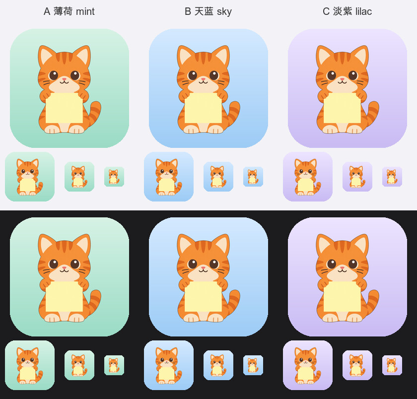
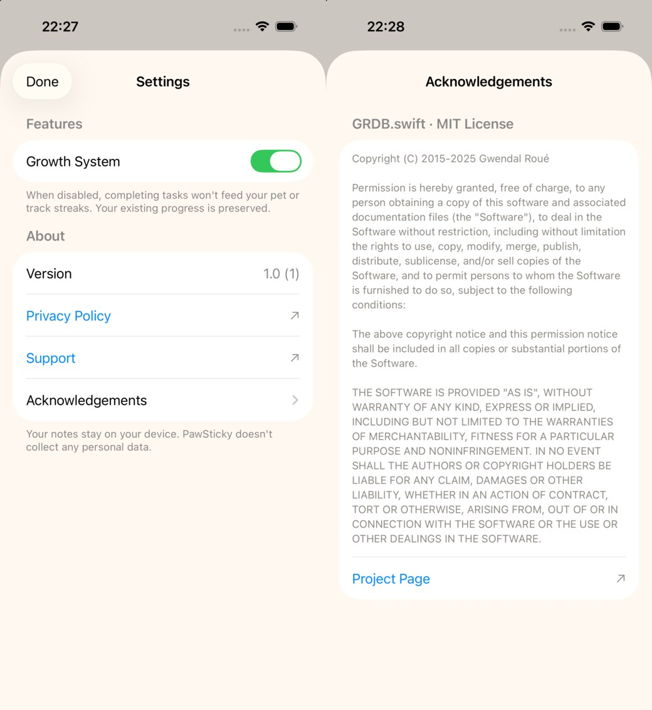
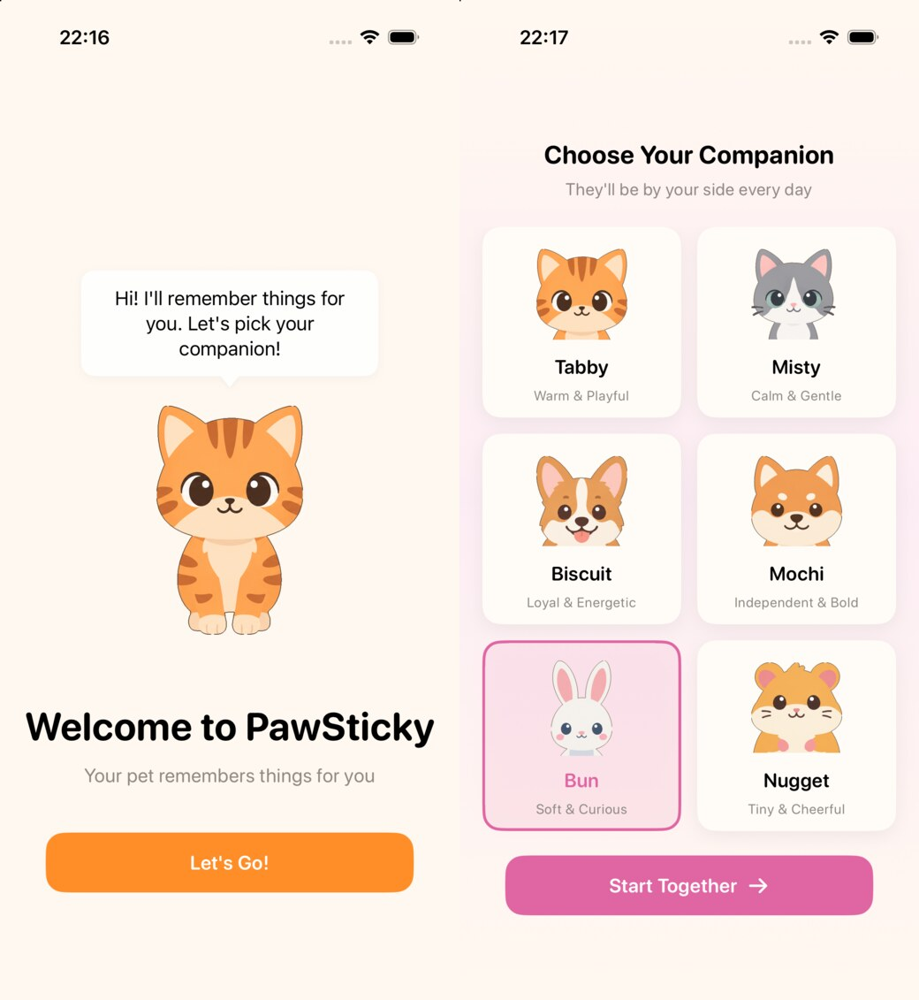
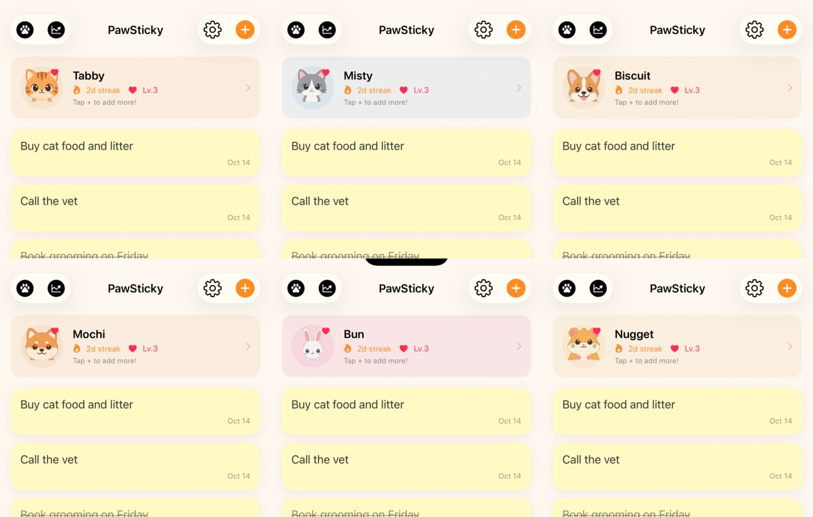
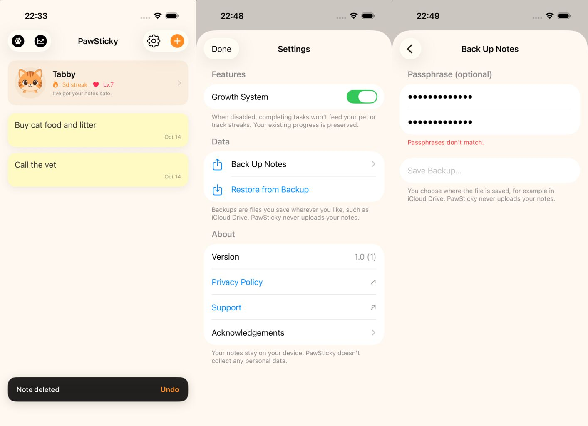
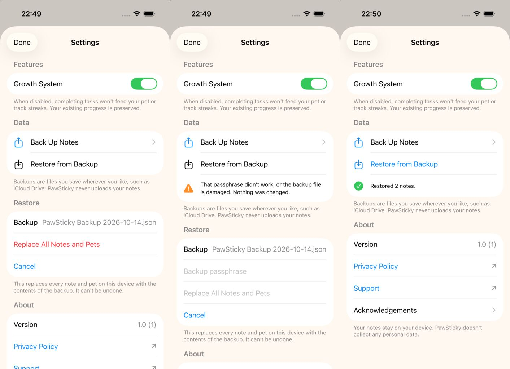
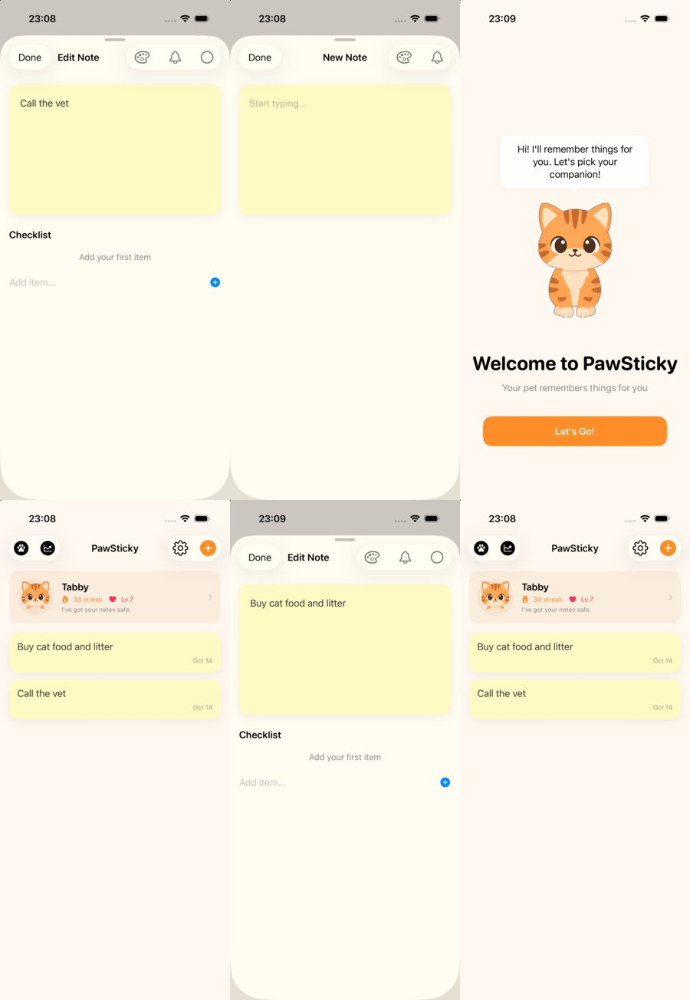
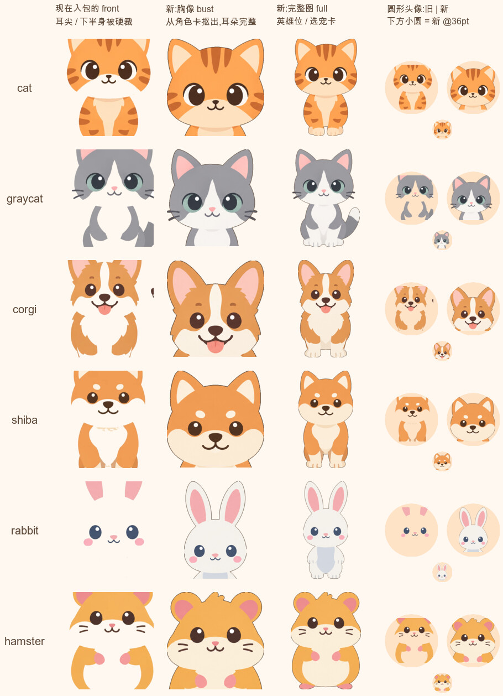

# PawSticky v1.0 上线 TODO

> **这是唯一回答"现在该做什么、做到哪了"的文档。** 勾了 = 做完;没勾 = 没做。
> *为什么*要做某一项 → 看审计依据 [`launch-readiness.md`](launch-readiness.md)(只读快照,不再记状态)。
> **更新:** 2026-10-14 · 代码基线 `f36d2d4`(其后只有文档与美术脚本的提交)· v1.0 免费版 · 仅 iPhone(+ Watch)

**怎么用:** 从上往下做;做完把 `- [ ]` 改成 `- [x]`(或回复我任务编号,我来改)。
**图例:** 🔴 不做就不能提审 · 🟡 应做(口碑 / 兑现承诺)· ⚪ 可推迟 ｜ **[你]** 只有你能做(账号、审美拍板、对外发布)· **[我]** 我来写代码 / 文档

---

## 0. 一眼看懂

| 阶段 | 内容 | 谁 | 进度 |
|---|---|---|---|
| ✅ 工程 P0 | 改名 / ID / 隐私清单 / 版本号 / 合规键 / 相册崩溃 / 回前台刷新 / 锁浅色 / 仅 iPhone | 我 | **已完成** → [文末](#已完成) |
| **A** 先拍板 | 6 个小问题,一条消息答完 | 你 | 4 / 6(还差 A2 Team ID、A3 合规结论) |
| **B** 账号 + 真机 | 填 Team ID、真机跑通 | 你 | 0 / 5(B4 仅出错时才做) |
| **C** 代码 + 美术 | 图标、宠物图、设置页、撤销 / 备份、Widget 体验 | 我 | 0 / 8 |
| **D** 站点 + ASC | 隐私政策页、商店资料、截图 | 你(我起草文字) | 0 / 6(D1、D8 可推迟) |
| **E** 出包 + 提审 | 构建、TestFlight、提审、发布 | 你为主 | 0 / 4 |

**👉 现在:** 你补 A2(Team ID)、A3(公司合规结论),并处理 **D2 的隐私政策页**(现有页面只覆盖网站,见下)。我已开工 C1–C7。
**关键路径:** A → ( B ∥ C ∥ D 前半 ) → D6 截图(要等 C 做完)→ E。
**时间:** 从你答完 A 起算,**紧凑 ≈ 2 周,宽松 ≈ 3 周**。TestFlight 与审核等待约占一半;真机问题和审美返工是最大变数。
**美术:** v1.0 **不需要再生成任何图**,证据与做法见 [§美术方案](#美术方案零生成)。

---

## A. 先拍板(你 · 约 10 分钟)

> 每项都给了我的默认。**没意见就回复"按默认"**——只有 A2(Team ID)和 A3(公司的合规结论)必须由你给出内容。

- [x] **A1 ID 映射** 🔴 — ✅ 你已确认 "ID OK"(2026-10-14):App `com.fitpetgo.pawsticky` · Widget `….widgets` · Watch `….watchkitapp` · Watch Widget `….watchkitapp.widgets` · App Group `group.com.fitpetgo.pawsticky.shared`。在 ASC 创建 App 记录(D3)后 Bundle ID 永久不可改。
- [ ] **A2 Team ID** 🔴 — developer.apple.com → Account → Membership details 里的 10 位字符。→ 发我(我写进 `project.yml`),或自己按 B2 放进本地文件。
- [ ] **A3 出口合规结论** 🔴 — App 用 CryptoKit(AES-GCM)与 CommonCrypto(PBKDF2)加密**用户导出的备份文件**。我按"仅系统自带加密、仅用于用户自己的备份"写入了 `ITSAppUsesNonExemptEncryption = false`。**Apple 的说法:是否豁免由开发者自己判断,误报豁免的责任也在开发者**([说明页](https://developer.apple.com/help/app-store-connect/manage-app-information/overview-of-export-compliance))。→ 请公司确认;结论是"非豁免"就告诉我翻成 `true`(ASC 会要求提交加密文档)。另:该页提到法国对"安全存储"类 App 另有管制——软启动 NZ → CA → US 不涉及,进法国前再评估。
- [x] **A4 图标底色** 🔴 — ✅ 你选了 **B 天蓝**(2026-10-14)。下图保留以便回看:
  
- [x] **A5 美术方案 + 装扮图标** 🔴 — ✅ 你选了 **(a)**(2026-10-14):v1.0 零生成(依据见 [§美术方案](#美术方案零生成));装扮保持现在的 SF Symbol 锁 / 解锁网格,UI 文案 "Outfits" 改成 "Collection"。商店文案**不写** dress up。
- [x] **A6 隐私政策与支持页的 URL** 🔴 — ✅ 你给了 `https://www.fitpetgo.com/privacy-policy` 与 `https://www.fitpetgo.com/contact-us`(2026-10-14),不再单独注册 pawsticky 域名。**⚠️ 隐私政策页内容不够用,见 D2。**

---

## B. 账号 + 真机(你 · 约半天,可与 C 并行)

> 为什么要早做:**模拟器不强制 entitlement,真机才强制**。App Group、Widget 读写、Watch 同步只有真机能证明——越晚发现越贵。依赖 A1、A2。

- [ ] **B1 登录账号** 🔴 — Xcode → Settings → Accounts 登录公司 Apple ID;确认角色是 Account Holder / Admin(注册 App ID、App Group、建 ASC 记录都要)。
- [ ] **B2 填 Team ID** 🔴 — `cp Config/Signing.local.xcconfig.example Config/Signing.local.xcconfig`,填 `DEVELOPMENT_TEAM = <Team ID>`(文件被 git 忽略;已实测**不需要**重新 `xcodegen generate`)。A2 若已发我,跳过。
- [ ] **B3 真机跑起来** 🔴 — `xcodegen generate` → 打开 `PawIt.xcodeproj` → 选真机 → Run。自动签名会替你在开发者后台注册 App ID 与 App Group。
- [ ] **B4 (仅 B3 报 App Group 错才做)** — developer.apple.com → Certificates, IDs & Profiles → Identifiers:手动建 App Group `group.com.fitpetgo.pawsticky.shared`,再到 4 个 App ID(App / Widget / Watch / Watch Widget)的 App Groups 能力里勾上它。
- [ ] **B5 真机冒烟 15 分钟** 🔴 — 启动不崩 → 选宠物 → 记一条 → 加小 / 中 / 大 / 锁屏 Widget(**画廊里应是示例便签,而不是空状态**)→ **在 Widget 上勾选 → 回 App,列表已同步**(P0-8 的真机回归)→ **点空状态的 Widget 直达新建页、点有便签的 Widget 直达那一条(C6);开着设置页回主屏再点一次** → Watch 配对后能看到数据 → **设置 → Back Up Notes 存到“文件”,删 App 重装后 Restore from Backup(明文、加密各一次;系统文件面板只有真机能验,见 C5)**。完成标准:无崩溃,Widget 读到了 App 写的数据(= App Group 在真机生效),且备份能原样恢复。

---

## C. 代码 + 美术(我 · 合计约 4–5 天;只做 🔴 约 1 天)

> 每项一个小提交;做完我会跑 `xcodegen → 构建 → 测试 → preflight` 并给模拟器截图。依赖标在各项后。

- [x] **C1 设置页:隐私政策 / 支持 / 版本** 🔴 — ✅ 已完成:设置页新增 About 分组——Version(`1.0 (1)`,取自 Info.plist)、**Privacy Policy** 与 **Support** 外链(URL 常量在 `Core/Sources/Core/Core.swift` 的 `PawItInfo`,目前是你给的 fitpetgo.com 两个地址)、Acknowledgements(GRDB 的 MIT 原文)。审核指南 5.1.1(i) 要求隐私政策在 App 内“易于找到”,放在设置页第一屏即可见。 测试:`CoreTests.legalURLsAreHTTPSLinksToConcretePages`(https / 有 host / 带路径)、`AppInfoTests`(版本文案,含“构建后变量已展开”),均先看它失败再实现。preflight 新增 3 类守卫:① 两个 URL 存在且是真实 https(❌);② `Package.resolved` 里每个依赖都要在 Acknowledgements 里声明(❌;先拿掉文件看它变红再恢复);③ **隐私政策 URL 仍是 fitpetgo.com 通用页时显示 ⏳**——这是提醒你做 D2,换成专属页的 URL 后自动消失。
- [x] **C2 App 图标接入(iOS + Watch)** 🔴 — ✅ 已完成:`art/scripts/make-app-icon.sh` 用 `B_cat-sitting` 合成天蓝底(`#D4E9FF → #9CCBF5`)1024×1024 sRGB 无 alpha PNG,写入 `PawIt/` 与 `PawItWatch/` 的 `AppIcon.appiconset`(`Contents.json` 已补 `filename`)。验证:preflight 两条图标检查 ⏳ → ✅(并新增“Contents.json 必须引用图标文件”检查,先造出失败再修好);构建后 `Assets.car` 与 `CFBundleIcons` 均含 AppIcon。想换底色:`ICON_TOP=… ICON_BOTTOM=… art/scripts/make-app-icon.sh`。
- [x] **C3 宠物图零生成接入(P1-2)** 🟡 — ✅ **代码与素材已完成,等你过目点头**:`extract-from-sheets.sh` 抠图 → 新增 [`art/scripts/export-pet-imagesets.sh`](../art/scripts/export-pet-imagesets.sh) 导出 6 物种 `pet-<sp>-front`(胸像,方形画布 88% 内接,@1x/2x/3x = 100/200/300px)覆盖 4 个 catalog(**名字不变**,约 20 处引用零改动;Watch 同样用胸像),并新增 `pet-cat-full`(全身,仅 PawIt)给欢迎页英雄位——胸像的下沿是裁切线,放在无背景的大图位像“漂浮的头”。**选宠卡仍用胸像**:我对比后发现 90pt 高的卡片里全身图脸太小,胸像更清楚,所以另外 5 个物种不需要 `full`,没打进包(省约 1 MB)。cat / corgi 的举牌图没动。验证:preflight 新增“宠物素材齐全”检查(先让它因缺 `pet-cat-full` 失败,再导出变绿);模拟器截图——欢迎页、选宠网格、6 物种各自的列表头,耳朵完整、兔子清晰可见: **Widget / 锁屏 / Watch 没在真机或模拟器里看过**(模拟器无法脚本化添加 Widget),它们复用同一批 `front` 图;圆形锁屏小组件对图片做了 `clipShape(Circle())`,实测 cat / corgi / hamster 的耳尖有 4–5% 像素落在圆外会被略微裁掉(≈ 1pt),可接受——**真机 B5 冒烟时请看一眼锁屏圆形组件**。
- [x] **C4 宠物名字统一(P1-1)** 🟡 — ✅ 已完成:头部叫 Tabby,对话里它却自称 Mochi(而 Mochi 是另一只柴犬)。两份私有台词 switch 收敛成 `PetDialogue`(选宠 / 换宠),名字一律读 `PetAsset.displayName`。先写 `PetDialogueTests`(名字 = 卡片名、不提别的宠物)并看它因旧台词失败(14 个断言),改完全绿。
- [x] **C5 删除撤销(P1-7)+ 备份 / 恢复最小界面(P1-6)** 🟡 — ✅ 已完成:**① 删除撤销**:删除后底部出现 5 秒 "Note deleted · Undo" 小条;撤销在**同一事务**里把便签与清单项一起复活(新增 `NoteRepository.undoDeleteNote`,复用 `restore` 的单实体语义——历史不记父子关系,所以清单项 id 要在**删除前**读出来带上),并补回提醒、刷新 Watch / 锁屏。重复点撤销按成功处理;删除失败不再被静默吞掉,也不会误取消提醒。**② 备份 / 恢复**:设置页新增 Data 分组——**Back Up Notes**(口令可选:留空 = 明文 JSON;填了 = AES-GCM + PBKDF2 加密,**至少 8 位**、输两遍;走系统“存储到文件”,默认文件名 `PawSticky Backup 2026-10-14`)与 **Restore from Backup**(选文件 → 先校验信封,不是备份的文件在问口令**之前**就拒掉 → 页内出现红色 "Replace All Notes and Pets" 确认卡片,加密备份在卡片里输口令 → 整体替换;口令输错留在卡片里重输,不必重选文件)。 
  - **设计取舍:** 结果用页面内联状态行而不是弹窗(文件面板刚关闭就弹 alert,在 SwiftUI 里常弹不出来;内联对 VoiceOver 也更稳,另有播报);口令统一规整成 NFC(不同键盘对 “é” 的字节序列不同,不规整会出现“口令没错却解不开”);备份文件上限 20 MB(超限基本是选错了文件);恢复成功后一次性对齐库外状态——取消被替换便签的提醒与锁屏钉住、按备份里的到期日重排提醒(这台设备还没被问过通知权限时,只有存在未过期到期日才在此刻询问)、Watch 与小组件各刷新一次;设置页关闭后列表与宠物头部重新加载。口令下限在 `BackupPassphrasePolicy.minimumLength`(一个数字,想收紧 / 放宽只改它,测试相对它书写)。
  - **验证:** 先写测试看它因缺类型 / 缺方法而红,再实现转绿——Core +6(`undoDeleteNote` ×4、`inspectExport` ×2)、App +41(口令策略、失败文案、文件读取与命名、服务往返含 NFC 与“口令错库不动”、控制器流程;全部用真实临时库)。全量 **226 / 226 通过**(Core 175 + App 51)。模拟器实测:撤销条样式;设置页 Data 分组;导出页校验;恢复确认卡片(明文 / 加密);口令输错后的提示与卡片保留(这一步跑的是 App 里的真实代码路径);恢复成功(备份后临时多塞一条便签再恢复——库里只剩原来 2 条,多的那条在历史里留有快照)。顺带修了一个链接坑:`SharedStore.init` 的默认参数把 GRDB 符号编进了调用方,App 测试包链接失败,拆成无参重载。
  - **没验证的:** 系统的“存储到文件 / 选择文件”面板(模拟器无法脚本化点击)。→ **B5 / E2 真机请走一遍:备份 → 存到文件 → 删 App 重装 → 恢复(明文、加密各一次)**。
- [x] **C6 Widget 两项体验(P1-5、P1-4)** 🟡 — ✅ 已完成:**① 画廊预览不再是空状态**:`getSnapshot` 判断 `context.isPreview`,预览与占位改走示例内容——一张 "Pick up groceries"、3 项清单(第 1 项已勾)、2 小时后提醒、你选的宠物(没选过就是猫);示例永不逾期(不会渲染成红字)、不读也不写便签库(`WidgetSample`)。已添加的小组件仍读真实数据,空库就如实显示空状态。**② 点 Widget 直达**:所有尺寸(含锁屏三款)加 `widgetURL`——正在显示便签 → `pawsticky://note/<id>` 打开**那一条**;空状态 "Tap to add a note" → `pawsticky://new` **直接进新建页**("一秒速记"终于兑现)。勾选 / 翻页按钮是 App Intent,不受影响。App 端 `onOpenURL` → `DeepLinkRouter` 先挂起 → 列表页出现后取走(冷启动时 URL 早于列表页,不挂起就丢)。`pawsticky` scheme 写在 `project.yml` 的 `CFBundleURLTypes`,Info.plist 由 XcodeGen 重新生成。
  - **设计取舍:** 链接解析是**严格白名单**(未知 scheme / host、多余路径段、坏 UUID 一律丢弃;查询串与片段忽略,留给将来加埋点)——scheme 一注册,网页和别的 App 就能触发它,所以只放行两种“只打开页面、不改数据”的形态。落点还会尊重现实:便签已被删(小组件快照比库旧)→ 停在列表,不开空编辑器;全新安装还没走完引导 → 不弹编辑器(引导结束本来就会进新建页;全新安装的人可以在打开 App 前就从画廊加了小组件);设置 / 选宠 / 成长 / 分享页开着时先收起、再开编辑器(同一时刻只能开一个 sheet)。
  - **验证:** 先写测试并看它失败(桩实现让断言落空,不是缺符号),再实现转绿——Core +19(`DeepLink` 12:构造 / 往返 / 大小写 / 结尾斜杠 / 查询串 / 外来 scheme / 未知 host / 坏 UUID / 多余路径;`WidgetSample` 7:不逾期、文字不超 3 行、清单有勾有未勾且圆环半满、id 稳定、宠物回退)、App +9(落点决策 4、路由器 4、**scheme 确实注册进了 Info.plist** 1——这一条先因 Info.plist 未重新生成而红)。全量 **254 / 254 通过**(Core 194 + App 60)。preflight 新增“Info.plist 注册的 scheme == `DeepLink.scheme`”,**51 通过 · 2 ⏳ · 0 失败**。模拟器:`simctl openurl pawsticky://…` 弹出系统确认框 **"Open in 'PawSticky'?"**——说明 scheme 已被系统认到本 App;但这个框模拟器里点不了,所以用一个**临时启动参数**把 URL 直接塞给路由器(验完已删除并用 Grep 确认源码里无残留),覆盖六个场景,见上图:冷启动→便签 ✅ · 冷启动→新建 ✅ · 全新安装→**只有引导、没有编辑器叠在上面** ✅ · 便签 id 不存在→列表 ✅ · 热启动(App 已在列表页)→便签 ✅ · 乱写的链接→列表 ✅。
  - **没验证的:** ① 画廊本身(模拟器无法脚本化打开);`isPreview` 分支只有一行条件,示例内容的“看起来是好的”由上面 7 个测试守住。② 真实的“点 Widget → `onOpenURL`”(系统投递 Widget 链接时没有确认框;模拟器里加不了 Widget)。③ 设置页开着时从主屏点 Widget 的“先收起再开编辑器”时序(决策函数有单测,收起动画没跑过)。→ **B5 真机请看:画廊里是示例便签而不是空状态;点空状态的 Widget 直达新建;点有便签的 Widget 直达那一条;开着设置页回主屏再点 Widget。**
  - **没做(不在 C6 范围):** Live Activity(锁屏 / 灵动岛上钉住的便签)点按仍只是打开 App,没接这套链接——接法一样(`widgetURL` + `DeepLink.openNote`),可放 v1.0.x。
- [x] **C7 装扮文案(P1-3)** 🟡 — ✅ 已完成(按 A5(a)):成长页标题 "Outfits" → "Collection"、统计块 "Outfits"(原 T 恤图标)→ "Collected"(sparkles 图标)、"All outfits unlocked!" → "Collection complete!"、分享卡 "n/12 outfits" → "n/12 collected";SF Symbol 网格不变。另给 preflight 加了守卫:用户可见字符串里再出现 outfit 就失败(先让它抓到 4 处,改完变绿)。
- [ ] **C8 每批收尾回归** 🔴 · 随每次改动 — `xcodegen generate` → 构建 → `xcodebuild test` → `scripts/preflight.sh` 0 失败(命令见[附录](#附录常用命令))。

---

## D. 站点 + App Store Connect(你 · 我起草文字 · 约 2–3 天,多数可与 C 并行)

- [ ] **D1 ⚪ 注册 pawsticky 域名(可选)** — 不再是必需:隐私 / 支持页用 fitpetgo.com 即可(A6)。仅当想要独立官网 / 防抢注时再买。
- [ ] **D2 PawSticky 专属隐私政策页** 🔴 · [你] 发布 · 30 分钟 · **⚠️ 现有页面不能直接用** — 我读了 `fitpetgo.com/privacy-policy`:它第一段写明"只适用于本网站、**不适用于其他渠道**",内容是网站 cookies / 广告合作方 / 账号注册信息——既没提 App,也与我们"不收集数据、无广告"的隐私问卷(D5)矛盾。审核指南 5.1.1(i) 要求政策**明确说明 App 收集什么数据、怎么用、保留与删除方式**,拿这页去提审大概率被拒。做法:在 fitpetgo.com 新增一页(如 `/pawsticky-privacy`),贴 [`pawsticky-privacy-policy.md`](pawsticky-privacy-policy.md) 的英文稿(我按代码现状写好,已逐条对照源码),发布后把 URL 告诉我,我换进设置页常量(C1)。另请在手机上打开 `contact-us`,确认页面上**看得到联系方式**(邮箱或表单)——我这边抓取只看到标题,无法确认;ASC 的 Support URL 必须能联系到你。完成标准:新页面 URL 能打开且含 PawSticky 字样。
- [ ] **D3 ASC 创建 App 记录** 🔴 · 30 分钟 · 依赖 B3(A1 已确认) — App Store Connect → Apps → + → New App:平台 iOS;名称(草稿 `PawSticky: Notes Widget`,23 / 30 字);主语言 English (U.S.);Bundle ID 选 `com.fitpetgo.pawsticky`;SKU 自拟(如 `pawsticky-ios`)。**这一步之后 Bundle ID 永久不可改**;名称先到先得,建完即占位。
- [ ] **D4 填商店资料** 🔴 · 2–3h · 依赖 D2 — 副标题 / 宣传文本 / 关键词 / 描述 / What's New 用审计附录 C 的草稿(C5 已做,备份那一段可以保留);类别 Productivity(主)+ Lifestyle(次);价格 Free;可用地区**先只选 NZ**(之后逐步加 CA、US);年龄分级问卷(预期 4+,**不要选 Kids 类别**);内容版权选"不含第三方内容";隐私政策 URL、支持 URL。关键词里**不要放竞品名**。
- [ ] **D5 App 隐私问卷** 🔴 · 15 分钟 — 预期 **Data Not Collected**。我已在 `f36d2d4` 核对:全部 Swift 源码里没有 `URLSession` / 分析 / 广告 / 定位 / 相册等 API,唯一第三方依赖是 GRDB(本地 SQLite)。以后加任何 SDK 或网络请求,必须回来改这份问卷。
- [ ] **D6 截图** 🔴 · 2–4h · 依赖 C2、C3、C5 做完(避免重拍) — iPhone:至少 1 张、最多 10 张,PNG / JPEG,**不能带 alpha**;必需尺寸是 "iPhone with Dynamic Island (medium display)":**1206×2622**(iPhone 17 Pro 模拟器的原生截图尺寸)或 1179×2556。Apple Watch:**含 Watch App 就必须提供**,选一种尺寸(如 Series 10 / 11:416×496),各语言必须同一尺寸。截图必须是 App 实际界面(审核指南 2.3)。仅 iPhone,不需要 iPad 截图。建议 5–6 张,画面脚本见 [art 提示词 §F.0](launch-art-prompts.md)。(尺寸依据:Apple 截图规格页,2026-10-14 核对。)
- [ ] **D7 审核信息** 🔴 · 30 分钟 — ASC "App Review Information":联系人姓名 / 电话 / 邮箱(必填)、取消勾选"需要登录"、审核备注贴[附录模板](#附录审核备注模板)。
- [ ] **D8 ⚪ 进欧盟前再做** — DSA trader 声明(公司主体按 trader 申报,地址 / 电话 / 邮箱会公开展示在欧盟商店页);商标初筛(USPTO / IPONZ / CNIPA)。软启动 NZ → CA → US 阶段不需要。

---

## E. 出包 + 提审(你为主,我协助)

- [ ] **E1 构建并上传** 🔴 · 1h · 依赖 B、C、D3 — 先 `xcodegen generate` → 构建 → `scripts/preflight.sh`(0 失败,⏳ 项要清零:Team ID、两处图标)。(推荐)把 `dev` 合到 `main` 并打 tag(如 `v1.0.0`),保证每个 build 能回溯到代码。Xcode:目标选 Any iOS Device → Product → Archive → Distribute App → App Store Connect → Upload。**每次上传 Build 号必须递增**(改 `project.yml` 的 `CURRENT_PROJECT_VERSION` 后重新 `xcodegen generate`)。完成标准:ASC 的 TestFlight 页出现该 build,状态不是 Invalid / Missing Compliance。
- [ ] **E2 TestFlight 内测 + 真机 QA** 🔴 · 3–7 天 — 邀请自己 + 几位朋友(Internal Testing:ASC 用户最多 100 人,**无需审核**),按审计 §8 的 11 个场景在真机跑一遍;设备至少:最小屏 iPhone、带灵动岛的 iPhone、一块 Watch。崩溃以 Xcode Organizer 报告为准,门槛沿用商业计划:崩溃率 < 0.1%。
- [ ] **E3 修复迭代** 🔴 · [我] — 把 QA 发现的问题(截图 + 复现步骤)给我,我修,你重传(Build 号 +1)。
- [ ] **E4 提审与发布** 🔴 · 30 分钟 + 审核等待 — 在 ASC 的版本页选 build → 核对 D3–D7 全绿 → Submit for Review。审核通常 1–2 天,首次可能更久。发布方式选"手动发布",过审后自己按下按钮;地区先 NZ。被拒:把拒信贴给我,按条目处理。

---

## 美术方案(零生成)

**结论:不需要重新生成,先发布。** 已有素材够用,而且比现在入包的图更好——现在入包的 `front` 是从 450px 角色卡视图**硬裁**出来的(耳尖 / 下半身被切,兔子是白色落在奶油底上几乎看不见),这才是该修的问题。



| 资源 | 要新图吗 | 用什么 |
|---|---|---|
| App 图标 | 否 | 已有 `B_cat-sitting`(举牌橙猫,1024²)+ 渐变底色合成(主体 920px → 760px,不放大) |
| 6 物种头像 `front`(约 20 处使用) | 否 | 从**已有角色卡**重新抠出正面图 → 胸像。脚本 [`art/scripts/extract-from-sheets.sh`](../art/scripts/extract-from-sheets.sh),4 秒、零成本 |
| 英雄位 / 选宠卡 `full` | 否 | 同一脚本产出的完整正面图 |
| graycat / shiba / rabbit / hamster 举牌图 | **否** | Widget 里宠物只是便签旁的**装饰角标**(便签本身是 SwiftUI 画的),没有举牌图时代码本来就回退到 `front`(`hasHoldingPose`)。我之前写的"Widget 叠层按举牌图调过"**是错的**,已在 art 提示词里更正 |
| 装扮图标 ×12 | 默认否 | 见 A5 |
| 营销背景 / happy / sleeping | 否 | 截图用真实界面;happy / sleeping 是 P2 |

**"一定要重新生成吗?"** 不必。**"脚本能不能生成?"** `art/scripts/gen-images.sh` 能(OpenRouter `openai/gpt-image-2.5-flare`,≈ $0.053/张),但它**只支持文生图**——请求体里只有 `model / prompt / aspect_ratio / quality / n`,**没有参考图字段**。重抽同一只宠物会风格漂移,[`style-notes.md`](../art/style-pack/style-notes.md) 明确写了"在支持参考图之前,禁止批量生成新姿势"。所以**成本不是问题**(原计划整套约 80 张 ≈ $4–5),**风险**才是。以后真要补图:在 gpt-image-2.5 对话端手动挂角色卡当参考图,或让我先给脚本加 `image` 字段。

**抠图的坑(都写进了脚本注释):** 白毛物种(graycat、rabbit)与背景只差 4–5%,泛洪 `fuzz` 必须 2%——旧文档配方里的 8% 会把白毛吃掉;兔子耳朵很长,胸像要取到 72% 高度才包得住脸;灰猫的尾巴尖会在胸像右下角露出一块,脚本会把它抹掉。脚本每次运行还会自检:完整图和胸像都必须是**单一连通块**,否则报错而不是悄悄出残图。无损母版(`art/scripts/.tmp/raw/`)不在 git 里,脚本找不到时自动回退到入库的 webp——两种输入我都跑过,结果一致(±2px),所以全新 clone 也能跑。

---

## 想更快上线

| 砍什么 | 省 | 代价 |
|---|---|---|
| C5 备份 + 撤销 | 1.5–2 天 | 商店描述删掉 "YOUR NOTES STAY YOURS" 整段(附录 C 的 ⚠);删除没有后悔药;"可靠性"卖点变弱 |
| C6 Widget 两项 | 3–5h | 画廊里是空状态;点 Widget 只进列表,"一秒速记"落空 |
| C3 里的 `full`(只换胸像) | 约 0.3 天 | 欢迎页英雄位用放大的胸像(可接受) |
| C4 / C7 | 1–2h | 名字对不上、装扮文案仍写 Outfits(无害但不严谨) |
| **不能砍** | — | A、B、C1、C2、C8、D2–D7、E |

---

## 推迟到 v1.0.x / v1.1(不挡上线)

| 项 | 去向 | 备注 |
|---|---|---|
| zh-Hans 本地化(P1-11) | v1.0.x | 决议 #8:软启动在英语市场,先 EN |
| 深色模式完整适配 | v1.1 | 现在锁浅色(决议 #7) |
| 每个 Widget 独立选便签 + 清单条目可点(P1-12) | v1.1 | v1.0 文案不要承诺 |
| Siri / 快捷指令短语(P1-10) | v1.0.x | 2–3h;iOS 17.4+ 需 `AppIntentsPackage`,要真机验证 |
| 装扮图标成图 / 真换装 | v1.0.x / v1.1 | A5 选 (c) 就是 v1.0.x |
| 多字体 / 渐变便签 | 砍掉 | 商业计划 §4.2 曾写,代码没有;文案不要写 |
| P2 打磨项 | v1.0.x | 审计 §4(启动图、锁竖屏、无障碍、分享卡字号 …) |
| 4 物种举牌图、happy / sleeping、营销背景图 | 看数据再说 | 见 [§美术方案](#美术方案零生成) |
| iPhone Duo(折叠屏)截图 | 2027-04 前留意 | Apple 截图规格页在该机型下提示:2027 年 4 月起,使用 iOS 27.1 SDK 及以上的 App 需要提供其截图;12 月上线不受影响 |
| ⚪ 顺手:备份无损母版 | 5 分钟 | `art/scripts/.tmp/raw/`(17 MB,18 张 PNG)是唯一无损来源且不在 git 里,拷到网盘 / 外置盘;入库的 webp 是有损的 |

---

## 已完成

<details>
<summary>工程 P0(点开看提交与验证口径;依赖外部输入的 3 项已转成上面的任务)</summary>

**验证口径(2026-10-14):** `xcodebuild test`(iPhone 17 Pro 模拟器)**172 / 172 通过**(Core 168 + App 4);干净构建成功,编译警告仍是审计时的那 2 条,没有新增;构建后跑 [`scripts/preflight.sh`](../scripts/preflight.sh)**41 通过 · 3 等待外部输入 · 0 失败**。该脚本是配置类 P0 的可重复验收(先在改动前跑出红灯,再逐项转绿)——**每次出包前先构建、再跑它**;不先构建会报"找不到构建产物"。

| P0 | 状态 | 提交 | 怎么验证的 · 遗留 |
|---|---|---|---|
| P0-1 图标 | ⏳ → **C2** | — | 接线已实测:临时放 1024 PNG 后构建通过,`CFBundleIconName = AppIcon`、`Assets.car` 含各尺寸,preflight 图标检查转 ✅;随后已撤掉,**未提交占位图** |
| P0-2 签名 | ✅ 机制 · ⏳ → **A2 / B2** | `1fbd2e2` | `Config/Signing.local.xcconfig`(git 忽略,模板见 `.example`)。无本地文件时 `DEVELOPMENT_TEAM` 为空且构建不受影响;有文件时 PawIt / PawItWatch 都拿到 |
| P0-3 隐私清单 | ✅ | `f051d15` | 4 个 bundle 各一份(App:`CA92.1` + `1C8F.1`;其余:`1C8F.1`),`NSPrivacyTracking=false`;preflight 在构建产物里逐个核对 |
| P0-4 版本号 / 构建号 | ✅ | `5973522` | 用 `MARKETING_VERSION=9.9 CURRENT_PROJECT_VERSION=99` 构建,4 个 bundle 的 Info.plist 全变成 9.9 / 99 |
| P0-5 出口合规键 | ✅ 已写入 · ⚠️ → **A3** | `72379d7` | `ITSAppUsesNonExemptEncryption = false`(口径见审计 §10 决策记录 #3)。**这是代你公司做出的合规声明** |
| P0-6 保存到相册崩溃 | ✅ | `23f3ffb` `1b98d12` | 移除直接调 `UIImageWriteToSavedPhotosAlbum` 的按钮与"已保存"弹窗,保存改走分享面板;preflight 守卫:源码里再出现相册 API 却没有用途描述会报红。**没在模拟器里复现过崩溃**(代码审计结论);分享面板里有 Save Image 是系统对图片的标准行为,**没在模拟器里点开确认** → E2 看一眼 |
| P0-7 深色模式 | ✅ 止血(v1.1 完整适配) | `8c103aa` | `UIUserInterfaceStyle = Light`。系统切到深色后重新验证:欢迎页与列表文字清晰,见 [`09`](assets/launch-audit/09-darkmode-locked-light-after.png)(对比审计时的 [`01`](assets/launch-audit/01-darkmode-onboarding-light-vs-dark.png) / [`02`](assets/launch-audit/02-darkmode-list-light-vs-dark.png))。Widget / Live Activity / Watch 不受此键影响(Widget 便签色固定,安全) |
| P0-8 回前台不刷新 | ✅ | `192fc59` | 同一套"外部进程改库后回前台"步骤跑两遍:修复前列表仍是旧的,修复后勾选划线 / 新名称 / 新便签都出现,见 [`08`](assets/launch-audit/08-foreground-refresh-before-after.png)(左:前,右:后)。`scenePhase` 没有可单测的接缝,所以用模拟器复现验收 |
| P0-9 命名与不可逆 ID | ✅ 代码 · ⏳ → **A1** | `1dcde49` `8b84084` | Bundle ID / App Group 迁移测试先行(先改期望值看红,再改常量转绿);用户可见字符串与 4 个显示名已改为 PawSticky,preflight 守卫防旧品牌名回流 |
| P0-10 ASC 物料 | ⏳ → **D** | — | 隐私政策站点 / 支持页 / 截图 / 描述 / 年龄分级 / 隐私标签 |

**同批顺手落地:** 仅 iPhone(P1-9 选 a,`6a25d64`);通知标题改为 PawSticky。

**模拟器做不到、只能真机验的:** 真机签名与 App Group 容器、交互式 Widget 点击、Live Activity、Watch 配对同步、重启后首次解锁前的读写 → 对应 B5 与 E2。

</details>

---

## 附录:常用命令

```bash
xcodegen generate                                   # 改了 project.yml 之后必跑(Info.plist / entitlements 是入库的生成物,别手改)
xcodebuild -project PawIt.xcodeproj -scheme PawIt -destination 'generic/platform=iOS Simulator' build   # 不要加 -sdk iphonesimulator
xcodebuild test -project PawIt.xcodeproj -scheme PawIt -destination 'platform=iOS Simulator,name=iPhone 17 Pro'
scripts/preflight.sh                                # 先构建再跑;要求 0 失败
art/scripts/extract-from-sheets.sh                  # 从已有角色卡抠宠物图(输出到 art/scripts/.tmp/sheets-out/)
art/scripts/export-pet-imagesets.sh                 # 把抠出的图导成 4 个 catalog 的 imageset(front × 6 物种 + cat full)
art/scripts/make-app-icon.sh                        # 合成天蓝底 App 图标并写入 iOS / Watch 两个 AppIcon
xcrun simctl io booted screenshot shot.png          # 模拟器截图;iPhone 17 Pro = 1206×2622
```

## 附录:审核备注模板

贴进 ASC → App Review Information → Notes。**第 5、6 条的措辞等真机 QA 后再核对一遍**(Watch 的描述我还没在真机上验证)。

```text
PawSticky works fully offline and needs no account or sign-in. All data stays on the device.

Try it in 30 seconds:
1. Open the app and pick a pet on the welcome screen.
2. Tap the + button to write a note (or a checklist), then close the editor.
3. Add the widget: long-press the Home Screen > "+" > search "PawSticky" > add a Small, Medium or Large widget. Lock Screen widgets: long-press the Lock Screen > Customize > Add Widgets.
4. Tap the checkmark on the widget to complete a note, then open the app. The note is checked off and your pet has been fed.
5. Live Activity: long-press a note in the list and choose Pin to show it on the Lock Screen.
6. Apple Watch: install the Watch app from the Watch app on iPhone; it shows your current note and pet.

Notifications are optional. Permission is requested only when you set a reminder on a note. The app does not collect or transmit any data.
```
